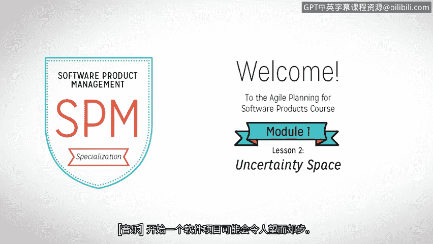
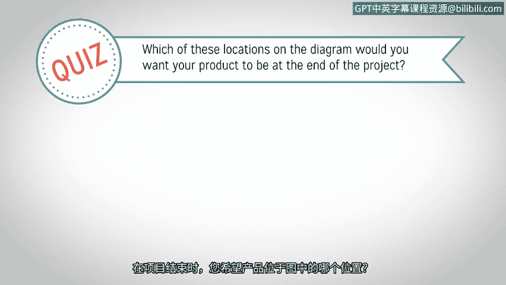
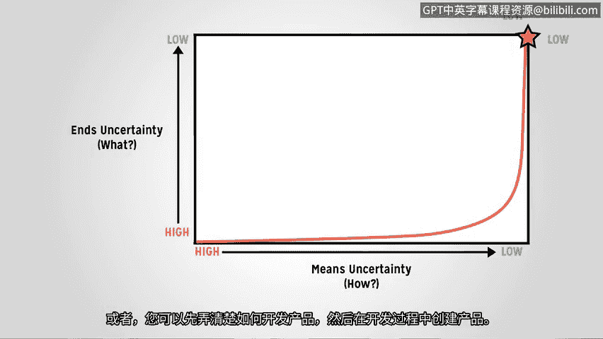
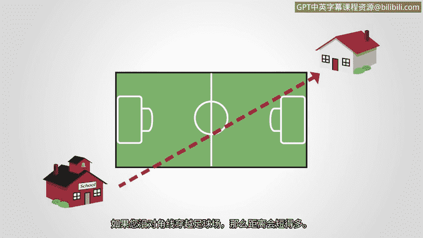
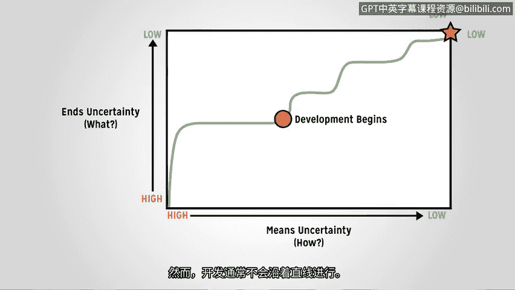

# 005：不确定空间

## 概述
在本节课程中，我们将学习一个用于理解和管理软件项目不确定性的核心模型——不确定空间图。我们将探讨项目中“做什么”和“怎么做”这两类不确定性，并学习如何规划路径以高效地降低它们。

---

启动一个软件项目可能令人望而生畏。从哪里开始，到哪里结束。你的团队将如何开发，以及开发什么。你如何驾驭所有这些不确定性。

研究员兼项目经理亚历山大·莱弗指出，需要同时处理两种类型的不确定性。Scrum方法的贡献者之一迈克·科恩用一个基于不确定性的图表描绘了这个问题。

该图表用于展示产品从概念、经过开发、到可运行状态的过程中，不确定性的水平。对于每个产品，你需要弄清楚你要创造什么以及你将如何开发它。

当你开始时，两者的不确定性都相当高。理想情况下，你希望确切地知道你要生产什么，以及你的团队将如何实现它。现实中，存在很多不确定性，需求会变化，方法也会变化。

这个不确定空间图沿X轴衡量“方法不确定性”。“方法不确定性”是你项目的“如何”。你将如何开发这个产品？你的项目应该从高方法不确定性走向低方法不确定性。

该图沿Y轴衡量“目标不确定性”，这是你项目的“什么”。你实际上在开发什么？同样，这种不确定性应该从高走向低。

观察不确定空间图上的这些点。

以下是这些点的描述：
*   **点A**：高方法不确定性，高目标不确定性。
*   **点B**：高方法不确定性，低目标不确定性。
*   **点C**：低方法不确定性，高目标不确定性。
*   **点D**：低方法不确定性，低目标不确定性。

在项目结束时，你希望你的产品处于图表上的哪个位置？

A，高方法不确定性，高目标不确定性；B，高方法不确定性，低目标不确定性；C，低方法不确定性，高目标不确定性；或D，低方法不确定性，低目标不确定性。

希望在项目结束时，你的团队具有低方法不确定性，这样你就知道如何创建或已经创建了你的产品。具有低目标不确定性说明你知道你在创造什么，因此，答案D是正确答案。目标或方法中任何一项具有高不确定性，都表明产品存在一些待解决的不确定性。

---

上一节我们介绍了不确定空间图的基本概念，本节中我们来看看如何利用这个图表来规划项目路径。

让我们看看一些使用此图导航项目的方法。

一种导航项目的方法是先弄清楚你要创造什么，然后再弄清楚你将如何创造它。这种方法要求你在规划完成这些需求的任何方法之前，预先详细确定所有需求。这类似于遵循瀑布流程。如图所示，在方法不确定性水平开始显著变化之前，目标不确定性水平已经很低。

这种导航方式不允许需求轻易改变，因为它们都是预先确定的，因此不是很敏捷。

或者，你可以先确定如何开发产品，然后在开发过程中创造产品。这种类型的开发属于临时开发，它涉及很少的规划，基本上开发团队会边想实现方案边拼凑产品。这不是一种非常合乎逻辑的软件开发方式，可能导致工作浪费。

你最好的选择是在中间某个路径导航。让我们用另一种方式可视化这一点。

想象一下，在你家和学校之间有一个足球场。你的家和学校在对角。如果你从学校走回家，你可能不会绕着场地走回家。如果你斜着穿过场地，距离会短得多。

类似地，斜着穿过不确定空间所需的工作量也少得多。然而，开发过程通常不会沿直线进行。

常见的情况是，在你开始设计如何完成需求之前，你会与客户和开发团队一起定义大部分需求。一旦确定了需求，你和你的开发团队将开始规划解决方案。此时，项目的目标和方法的确定性更高，这是开始开发的好地方。然后，需求会发生变化或被添加。同样，你的解决方案也会改变。你的开发团队将实施这些更改，并朝着目标和方法的低不确定性目标努力。

无论你在不确定空间中采取何种路径，你都将完成任务。在下一课中，你将学习如何将工作分解为任务。

---

## 总结
本节课中我们一起学习了“不确定空间图”这一重要工具。我们明确了软件项目中存在的两种核心不确定性：**目标不确定性**和**方法不确定性**。一个成功的项目应力求在结束时达到两者都低的理想状态。我们探讨了不同的项目导航路径，并认识到最有效的路径通常是斜向穿越不确定空间，在逐步明确“做什么”的同时，也迭代地确定“怎么做”，这正体现了敏捷规划的核心思想。