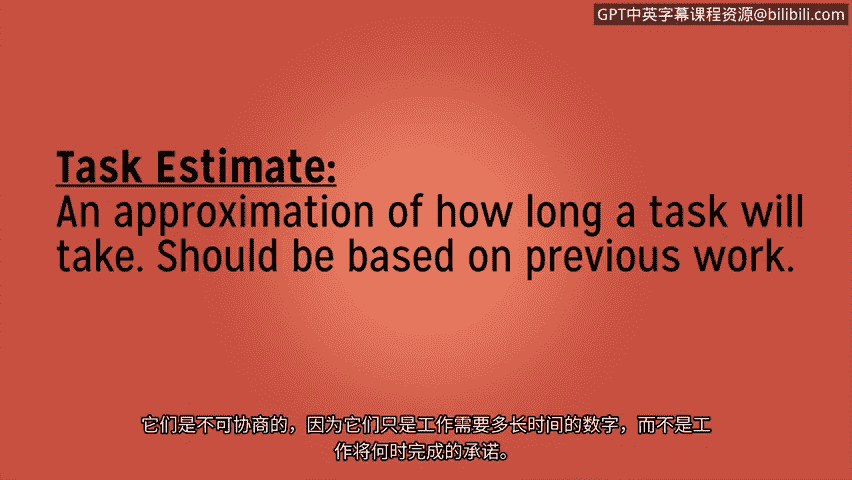
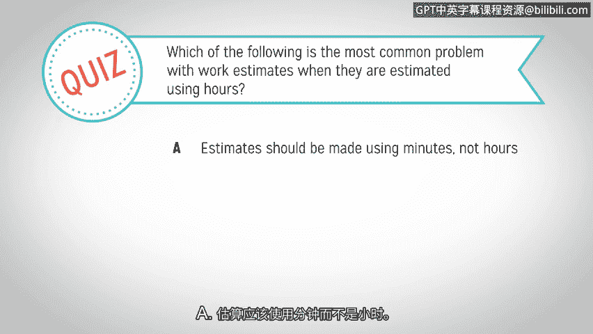

# 008：故事点

欢迎来到软件产品敏捷规划的下一个模块。在上一个模块中，摩根介绍了一些规划的核心概念，例如不确定性空间、如何分解工作，以及估算、目标和承诺之间的区别。

在本模块中，我将讨论故事点和速率，然后介绍一些将这些估算转化为具体计划的技术。

## 估算、目标与承诺回顾

在上一课中，摩根谈到了估算、目标和承诺。以下是简要回顾。

*   **任务估算**是对一项任务将花费多长时间的近似值。这些估算由预期从事该任务的开发人员做出。估算应基于以往的工作经验。它们是不可协商的，因为它们只是对工作耗时的预测，而非对工作何时完成的承诺。

*   **目标**是需要满足的截止日期。目标通常由开发团队外部设定。它们也是不可协商的，因为其他方可能依赖这些日期。
*   **承诺**是开发团队承诺完成的具体、强制执行的工作。它们明确规定了在什么时间完成什么工作。承诺基于目标截止日期和现实的估算。承诺是确定项目进度的依据，由客户和开发团队协商确定。

项目承诺受目标和估算的制约。目标是具体的日期，而估算为承诺提供了现实的依据。如果没有对工作耗时的估算，做出的承诺可能不切实际。

## 小测验：识别概念

我刚刚重申了估算、目标和承诺之间的区别。以下哪个术语描述了在开发团队外部设定且必须满足的截止日期？

A. 估算
B. 目标
C. 承诺

**正确答案是 B. 目标**。目标是在开发团队外部设定且必须满足的日期。而承诺是可协商的，目标则不可协商。

## 如何创建良好的估算？

摩根在上一课中提到，开发人员应根据过去实现类似功能所花费的时间来估算。她谈到了几种软件开发人员给出时间估算的场景，通常会留出一些缓冲时间。但这是为什么呢？是什么让软件开发人员觉得他们一开始就必须在估算中留出缓冲？

通常发生的情况是，管理者误将开发人员的估算当作承诺。开发人员知道这一点。他们也清楚自己的估算可能偏差很大。为了保护自己免于承诺无法完成的事情，开发人员会给自己留一点缓冲空间，即他们在估算中加入了余量。因此，过去需要4小时完成的任务，现在被估算为需要10小时。

当然，管理者也知道这一点。他们能看出估算何时显得不合理。因此，管理者最终与开发人员协商这些估算也就不足为奇了。现在，一个10小时的估算被削减到6小时。他们在协商本应是绝对的估算。从组织角度来看，这不太合理。

如果能在不使估算听起来像承诺的情况下进行估算，岂不是更好？这里的问题之一是，时间经常被用作工作估算的度量单位。也就是说，每个估算都以小时来衡量：做这个需要5小时，做那个需要1小时。你自然会想，如果一个标准工作日有8小时，你可以完成一个5小时的任务和大约三个1小时的任务。自然而然地，开发人员和产品经理开始将时间估算与工作时间联系起来。这使得人们很容易将估算误认为是承诺。

## 小测验：识别常见问题

我刚刚讨论了软件项目工作估算的一些问题。当使用小时进行估算时，以下哪项是工作估算最常见的问题？

A. 估算应使用分钟，而不是小时。
B. 基于时间的估算可能被误解为承诺。
C. 软件开发人员不擅长估算时间。
D. 估算应使用天数，而不是小时。

**正确答案是 B. 基于时间的估算可能被误解为承诺。**

## 引入故事点

故事点正是我们旨在用来替代时间单位的度量方式。让我们进一步讨论故事点。

---

**本节课总结**

在本节课中，我们一起学习了敏捷规划中的核心概念区分：估算、目标和承诺。我们探讨了使用时间（如小时）作为估算单位可能导致的问题，即估算容易被误解为不可变更的承诺。为了解决这个问题，我们引入了**故事点**的概念，它是一种相对估算单位，旨在更准确地反映工作的复杂性和不确定性，避免与具体时间绑定，从而为团队规划提供更大的灵活性。下一节，我们将深入探讨故事点的具体定义和使用方法。