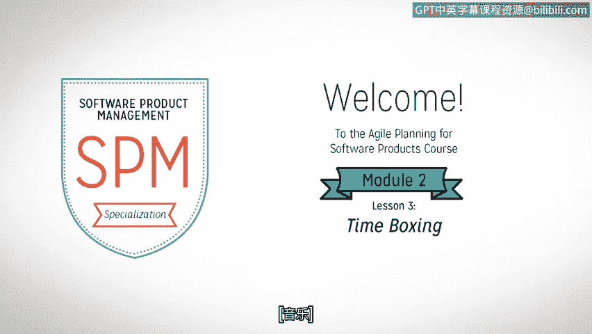
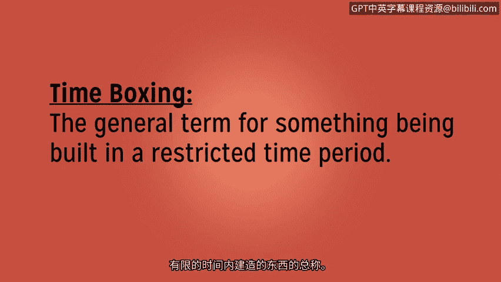
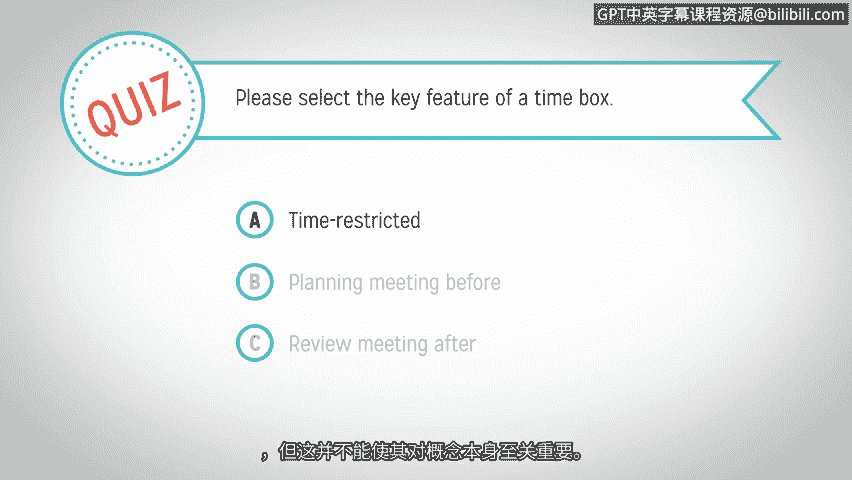

# 011：时间框 🗓️

在本节课中，我们将要学习**时间框**的概念。上一节我们介绍了如何利用团队速率来估算工作量，本节中我们来看看为什么在敏捷开发中，我们通常将工作周期固定为“冲刺”。

## 概述

时间框是一种将工作划分到固定时间段内完成的方法。它为软件团队提供了组织工作的框架，并留出了反思进度的空间。这是现代流行的组织工作方式，也是Scrum运作背后的核心理念。

## 什么是故事点？

在深入时间框之前，我们先简要回顾一下故事点。故事点是用于估算任何给定用户故事所需工作量的相对单位。它们不以时间单位衡量，以避免估算听起来像承诺。你可以通过跟踪团队在一个冲刺中能完成多少工作来确定团队的速率。

## 引入时间框

你可能会想，如何确保开发过程是有纪律的呢？答案就是时间框。

时间框是指在**受限的时间段**内构建某物的通用术语。你可以为任何活动设置时间框，从为期四周的Scrum冲刺到半小时的计划会议。

> 以下是一个关于时间框类别的小测验：
> 问题：Scrum冲刺所属的广泛类别被称为？
> A. 时间锁
> B. 计划
> C. 工作箱
> D. 时间框
> 正确答案是 **D. 时间框**。

Scrum冲刺被认为是时间框化的，因为它们被限制在相对较短的开发时间和相对较少的工作量内。

## 如何创建时间框

创建一个时间框很简单，你只需要：
1.  在项目中设定一个**时间段**，工作将在此期间完成。
2.  为在该时间段内要完成的工作量**设定一个限制**。
3.  在开始时**规划**这些工作。

在Scrum中，冲刺的长度通常为两到四周，前后分别有计划和评审阶段。

## 时间框的重要性

独自开发产品并跟踪进度，然后根据速率估算项目完成日期是一回事。而规划工作以确保保持在正轨上则是另一回事。

这是因为，如果没有开发目标或里程碑，大多数人往往会比定期规划工作时开发得更慢。试想一下，如果你给自己一项任务，但没有明确的完成截止日期，那么很容易分心去做不必要的工作。由于时间看似灵活，**范围往往会扩大**，这是一种风险。

然而，如果你将工作规划在足够小的时间剂量内，就很容易看到下一个目标是什么，以及在那之前需要完成什么。

## 时间框的工作原理

当你使用时间框时，你将一定量的工作放入**特别规划的、固定长度的时段或“时间盒”**中。你取项目结束时需要完成的工作的一个子集，并将其划分为可管理的块，放入这些时间盒中。

在Scrum中，每个时间框或冲刺还涉及在每段时间结束时**评审团队完成的工作**。所有这些加在一起，使你能够看到项目持续、稳定的进展节奏。

## 规划的艺术

然而，规划工作是一门艺术。你可以把所有想要完成的工作都放进一个时间框，但这并不意味着在时间框结束时一切都能完成。这不太可能。

这就是为什么使用团队的速率如此有帮助——你可以利用他们的**生产力历史**来了解在一个时间段内实际可以完成多少工作。

## 时间框的优势

时间框的妙处在于，除了以理性、可持续的方式组织工作外，你现在还可以定期从工作中学习。

许多方法允许你规划出评审时间。你可以利用这段评审时间回顾你的进展，然后利用获得的见解来为下一个时间框制定计划。这对于时间框原则本身来说并非关键，但却是该原则的一个宝贵延伸。

时间框让你有机会看到工作将如何在你的项目中划分。即使你不知道具体在什么时间会完成什么，有一个大致的想法仍然是很有用的信息。

## 实现可发布的产品

你不必等到项目最后才拥有一个可发布的产品。它可以分阶段发布。事实上，在每个时间框结束时，你都应该拥有**可以潜在地作为产品发布的、可工作的软件**。这能保持开发人员的士气，并确保即使资源耗尽，你在项目结束时仍然拥有一个有形的产品。

> 以下是一个关于时间框关键特征的小测验：
> 问题：请选择时间框的关键特征。
> A. 时间受限
> B. 之前有计划会议
> C. 之后有评审会议
> 正确答案是 **A. 时间受限**。时间框化的工作可以在前后有计划会议和评审会议，但这并不是其概念本身的关键，所以时间框只是一种将你的工作计划分解为可管理块的方式。

## 总结

本节课中我们一起学习了**时间框**。它是一种将工作分解到固定、受限时间段内完成的方法，易于实施，并能显著提高项目成功的几率。时间框帮助我们保持开发节奏、控制范围蔓延，并允许我们定期评审和调整计划。

在下一课中，我将讨论一种流行的可视化项目计划的方法——燃尽图。让我们继续学习。