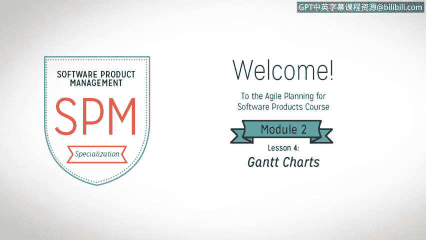
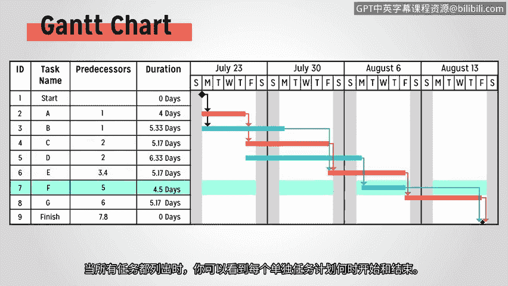
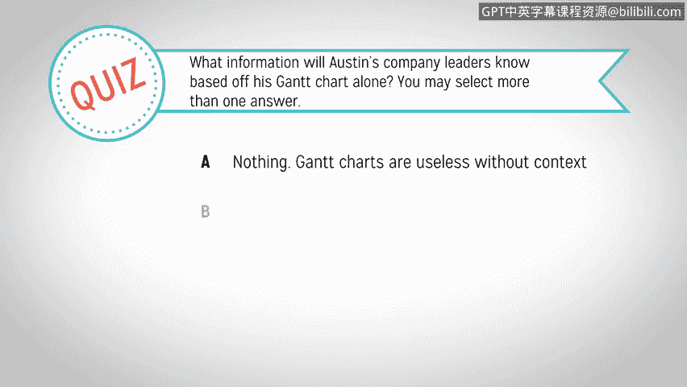

# 012：甘特图 🗓️

## 概述

在本节课中，我们将学习一种用于项目规划的可视化工具——甘特图。我们将了解它的基本构成、如何创建它，以及它如何帮助管理者洞察项目的时间安排和任务依赖关系。

## 甘特图简介

上一节我们介绍了时间盒规划法。本节中，我们来看看另一种项目规划技术：甘特图。

与时间盒不同，甘特图并非组织时间的通用方法，而是一种用于可视化展示项目期间计划工作的图表工具。甘特图能为你提供项目的长期和短期洞察，它们非常有价值，能对项目的成功产生巨大影响。

甘特图是一个用于可视化项目的简单工具。其基本理念是，它能在一个视图中同时展示项目计划、任务依赖关系和截止日期。

## 甘特图的基本构成

一个基础的甘特图由任务和日期构成。

*   任务来自工作分解结构，沿着图表的左侧纵向排列。
*   日期沿着图表的顶部横向排列。

每个任务被逐一列出，第一个计划开始的任务位于最顶部。该任务的开始日期，由一条在顶部对应日期下绘制的横条的起点表示。这条横条从开始日期延伸至该任务计划完成的日期。

当所有任务都布局好后，你就能看到每个独立任务计划何时开始与结束。

## 甘特图与敏捷性

但是，这难道不是非常不“敏捷”吗？如果甘特图只是一系列顺序任务列表，那它岂不是更适合瀑布式流程？

答案是，如果你只是毫无上下文地一个接一个列出任务，确实如此。然而，你可以在甘特图中添加更多信息。

如果你将图表的某些部分划分出来并标记为“冲刺”呢？这完全可行。并且，如果你允许这个计划发生变化，它也完全符合敏捷理念。

你可以利用甘特图来获取关于项目的一些关键洞察。其中最明显的几点包括：你能够大致看到项目何时完成，以及哪些任务会同时进行。

## 甘特图的应用实例

奥斯汀是一位软件产品经理，正与软件开发团队合作。他选择使用甘特图向公司领导展示他的项目，以说明项目进度。

基于奥斯汀的甘特图，公司领导能了解到哪些信息？（可选多个答案）

A. 没有信息，没有上下文的甘特图毫无用处。
B. 项目任务依赖关系。
C. 预估的任务时长。
D. 项目预算。

正确答案是 **B** 和 **C**。甘特图让你能够看到项目的任务时长，也能看到任务依赖关系。

接下来，我们来详细谈谈任务依赖关系。

## 任务依赖关系与关键路径

甘特图不仅仅是日历和待办事项列表的混合体。如果你在甘特图中加入任务依赖关系，它会变得更有用。

以下是操作方法：

1.  在创建甘特图之前，先列出将要包含在图表中的任务。
2.  找出哪些任务需要等其他任务先完成。假设你有两个任务，如果第二个任务必须等到第一个任务完成后才能开始，那么你就说第二个任务依赖于第一个任务。
3.  在你的任务列表旁，为第二个任务做备注，说明它依赖于第一个任务。
4.  为所有任务及其依赖关系都这样做，现在你就得到了一个通过依赖关系紧密相连的完整任务列表。

当你将这些信息转化为甘特图时，你像之前一样列出所有任务及其起止日期。唯一的不同是，你现在知道某些任务必须等到其他任务完成后才能开始。

在甘特图上，这通过一个从被依赖任务指向依赖任务的箭头来表示。

将任务依赖关系这样布局的好处在于，你可以非常容易地看到项目的**关键路径**。这让你能够看清资源的最佳投入点，并了解在什么时间需要完成什么工作。摩根将在下一个模块中更详细地讨论任务依赖关系和关键路径。

## 甘特图的应用层级

需要注意的是，甘特图可以在迭代（冲刺）层级或发布层级使用。

*   在**迭代层级**，你可以用它来洞察当前冲刺时间盒内未来几天的任务安排。
*   在**发布层级**，你可以使用用户故事（而非任务）作为图表中的工作单元，来洞察未来几个冲刺中的这些用户故事。

## 总结

本节课我们一起学习了甘特图。它是一种用于可视化项目计划的超级简单的方法。市面上有大量工具可以帮你创建甘特图。

在下一课中，我将整合本模块讨论的许多内容，并介绍发布计划。发布计划是项目成功的关键方面，请不要错过。