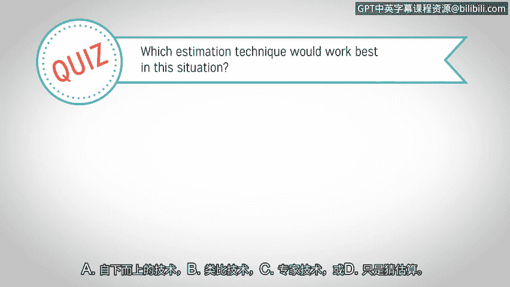

# 014：任务时间估计 📊

在本节中，我们将学习如何进行任务时间估计。我们将从理解项目整体的不确定性开始，然后探讨几种不同的估算方法。掌握准确的估算对于制定可行计划和达成项目目标至关重要。

## 不确定性锥体 📈

上一节我们介绍了估算的重要性，本节中我们来看看影响估算准确性的关键因素——不确定性。在项目初期，不确定性通常很高；而在项目末期，不确定性则很低。这是我们在讨论不确定性空间时曾提及的概念。

如果在不确定性高的时候进行估算，估算结果很可能极不准确。随着项目推进，需求和发展节奏变得更加清晰，做出准确估算会容易得多。这正是“不确定性锥体”所展示的。

在深入讨论不确定性锥体之前，我们先来解读一下图表。

以下图表中，哪个点具有最高的可变性？A点、B点、C点还是D点？

在不确定性锥体图中，当垂直区间最大时，可变性最高。随着时间的推移，可变性越来越小。因此，位于项目起始阶段的A点具有最高的可变性。此时的估算可能比实际值小四倍或大四倍。所以，正确答案是A。

在Y轴上，我们表示的是可变性，即估算可能变化的倍数。区间越大，可变性越高。从图中可以看到，随着时间沿X轴推进，我们的可变性变得越来越小，从而形成了一个锥形，故而得名“不确定性锥体”。

那么，如何将其应用于项目呢？随着项目进行，不确定性被逐步解决，因此估算的可变性会变小。

项目始于初始产品定义阶段，此时形成了产品的初步构想。你脑中有一个大致概念，但没有具体的解决方案。这个时间点的可变性相当高。如果在此早期阶段进行估算，你可能需要一个很大的范围。

当你进入需求启发活动时，可变性变小。此时，产品的特性更加明确，因此更容易做出准确估算，估算范围也可以更小。

接着，你制定潜在方案，可变性进一步减小。一旦完成架构设计和最终的详细设计，可变性就小得多，你的估算也更加可靠。

你可以利用这些可变性来为项目进行估算。根据你在项目时间线中所处的位置，可以将估算值乘以相应的可变性系数，以获得更准确的范围。

例如，假设你猜测一项任务需要4小时完成。如果你正处于需求启发活动阶段，图表估计可变性系数为2和0.5。那么，你可以将4小时的猜测值乘以2和0.5，得到完成该任务的估算时间范围为2到8小时。

## 估算方法 🛠️

到目前为止，你已经了解了估算是什么、如何使用以及何时可变性最小。但你还没有学习如何进行估算。现在让我们来探讨这个问题。

有多种方法可以用来生成估算。我们之前说过，估算应该是不可协商的，并且应该基于某种数据。

以下是几种常见的估算方法：

**自下而上法**
在这种方法中，你需要将项目分解为小的、可管理的任务，就像本课程前面介绍的工作分解结构那样。估算小任务比估算整个项目更容易、更准确。分解任务后，为每个任务生成估算，然后将它们全部加起来，就得到了项目总估算。这种方法的优点是基于较小的估算，不确定性应更低。然而，这些任务的估算可能并非基于任何实际数据。你可能需要将此方法与另一种方法结合使用，以获得最准确的结果。

**类比法**
在这种方法中，你利用类似项目的经验进行估算。当然，这种方法适用于你和你的团队已经完成过类似项目的情况。你需要确保工作流程和使用的技术与之前使用的相似。这种方法的优点是易于使用和理解。如果团队完全相同，且项目与过去的项目相似，它也能基于团队已完成的工作提供准确的结果。但这种情况很少见，因为每个软件项目都有独特的需求和随之而来的独特问题。因此，这种方法肯定有许多缺点。

**专家法**
在这种方法中，你汇集多位估算者的估算结果。如果让多位估算者专门审视你的项目，这种方法成本可能很高。然而，你会得到更准确的结果。如果你使用的是专家对类似项目的估算，请注意你的项目可能有其独特的问题，因此估算不会完全吻合。

## 方法选择练习 💡

现在，让我们通过一个练习来应用所学知识。

假设你是一名软件产品经理，正在开发一款小型移动应用程序。你刚刚完成了一个类似的移动应用程序项目。你之前的项目中有两名开发人员也在这个新项目团队中。团队总共有八名开发人员。你已经创建了工作分解结构。你有一些专家的估算，但那是基于一个更大的移动应用程序得出的。你需要为你的项目创建估算。你的客户要求在一小时内提供估算，因此你只有时间完成一种估算技术。

在这种情况下，哪种估算技术效果最好？A. 自下而上法，B. 类比法，C. 专家法，还是D. 直接猜测？

理想情况下，你会利用所有可用信息来生成准确的估算。如果在这种情况下只能选择一种技术，最好的选择是使用自下而上法。因此，答案A是最佳答案，因为你已经有了现成的工作分解结构可供使用。类比法在这里并不理想，因为团队与你之前的团队有很大不同。新开发人员开发这个产品可能需要更多或更少的时间。由于专家的估算是基于更大的移动应用程序，它们可能对你不准确。而你永远不应该只是猜测估算。

## 总结 📝

本节课中，我们一起学习了任务时间估计。我们首先通过“不确定性锥体”理解了估算准确性如何随项目阶段变化：项目初期不确定性高，估算可变性大；随着项目推进和细节明确，估算会越来越可靠。接着，我们探讨了三种主要的估算方法：基于任务分解的**自下而上法**、基于历史项目经验的**类比法**以及汇集多方专业意见的**专家法**。每种方法都有其适用场景和优缺点。在实际项目中，结合具体情况和可用信息选择合适的方法，是做出有效估算的关键。记住，良好的估算是项目规划和成功交付的基石。