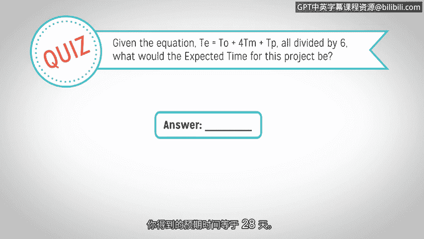

# 015：任务时间估计 📊


## 概述
在本节课程中，我们将学习一种使用公式来更精确地估算任务时间的方法。由于实际工作中存在各种变数，一个良好的时间估算不应只是一个单一的数字，而应该是一个范围。我们将通过一个具体的公式来计算这个范围，并理解不同置信度下的估算意义。

## 核心公式介绍
上一节我们介绍了几种估算时间的方法，本节中我们来看看如何通过一个数学公式来得出一个更可靠的估算范围。这个公式基于三个关键时间点：

*   **最可能时间**：我们称之为 **TM**。这是你对任务或项目最可能花费时间的估计。
*   **乐观时间**：我们称之为 **TO**。这是在一切顺利、团队高效工作的情况下，完成任务所需的最短时间。
*   **悲观时间**：我们称之为 **TP**。这是在最坏情况下，完成任务所需的最长时间。

基于这三个数值，我们将计算两个核心结果：

1.  **期望时间**：我们称之为 **TE**。
2.  **标准差**：我们称之为 **σ**。在数学中，希腊字母σ常用来表示标准差，它将帮助我们确定估算的范围。

## 计算公式
以下是计算期望时间和标准差的公式：

**期望时间公式**：
`TE = (TO + 4 * TM + TP) / 6`

**标准差公式**：
`σ = (TP - TO) / 6`

## 计算估算范围
计算出期望时间 **TE** 和标准差 **σ** 后，我们就可以确定估算的范围了。

*   首先，用期望时间减去标准差，得到范围的下限。
*   然后，用期望时间加上标准差，得到范围的上限。

用数学术语表示，这个范围就是 **TE ± σ**。

这个范围（TE ± σ）表示实际任务时间有 **68.3%** 的可能性落在这个区间内。

如果你希望估算更加可靠，可以将标准差加倍，从而得到一个更宽的范围，即 **TE ± 2σ**。这个范围表示实际任务时间有 **95.5%** 的可能性落在其中。

你需要根据项目实际情况来决定：是选择一个范围更宽但准确率更高（95.5%）的估算，还是选择一个范围更窄但准确率稍低（68.3%）的估算。

## 例题解析
让我们通过一个例子来具体应用这些公式。

假设我们有以下数据：
*   最可能时间 **TM** = 15 天
*   乐观时间 **TO** = 12 天
*   悲观时间 **TP** = 30 天

**第一步：计算期望时间 TE**
```
TE = (TO + 4*TM + TP) / 6
   = (12 + 4*15 + 30) / 6
   = (12 + 60 + 30) / 6
   = 102 / 6
   = 17 天
```

**第二步：计算标准差 σ**
```
σ = (TP - TO) / 6
  = (30 - 12) / 6
  = 18 / 6
  = 3 天
```

**第三步：确定估算范围**
*   **68.3% 置信度范围**：TE ± σ = 17 ± 3 天 → **14 到 20 天**。
*   **95.5% 置信度范围**：TE ± 2σ = 17 ± (2*3) 天 → **11 到 23 天**。

可以看到，95.5%置信度对应的估算范围（12天）比68.3%置信度的范围（6天）要宽，但可靠性更高。

## 练习题
你正在进行的项目数据如下：最可能时间 **TM** 为 26 天，乐观时间 **TO** 为 18 天，悲观时间 **TP** 为 46 天。

**问题**：根据公式 `TE = (TO + 4*TM + TP) / 6`，该项目的期望时间 **TE** 是多少天？

**计算过程**：
```
TE = (18 + 4*26 + 46) / 6
   = (18 + 104 + 46) / 6
   = 168 / 6
   = 28 天
```
因此，该项目的期望时间是 **28 天**。



> **重要提示**：如果计算结果不是整数，请务必**向上取整**。例如，54.5 天应取整为 55 天，6.9 天取整为 7 天，23.1 天取整为 24 天。

## 学习建议
理解公式概念和亲自进行计算是两回事。为了确保你掌握了这项技能，强烈建议你完成课程提供的练习工作表。该工作表包含了多个示例，并附有详细的步骤解析答案页。如果在学习过程中遇到任何困难，欢迎在课程讨论区提问。

通过练习，你将能更自信地运用这种技术来生成更可靠的估算，这对于软件产品管理至关重要。

## 总结
本节课我们一起学习了如何使用 **PERT（计划评审技术）** 公式进行任务时间估算。我们掌握了如何根据**最可能时间（TM）、乐观时间（TO）和悲观时间（TP）** 来计算**期望时间（TE）** 和**标准差（σ）**，并据此构建不同置信度（68.3% 和 95.5%）下的估算范围。这种方法将单一的时间点估算转化为一个更符合现实情况的范围估算，有助于进行更稳健的项目规划。

现在你已经学会了如何生成估算，接下来我们可以开始讨论迭代计划。在下一课中，我们将探讨任务依赖性以及如何在迭代规划中考虑它们。