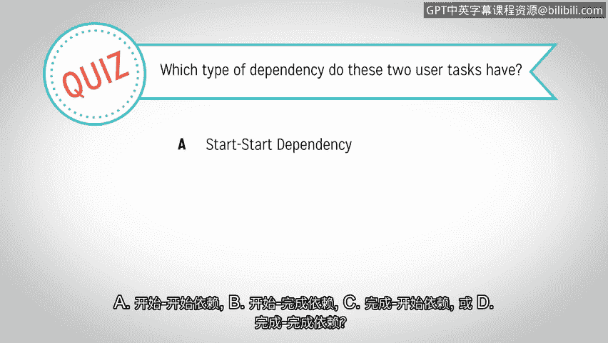

# 016：任务依赖关系

在本节中，我们将详细探讨任务依赖关系。任务依赖关系是制定项目计划时需要考虑的关键因素，它描述了任务之间的相互制约关系。

在之前的软件过程与敏捷实践课程中，以及本课程的第一课里，我们曾简要提及任务依赖关系。任务依赖关系是指一个任务的开始或完成，依赖于另一个（或多个）任务的状态。

## 依赖关系的四种类型

两个任务之间可能存在四种依赖关系。我们将以第一个任务的状态为基准，来考察第二个任务如何依赖于它。这四种依赖类型是：开始-开始、开始-完成、完成-开始以及完成-完成。

### 开始-开始依赖

开始-开始依赖关系关联两个任务的开始。具体而言，第一个任务必须在第二个任务开始之前启动。这种依赖关系不涉及任务的完成时间。

想象一场两人赛跑，其中一位选手（选手A）获得先发优势。选手B必须在选手A起跑后才能开始跑。依赖关系并未规定谁先完成比赛。

一个更具体的例子是编写教科书和创建术语表。这两个任务可以同时进行，但你必须先开始编写教科书并识别出重要术语，才能将它们添加到术语表中。因此，你必须在开始编写术语表之前开始编写教科书。至于你是否在完成教科书后仍在添加术语，或者是否在完成术语表后还未写完书（只要没有新术语需要添加），都无关紧要。

### 开始-完成依赖

开始-完成依赖是指第一个任务必须在第二个任务完成之前开始。这种依赖关系不涉及第二个任务的开始时间。

当存在某种重叠交接时，可能会出现开始-完成依赖。想象一名值夜班的保安，接班的保安必须在他结束轮班之前开始工作，他才能完成自己的班次。

同样，假设你的团队采用每周冲刺，从周三开始到下周二结束。在冲刺规划中，你可能希望在当前冲刺期间规划下一个冲刺。这样，开发人员就能在下一个周三立即有效地开始下一个冲刺的任务。因此，规划下一个冲刺需要在当前冲刺结束之前开始。或者说，规划下一个冲刺对当前冲刺存在开始-完成依赖。

**小测验：**
罗纳德是一位为婚礼制作蛋糕的面包师。他需要设计蛋糕、烘烤蛋糕、装饰蛋糕以及将蛋糕交付给客户。以下哪组任务之间存在开始-开始依赖？
A. 设计蛋糕和烘烤蛋糕。
B. 烘烤蛋糕和装饰蛋糕。
C. 设计蛋糕和装饰蛋糕。
D. 装饰蛋糕和交付蛋糕。

罗纳德必须在开始烘烤蛋糕之前开始设计蛋糕，以便知道要烘烤哪种面糊以及大约需要制作多少蛋糕。他可以在蛋糕烘烤期间继续设计，并在蛋糕烘烤完成之前或之后完成设计。这没有影响，因为这是开始-开始依赖。因此，**A是正确答案**。

### 完成-开始依赖

完成-开始依赖是最常见的任务依赖类型，你将遇到的大多数依赖都属于此类。它是指第一个任务必须在第二个任务开始之前完成。

例如，你必须先完成给汽车加油，才能开始驾驶汽车。在软件开发中，你必须先完成某个功能的设计并明确其作用，才能开始编写该产品的用户手册或培训手册。

### 完成-完成依赖

正如你现在可以猜到的那样，完成-完成依赖是指第一个任务必须在第二个任务完成之前完成。

例如，你必须先完成向客户开具产品账单，再完成产品交付，以避免无法获得工作报酬。

**小测验：**
你的开发团队创建了一个数据库程序，用于存储医生诊所的病人信息。用户可以输入病人信息到数据库中，也可以按姓名搜索病人。这两个用户任务之间存在哪种依赖关系？
A. 开始-开始依赖。
B. 开始-完成依赖。
C. 完成-开始依赖。
D. 完成-完成依赖。

要搜索数据库，需要已经添加了病人信息。因此，搜索病人对向数据库输入病人信息存在开始-开始依赖。这些任务如何或何时完成并不重要。用户不需要拥有所有病人信息才能使用搜索功能。因此，**A是正确答案**。

## 总结与展望

本节课我们一起学习了任务依赖关系的四种基本类型：开始-开始、开始-完成、完成-开始和完成-完成。理解这些依赖关系是进行有效任务排期的基础。

现在你已经了解了任务依赖关系的类型，接下来需要看看这些依赖关系如何融入项目计划中。在本模块的剩余部分，我们将探讨基于依赖关系组织任务的规划技术。在下一课中，我们将从关键路径法图表开始学习。