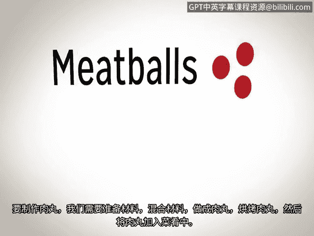

# 017：CPM图

## 概述
在本节课中，我们将学习如何应用任务依赖关系来规划项目。具体来说，我们将介绍一种名为关键路径法图的可视化工具，它可以帮助我们组织任务、识别依赖关系，并找出完成项目所需的最短时间。

---

## 什么是CPM图？
上一节我们介绍了任务依赖关系，本节中我们来看看如何将其应用于实际项目规划。

当你思考一个大型软件项目时，会发现许多任务之间存在依赖关系，这些关系必须在计划中予以考虑。虽然存在多种任务规划方法，但本节课我们将重点介绍一种我个人喜欢使用的方法：关键路径法图，通常简称为CPM图。

CPM图是一种组织任务依赖关系的可视化方法。让我们先看一个例子，然后详细讲解如何为你的项目创建CPM图。

---

## 示例：制作意大利面晚餐
我们将为制作一顿意大利肉酱面晚餐创建一个CPM图。这顿晚餐将包含意大利肉酱面和凯撒沙拉。

首先，我们需要识别完成这顿晚餐所需的任务。

**制作意大利面**需要以下任务：
*   煮水
*   煮面条
*   沥干面条
*   加热锅
*   加热酱汁
*   将酱汁浇在面上

**制作肉丸**需要以下任务：
*   准备食材
*   混合食材
*   制作肉丸
*   预热烤箱
*   烘烤肉丸
*   将肉丸加入菜肴

**制作沙拉**需要以下任务：
*   切生菜
*   加入面包丁
*   加入奶酪
*   加入沙拉酱
*   搅拌沙拉

下图展示了我们的工作分解结构。请注意，我为烹饪任务添加了几个额外的关联任务（例如煮水、加热锅、预热烤箱）。

现在，我们需要为每个任务添加一个以分钟为单位的耗时估算。为简化起见，我们将使用单一的预期时间值，而非一个时间范围。

接下来，我们需要根据任务依赖关系开始组织任务。

---

## 构建CPM图：意大利面任务
让我们从意大利面任务开始。

我们知道，在煮面条之前需要先煮水。同时，在沥干面条之前需要先煮好面条。独立于这些任务，在加热酱汁之前需要先加热锅。我们需要在面条煮好并沥干、且酱汁已加热之后，才能将酱汁浇在面上。

因此，在CPM图中，它的呈现形式如下。箭头描绘了任务间的依赖关系。为简化起见，我们假设这些都是**完成-开始**依赖关系，即一个任务必须完成后，下一个任务才能开始。

CPM图包含**路径**。路径是沿着箭头从一个任务到另一个任务的序列。在CPM图的这个特定部分，有两条**从头到尾的路径**，即从图的开始到结束的路径。

*   一条路径以“煮水”开始，以“将酱汁浇在面上”结束。
*   另一条路径以“加热锅”开始，以“将酱汁浇在面上”结束。

位于不同从头到尾路径上的任务可以独立完成。例如，“煮水”任务可以独立于“加热锅”任务进行。

请注意，两条从头到尾路径的交汇点是任务依赖关系的**协调点**。在这个例子中，这个协调点就是“将酱汁浇在面上”这个任务；你必须在沥干面条**并且**加热酱汁之后，才能将酱汁浇在面上。因此，你必须协调“沥干面条”和“加热酱汁”这两个任务。

**思考题**：根据CPM图的这个部分，完成所有任务的最短时间是多少？
A. 22分钟
B. 14分钟
C. 8分钟
D. 16分钟

**答案与解析**：观察CPM图时，你需要分别查看每条从头到尾的路径。我们可以在煮水或煮面条的同时加热锅和加热酱汁。但是，我们无法加速“煮水 -> 煮面条 -> 沥干面条 -> 浇酱汁”这个过程，因为这些任务之间都是完成-开始依赖关系。如果我们累加该路径上任务的耗时估算，得到的是16分钟。因此，**D是正确答案**。

---

## 添加肉丸任务
接下来，让我们看看肉丸任务。这些任务基本上是顺序进行的。

我们需要在混合食材之前先准备食材。需要在制作肉丸之前混合食材。需要在烘烤肉丸之前制作好肉丸。同时，需要在烘烤肉丸之前预热烤箱。然后，在烘烤肉丸之后，需要将肉丸加入菜肴。此外，我们还需要等待意大利面和酱汁准备就绪。

现在让我们看看CPM图变成了什么样子。如图所示，我们现在有四条从头到尾的路径。在“将酱汁浇在面上”、“烘烤肉丸”和“将肉丸加入菜肴”处也有协调点。

---

## 添加沙拉任务
主菜规划完成后，让我们添加沙拉任务。

首先，我们需要切生菜。然后，面包丁、奶酪和沙拉酱加入沙拉的顺序无关紧要。它们可以各自成为一条路径，但都必须在搅拌沙拉之前加入。

让我们单独看这个沙拉任务计划。在CPM图的这个部分，有三条从头到尾的路径。如果你能同时进行加入面包丁、奶酪和沙拉酱这三个任务，那么你可以在5分钟内完成这整个部分。我们会说这三个任务是**并行**发生的。切生菜需要2分钟，并行任务需要1分钟，然后搅拌沙拉需要2分钟。

现在，我们可以合并所有的图表。

---

## 完整的CPM图与关键路径
这里是我们完整的CPM图。它阐明了我们所有的任务依赖关系和协调点。这是生成时间表的重要第一步。

从CPM图中，你可以确立一条**关键路径**。关键路径是两个逻辑点之间耗时最长的任务路径。由此，你可以确定项目所需的最短和最长时间估算。它决定了哪些任务是**关键的**（即位于最长耗时路径上），以及哪些任务存在**浮动时间**（即这些任务可以延迟而不会给项目增加额外时间）。

在寻找关键路径时，从项目开始到结束的路径很重要。例如，“开始 -> 煮水 -> 煮面条 -> 沥干面条 -> 浇酱汁 -> 加入肉丸 -> 结束”就是一条路径。

**关键路径**是从开始到结束、关联耗时估算最长的路径。在我们的例子中，“开始 -> 准备食材 -> 混合食材 -> 制作肉丸 -> 烘烤肉丸 -> 加入肉丸 -> 结束”这条路径估算需要38分钟，这是耗时最长的路径。因此，**38分钟是完成这个项目可能所需的最短时间**。

回想一下我们的工作分解结构，当我们累加所有估算时，显示完成需要77分钟。这假设我们是一个接一个地顺序完成每个任务。而CPM图向我们展示了哪些任务可以**并行**发生。我们可以在制作肉丸和意大利面的同时制作沙拉。关键路径将显示你完成所有任务可能所需的最短时间，这可能涉及需要额外的人手来承担并行工作。

**思考题**：考虑以下CPM图，其中方框内的数字是时间估算。关键路径的时间估算是多少？
A. 15分钟
B. 16分钟
C. 11分钟
D. 20分钟

**答案与解析**：关键路径如下所示（图中应高亮显示最长路径，例如 A->B->D->F）。当你累加这些估算时，得到16分钟。所以16分钟是完成这个项目可能所需的最短时间，因此**B是正确答案**。

---

## 浮动时间与调度
你希望首先安排关键路径上的任务。所有其他任务可以花费更多时间而不会增加项目的总耗时，这是因为项目中存在**浮动时间**。

当一条从头到尾的路径的估算时间小于关键路径时，就会出现浮动时间。在我们的示例中，我们有四条其他这样的路径，它们都有一些浮动时间。

浮动时间在你制定时间表时会成为你的朋友，因为它提供了灵活性，允许某些任务花费比预期更多的时间，而不会影响达到目标日期。

---

## 总结
本节课中，我们一起学习了如何使用关键路径法图进行任务规划。我们了解了如何通过CPM图可视化任务依赖关系，识别关键路径以确定项目的最短可能工期，并利用浮动时间为项目调度提供灵活性。CPM图是将工作分解结构转化为实际可行时间表的重要工具。

在下一课中，我们将看一种类似的任务规划方法，称为PERT图。