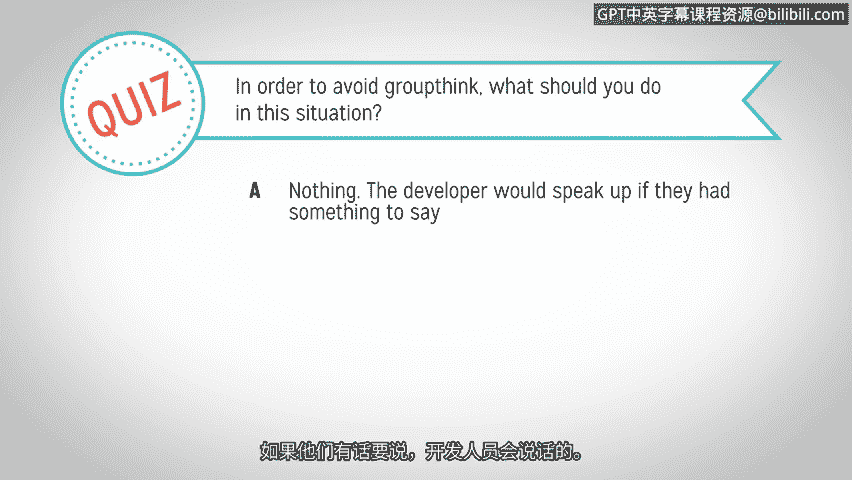

# 020：反面模式 🚫

在本节课中，我们将要学习软件项目管理中的“反面模式”。这些是项目中常见的、会导致失败的行为或情况。了解它们有助于我们识别并避免这些陷阱，从而提升项目成功的概率。

前面的三个模块已经为你提供了制定优秀计划、为项目真正成功奠定基础所需的工具。这些工具很有价值，请务必多加练习使用。

然而，还有一些东西是缺失的。缺失的部分是如何处理那些可能导致一个规划完美的敏捷项目失控的个体风险。在本课程中，这些你们可能知道自己不知道的事情，就是运行软件项目所伴随的风险。基本上，你知道存在风险，但不确定具体是哪些风险。本模块的重点就是揭示其中许多风险，并向你展示如何尽可能地减轻这些风险。

让我们开始吧。在本节中，我将介绍反面模式。

反面模式本质上是项目可能失败的常见方式。当然，你希望尽可能避免它们，而避免它们的最佳方法就是了解它们是什么。

一个**反面模式**是项目中经常出现的、会带来负面后果的情况。存在大量不同的反面模式。有些与编写代码有关，有些与软件架构有关，还有一些与软件项目管理方式有关。由于这是一门软件产品管理课程，我们将重点关注属于管理类别的那些反面模式。

许多反面模式被不同作者赋予了不同的名称，但核心理念是相同的。即使在管理层面，也存在许多不同的反面模式。因此，我将只介绍其中的几个。如果你想查看完整的反面模式列表，请查阅课程资源，那里我列出了链接，供你根据需要探索更多反面模式。

管理类反面模式主要围绕人展开。项目可能因个人或群体的行为方式而失败。让我们从涉及群体的问题开始，稍后再讨论涉及个人的问题。

以下是第一个要介绍的群体反面模式。

**分析瘫痪**通常发生在你的开发团队陷入项目的规格说明阶段时。客户或产品经理可能陷入困境，试图预先完全分析产品需求，并且在该分析完善之前无法决定产品的方向。这对项目的进展和成功是有害的，因为它通常意味着你的开发团队停滞不前。由于在分析中瘫痪，项目最终被不必要地延迟。开发人员发现这种情况令人沮丧。他们已准备好开始开发，但你更害怕选错道路，而不是取得任何实际进展。结果，你最终坐等更多信息，而不是把事情做完。

要避免这种情况，最好的方法是运行一个具有增量发布的敏捷项目。如果你在项目开始时并不了解所有事情，那没关系，你不必预先知道一切，因为你在整个项目中为灵活性和变更留出了空间。如果每个人都理解项目将随着时间的推移而完善，而不必预先知道一切，事情进展会快得多。

塔尼亚是一名软件产品经理。她和她的开发团队在过去一个月里一直试图与客户细化需求，以确保在开始构建之前一切都完美无缺。她掌握了所有需求的基本情况，其中一些已经可以开始，但整个产品尚未完全定义。鉴于她的产品没有完全定义，塔尼亚的最佳行动方案是什么？

A. 向客户探询更多信息。
B. 用她已有的信息开始开发。
C. 继续细化需求。
D. 放弃项目，没有希望了。

正确答案是 **B**。找出你的项目是否可行的唯一真正方法就是构建它。塔娜已经陷入了分析瘫痪。她最好继续前进。

上一节我们讨论了分析瘫痪，接下来看看另一个常见的反面模式。

**本末倒置**是一个常见的英语习语，讽刺以适得其反的顺序做事。在软件产品管理中，本末倒置的定义非常相似。它指的是过分强调项目中应该稍后完成的部分。一个很好的例子是，程序员被从开发关键功能中抽调出来，去开发一个目前不需要的功能。通过本末倒置，团队可能会发现他们有很多重要性不同但开发不佳的功能。更好的替代方案是拥有少数几个开发良好且重要的功能。

为了避免本末倒置，开发团队必须将精力集中在当前需要完成的任务上，而不是未来需要完成的任务上。

除了顺序问题，群体决策也可能出现问题。**群体思维**是一种可能使软件项目瘫痪的反面模式。群体思维是社会科学中的一个术语，描述了人们倾向于遵循群体的普遍意见，即使他们个人不同意。这种现象导致了许多问题，不仅仅是在软件领域。糟糕的决策可能是群体思维的结果。

群体思维的一个典型例子是，当一群开发人员协作设计产品架构时。如果你曾经是这样一个小组的一员，你可能已经注意到，一两个人的想法可能会主导会议。其他不那么健谈的开发人员为了避免冲突而保持沉默。这可能导致产品不佳。通常，存在一些小组没有讨论的选项。如果建设性地管理，冲突是可以接受的。

避免群体思维的一种方法是默默地生成问题解决方案。还记得《软件过程与敏捷实践》课程中的精益软件开发吗？精益通过让团队分成多个小组来解决这个问题，每个小组负责构想自己的解决方案。然后，当所有小组都制定好解决方案后，团队再聚在一起，合并解决方案。这是最小化群体思维影响的好方法。

我建议你在个人层面也这样做。与其让团队分成更小的小组，不如让每个人在纸上写下自己的解决方案，不说话。然后大家再聚在一起，团队可以依次讨论每个人的想法。这可以防止一两个人主导小组讨论。

你是一名软件产品经理，正在与你的开发团队开会，试图找到客户问题的最佳解决方案。团队正在讨论解决方案，但你注意到你的一位开发人员对主导的解决方案似乎感到不安。为了避免群体思维，在这种情况下你应该怎么做？

A. 什么都不做，如果开发人员有话要说，他们会说出来。
B. 让这位开发人员当场表态，挑战他们说出自己的想法。
C. 引导小组在比较想法之前，先把所有想法写在纸上。
D. 把开发人员拉到一边，告诉他们主导的解决方案通常是最好的。

这里的正确答案是 **C**。为了避免针对任何人，一个好的策略是让你的开发人员各自离开，在纸上写下解决方案，然后再比较笔记。这样，每个人的想法都能得到表达。

本节课中我们一起学习了软件项目管理中的几个关键反面模式：**分析瘫痪**、**本末倒置**和**群体思维**。了解这些常见陷阱是成功管理敏捷项目的重要一步。通过采用增量开发、聚焦当前任务以及鼓励独立思考等方法，我们可以有效规避这些风险，推动项目朝着正确的方向前进。