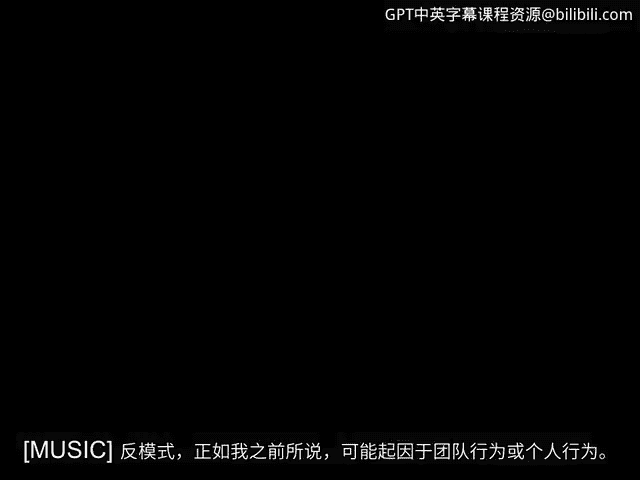
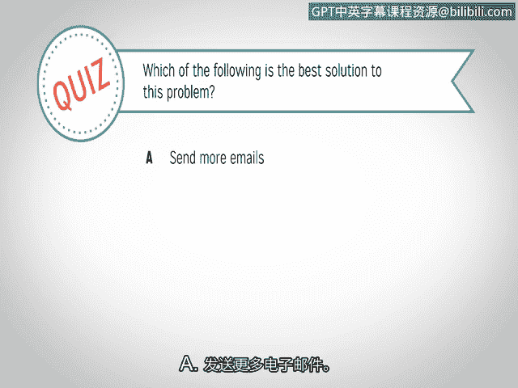

# 023：反面模式管理

在本节中，我们将学习软件开发中常见的几种反面模式，特别是由个人行为引发的管理问题。我们将探讨这些模式的表现、成因以及潜在的解决方案，以帮助您识别并改善团队中的不良实践。

反面模式可能源于群体行为或个人行为。许多由个人行为引发的反面模式，旁观者很容易识别，但当事人却难以察觉。当问题不出在自己身上时，批评总是容易的。但这种态度也可能使我们对自己的失误视而不见。为了解决接下来要描述的这些反面模式，营造一种开放、自省和持续改进的文化至关重要。

上一节我们介绍了反面模式的概念，本节中我们来看看几种具体的管理反面模式。

## 微观管理

让我们从最著名的反面模式之一——微观管理开始。微观管理非常普遍，几乎成了一个流行词。它是许多组织面临的真实问题。

微观管理发生在处于管理职位的人倾向于介入项目的每一个微小细节时。他们通常是那些要求抄送所有团队往来邮件的人，并且觉得有必要对工作场所的每一个决定或分享的观点发表意见。微观管理者想知道开发人员每分钟在哪里、在做什么。本质上，微观管理是关于控制。

微观管理源于某种程度上的不信任。这并不意味着这种不信任有现实依据，或者微观管理者的担忧是合理的。微观管理通常是管理者自身恐惧、不安全和压力的表现。微观管理者并非有意打击开发人员的士气。他们这样做是因为觉得没有他们的干预，整个项目就会崩溃。可能是因为过于激进的时间表、糟糕的产品质量，或者仅仅是担心没有合适的人选来完成工作。

无论原因如何，重要的是要认识到微观管理者是问题的根源。通常，被此人管理的团队成员会因其行为而受到指责。这不仅对团队士气有害，对产品也有害。正如我之前展示的，开发人员的士气不仅影响个人，也影响他们高效工作和与同事协作的能力。组织中的任何层级，没有人愿意在一个心理健康受到威胁的环境中工作。

那么，如何解决微观管理者的问题呢？最终，解决方案必须来自微观管理者自身。就像任何个人层面的反面模式一样，没有快速或简单的解决方法。要真正解决这个问题，表现出这种行为的管理者必须愿意承认其行为对团队有负面影响，并采取措施改进。这可能意味着寻求进一步的管理培训，或者努力增强自我意识并调整自己的行为。

以下是微观管理者通常不会表现出的行为：
A. 要求抄送所有项目往来邮件。
B. 向团队成员提供未经请求的建议。
C. 召开简短的每日会议评估项目状态。
D. 不断关注项目可能失败的方式。

答案是 **C**。微观管理者会表现出很多其他行为，但简短的每日状态会议本身并不值得担忧。事实上，这在Scrum项目中很常见，它们就是每日站会。

## 海鸥式管理

与微观管理者密切相关的一个反面模式是“海鸥式管理者”。这种人平时见不到，一旦出现问题，管理者就会“飞”进来，制造很多噪音，对每个人“狂轰滥炸”，然后“飞”走。引用该领域作家肯·布兰查德的话：“这很滑稽，但确实会发生。”这是一种与微观管理者不同的管理者，他们行为的动机也截然不同。

海鸥式管理者可能会在开发团队中引起与微观管理者同样多的骚动和压力。他们甚至可能无意中导致项目变成“消防演习”项目。对于开发团队来说，不断生活在担心下一次“轰炸”何时到来的恐惧中是充满压力的。

与微观管理者类似，海鸥式管理者的独特风格通常是由繁忙的日程、规划不足和巨大压力造成的。海鸥式管理者的行为可以用类似微观管理者的方式来解决，但通常最好的方法是减轻管理者的工作量。当然，作为软件产品经理，这可能不在你的职责范围内。如果你怀疑自己可能表现出海鸥式管理的迹象，或许是时候重新评估你的日程安排以及你与团队的互动方式了。

关于重新评估你与团队互动方式的最后一点本身就很重要。有时，管理者可能会在与团队的互动方式上变成海鸥式管理者。如果团队仍然觉得无法与管理者正常沟通，仅仅减轻管理者的工作量作用不大。

## 沟通不畅与电子邮件

造成沟通不畅的最大元凶是电子邮件。电子邮件沟通可以很快让一个善意的管理者变得令人不快。电子邮件的问题在于通常缺乏上下文，对于大多数沟通来说过于正式，并且很容易误解作者的意思。这是一个如此普遍的问题，以至于将电子邮件作为主要沟通方式本身也被认为是一种反面模式。

这个问题的解决方法很简单。花时间进行面对面沟通。对于远程团队，如果无法面对面，可以尝试其他解决方案，如在线团队聊天服务、视频会议和电话。花时间给予他人关注，你的投入将获得丰厚的回报。

塞雷娜在让团队回复她关于项目状态的电子邮件时遇到了问题。以下哪个是解决这个问题的最佳方案？
A. 发送更多电子邮件。
B. 打电话给开发团队负责人。
C. 什么都不做。
D. 与开发人员当面交谈。

最佳选择是塞雷娜与她的开发人员当面交谈。电子邮件可能造成隔阂且容易被误解。正确答案是 **D**。

## 总结

本节课中，我们一起学习了三种常见的个人管理反面模式：微观管理、海鸥式管理以及过度依赖电子邮件沟通。我们探讨了它们的特征、根源，并提出了改进建议。关键在于培养开放、自省和信任的团队文化，并选择更直接、更人性化的沟通方式。识别并主动调整这些行为模式，对于提升团队士气、生产力和最终的产品质量至关重要。