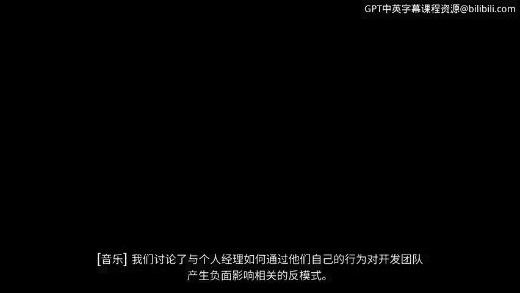
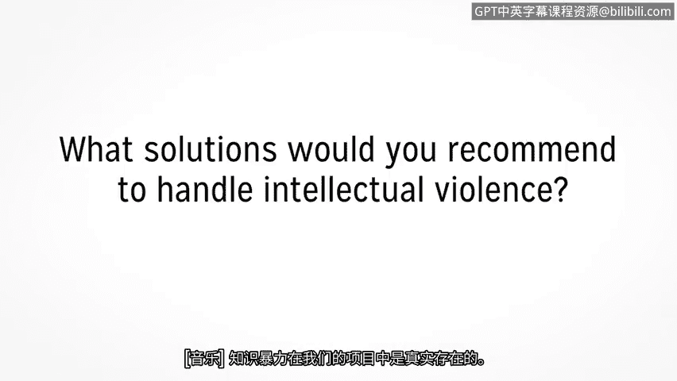

# 024：反面模式——个人开发者

## 概述
在本节课中，我们将要学习两种由个体开发者引发的、可能对团队和项目产生负面影响的“反面模式”。我们将了解“独行侠”和“知识暴力”这两种行为的具体表现、危害以及应对策略。

---

上一节我们讨论了管理者个人行为可能引发的反面模式。本节中，我们来看看源自个体开发者的几种反面模式及其应对方法。

第一种是“独行侠”。“独行侠”是指在不咨询团队其他成员的情况下，擅自做出重大项目决策的人。

他们也可能通过在任何话题上坚持己见，在工作场所制造问题。

“独行侠”非但不能帮助推进进度，反而常常通过提出琐碎的担忧、质疑每一件小事来阻碍进展。

如果此人频繁地坚持己见，团队中的其他人往往会为了避免争执而选择让步。

慢慢地，原本高效、开放沟通的团队会变成一团糟。更糟糕的是，“独行侠”可能让所有人对问题变得漠不关心，从而导致群体思维的产生。

当“独行侠”不咨询团队就做出决定时，他们可能给其他团队成员制造更多工作，并给所有相关人员带来重大困扰。

这不是英雄主义。正如我在本课前面讨论过的，这是鲁莽行为。

对于“独行侠”，并没有快速的解决办法，解决方案通常取决于个体为何会如此行事。有时“独行侠”只是想制造麻烦，有时他们想证明自己的价值。

应对“独行侠”的理想方案是尝试让个体认识到自身行为的破坏性，并采取措施改变它。

这些人的个性往往使得改变比必要的更加困难。在这些情况下，有时需要采取组织层面的措施来解决问题。

一个“独行侠”可以摧毁一个开发团队，并迅速使生产力脱轨。尽管处理起来可能很困难，但尽快应对“独行侠”的行为至关重要。

另一种由个体（通常是开发团队成员）表现出的破坏性行为是“知识暴力”。这是本课我将讨论的最后一个反面模式。

“知识暴力”既关乎开发者的内心世界，也关乎我描述过的其他反面模式。

“独行侠”也可能使用“知识暴力”，让会议变得难以忍受。

“知识暴力”是指一个人利用其在某个领域的高级知识来恐吓他人的情况。

这可能表现为，当团队成员询问他们不熟悉的技术问题时，开发者居高临下地对他们说话。

正如你可能想象的那样，这种行为可能导致团队成员感到不被欣赏和不重要。

因此，你团队的士气会下降，并且你可能错过一些关键的想法，或者至少是澄清问题的机会。

以下是应对“知识暴力”问题的一些建议：

*   **私下沟通**：尝试与当事人私下交谈。请他们反思自己的行为如何影响团队中的其他人。
*   **鼓励提问**：鼓励在会议中实行“没有愚蠢的问题”政策。
*   **促进开放沟通**：此外，尝试鼓励工作场所的开放沟通，并杜绝预先评判他人的意见或经验不足。

与“独行侠”一样，尽早处理这个问题非常重要，以免它对你的团队和项目产生持久影响。

---

让我们通过一个例子来巩固理解。

斯图尔特整个星期都坐在自己的办公室里，没有与团队中的其他开发者交流。

作为团队经理，波莉安娜走近斯图尔特，想看看他在忙什么。

当她与斯图尔特交谈时，他告诉她，他已经更改了团队的用户界面，以更好地符合正确的实践规范。

波莉安娜询问团队其他成员是否知道此事，他们告诉她并不知道。

斯图尔特表现出了哪种反面模式？
A. 无效行为
B. 知识暴力
C. 独行侠
D. 专家行为

这里的正确答案是 **C**。

在未经他人知晓的情况下对产品进行更改，斯图尔特的行为属于“独行侠”。

为了解决这个问题，波莉安娜应该首先鼓励斯图尔特更定期地与团队沟通，并避免在未先与团队其他成员讨论的情况下做出更改。

---

现在，让我们看看行业专业人士如何处理这些反面模式。

**关于沟通媒介的见解：**
“将电子邮件作为主要沟通工具在当今听起来是件很容易的事。每个人都在使用电子邮件，事实上，我认为它被过度使用了。我绝不会推荐将电子邮件作为主要的沟通媒介。在考虑沟通媒介时，我建议考虑两点：第一，你的利益相关者偏好的沟通媒介是什么？他们喜欢如何沟通？归根结底，这真的不是关于你的偏好和你的沟通媒介偏好，而是关于接收项目可交付成果的人。所以，他们希望如何被沟通？是通过电话、电子邮件、面对面还是其他方式？因此，要找出他们偏好的沟通媒介。至于将电子邮件作为主要沟通媒介，我还建议回归到电话或面对面的沟通。我认为我们过于依赖电子邮件，而电子邮件作为一种策略常常被误解，或者作为一种沟通媒介可能适得其反。它实际上可能导致沟通不畅，例如你试图通过电子邮件传达的语气或声音可能无法以你希望的方式被理解。因此，电子邮件有时会给你带来新的挑战，因为人们可能不会以你预期的方式理解那条信息，从而给你自己制造了更多工作。所以现在你必须去管理不同的个性、处理不同的情况，而这一切都是因为一封电子邮件的解读方式。因此，我建议主要沟通方式应符合你利益相关者的偏好，同时确保你记得还有电话，实际上也可以与人进行面对面的交谈。”

**关于知识暴力的见解：**
“知识暴力在我们的项目中是真实存在的。知识暴力可以定义为人们利用信息或知识作为权力，来恐吓项目中的其他人。因此，作为产品或项目经理，你需要真正理解不同人的个性，并了解如何打破一些信息孤岛和团队成员之间的信任壁垒，让他们明白，知识和信息只有在共享时才能真正发挥最大价值。为了取得你试图从项目中获得的结果的成功，你需要找到方法进行团队建设、建立信心，让你的团队和资源真正信任彼此，并创造安全的环境，这样他们才会分享。你希望从团队中得到的是确保和增强对彼此个性的理解，这样他们就能在一个安全的环境中感到舒适，分享他们所拥有的任何信息，并认识到你项目的真正成功取决于他们将进行的信息共享。”

---

好了，这就是我在本课程中要介绍的所有反面模式。正如我在课程开头所说，反面模式还有很多，这里只是从项目管理角度介绍的一小部分。然而，也存在专门与编码和软件流程相关的反面模式。如果你感兴趣，课程资源中有链接可以帮助你更深入地了解。

引用该领域的另一位作家史蒂夫·麦康奈尔的话：“有些错误犯得太多，以至于被认为是经典。另一些则是特定项目所独有的。”既然我们已经讨论了经典的反面模式，接下来让我们简要谈谈你可以做些什么来应对这些项目特有的错误。

请加入下一节课，一同探索。