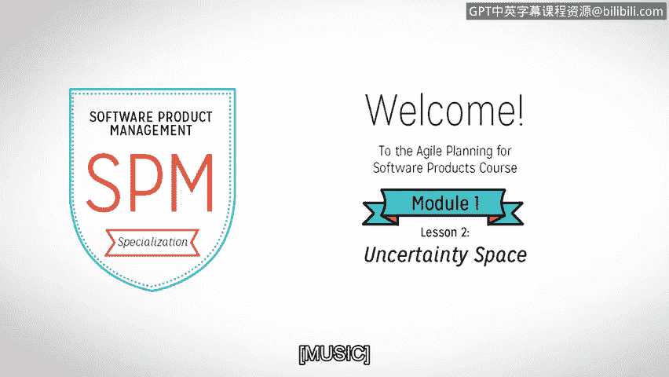
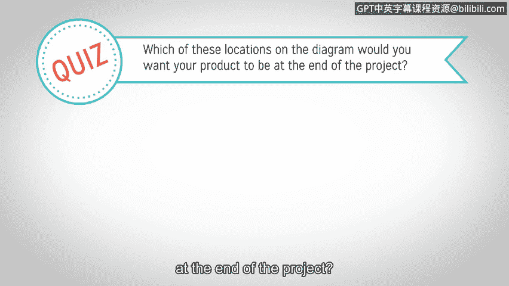
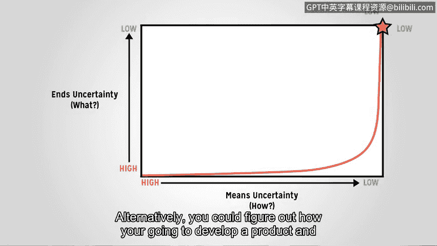
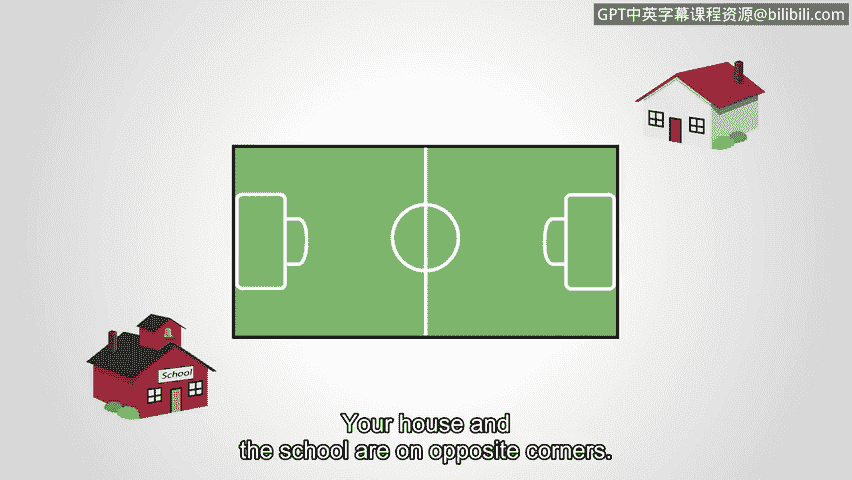
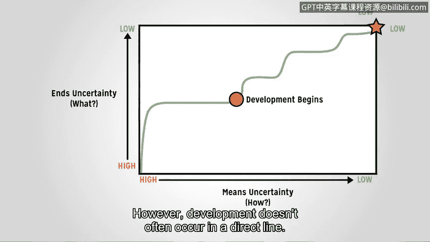

# 032：不确定性空间

## 概述
在本节课中，我们将要学习一个重要的概念：**不确定性空间**。这个工具能帮助我们理解在软件项目开发过程中，关于“做什么”和“怎么做”的不确定性是如何变化的，并指导我们更有效地规划项目路径。

## 不确定性空间的概念
启动一个软件项目可能令人望而生畏。你从哪里开始？到哪里结束？你的团队将如何开发？又将开发什么？你如何驾驭所有这些不确定性？

项目管理者研究员亚历山大·莱弗指出，需要同时处理两种类型的不确定性。Scrum方法论的贡献者之一迈克·科恩用一个基于不确定性的图表描绘了这个问题。

这个图表用于展示产品从概念、经过开发、到可运行状态的过程中，不确定性的水平。对于每个产品，你都需要弄清楚**你在创造什么**以及**你将如何开发它**。

## 理解坐标轴
项目开始时，这两者的不确定性通常都很高。理想情况下，你希望确切地知道你在生产什么，以及你的团队将如何实现它。但现实中存在很多不确定性，需求会变化，方法也会变化。

这个不确定性空间图沿X轴衡量**方法不确定性**。
*   **方法不确定性**指的是你项目的“如何”，即“你将如何开发这个产品？”。
*   你的项目应该从**高方法不确定性**走向**低方法不确定性**。

该图沿Y轴衡量**目标不确定性**。
*   **目标不确定性**指的是你项目的“什么”，即“你实际上在开发什么？”。
*   同样，这种不确定性也应该从**高**走向**低**。

## 分析图中的位置
请看不确定性空间图中的这些点：
*   **点A**：高方法不确定性，高目标不确定性。
*   **点B**：高方法不确定性，低目标不确定性。
*   **点C**：低方法不确定性，高目标不确定性。
*   **点D**：低方法不确定性，低目标不确定性。

**问题**：在项目结束时，你希望你的产品处于图中的哪个位置？

**答案**：希望在项目结束时，你拥有**低方法不确定性**（团队知道如何创建或已经创建了产品），同时拥有**低目标不确定性**（你知道你在创造什么）。因此，**答案D是正确的**。无论目标还是方法存在高不确定性，都表明产品仍有待解决的未决问题。

## 在不确定性空间中导航
接下来，我们看看如何利用这个图表来导航项目。

**第一种路径：先确定“做什么”，再确定“怎么做”**
这种方法要求你在规划如何完成需求之前，预先详细确定所有需求。这类似于遵循瀑布流程。如图所示，在方法不确定性开始显著变化之前，目标不确定性的水平已经很低。

这种导航方式不允许需求轻易变更，因为它们都是预先确定的，因此**不够敏捷**。

**第二种路径：先确定“怎么做”，再边做边确定“做什么”**
这种开发方式属于临时性开发，涉及很少的规划。基本上，开发团队会边摸索实现方案，边拼凑产品。

这不是开发软件的合理方式，可能导致工作浪费。

**最佳路径：在中间地带导航**
让我们用另一种方式来可视化这个过程。想象在你家和学校之间有一个足球场，家和学校在对角。

如果你从学校走回家，很可能不会绕着场地走。直接斜穿场地距离要短得多。同样，**斜向穿过不确定性空间所需的工作量也少得多**。

然而，开发过程通常不是一条直线。

常见的情况是，在开始设计如何完成需求之前，你会与客户和开发团队一起定义大部分需求。一旦确立了需求，你和开发团队将开始规划解决方案。此时，项目的目标和手段不确定性都降低了，这是开始开发的好时机。

随后，需求可能会改变或增加，解决方案也会相应改变。你的开发团队将实施这些更改，并朝着**目标和手段都具备低不确定性**的目标努力。

## 总结
无论你在不确定性空间中采取何种路径，你都将完成任务。在本节课中，我们一起学习了**不确定性空间图**，它帮助我们可视化项目在“目标”（做什么）和“方法”（怎么做）上的不确定性变化。理解这个空间有助于我们选择更高效、更敏捷的项目规划路径，避免在高度不确定性的区域停滞不前。

在下一课中，你将学习如何将工作分解为任务。