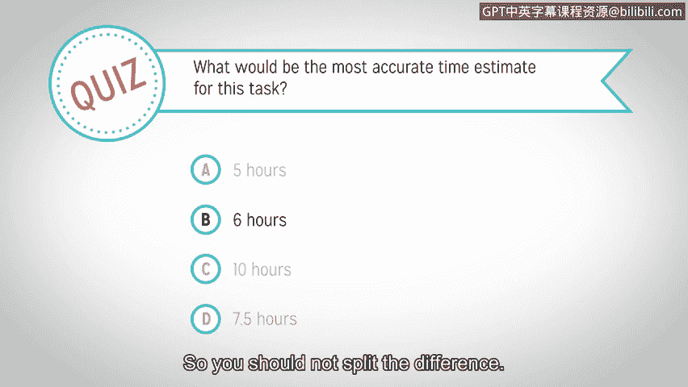
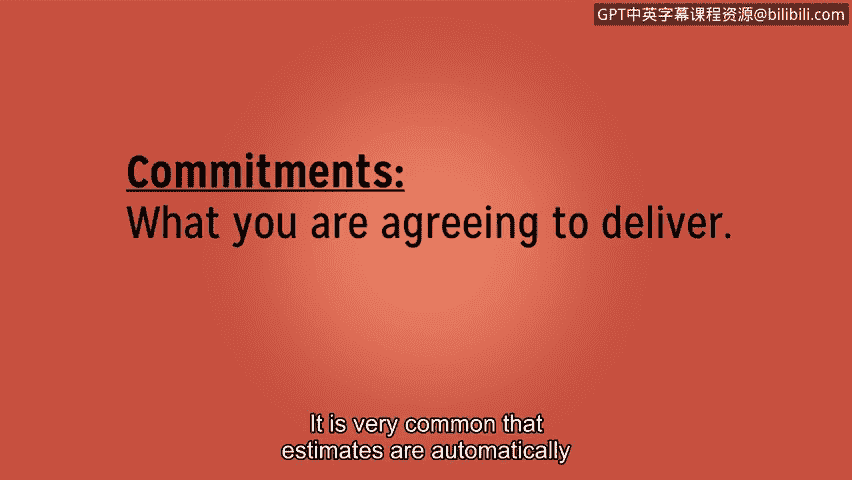
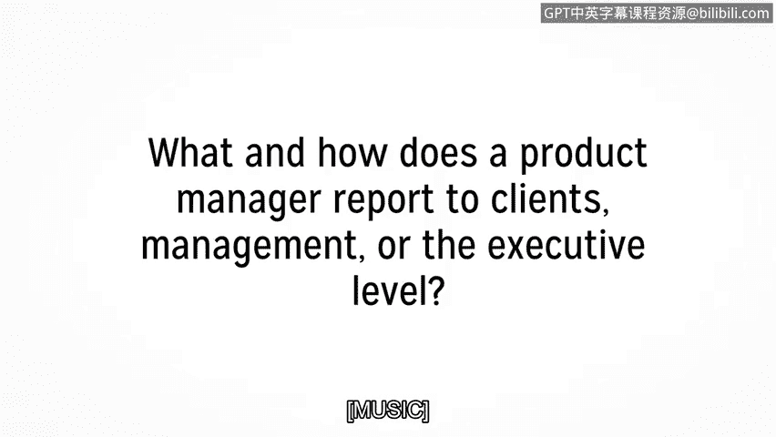

# 034：估算、目标与承诺 📊

在本节课中，我们将要学习软件项目管理中三个核心但常被混淆的概念：估算、目标与承诺。理解并区分它们对于团队协作和项目成功至关重要。

## 估算：基于数据的合理猜测

上一节我们介绍了敏捷规划的基本框架，本节中我们来看看第一个核心概念：估算。估算是指对开发团队完成任务所需时间的猜测。它应基于过往类似任务的数据，并且通常是一个范围，因为精确到小时或天数的预测往往不准确。最重要的是，估算本身不应被协商或讨价还价。

以下是关于估算的几个关键点：

*   **基于数据**：估算应参考过往类似工作的实际耗时。
*   **范围表示**：使用时间范围（如3-9小时）比单一精确数字更现实。
*   **不可协商**：估算反映的是客观预测，不应因主观意愿而改变。

让我们看一个例子。产品经理柯克询问开发人员莉兹开发某个功能需要多久。柯克根据以往经验猜测需要3小时。莉兹考虑到一些缓冲，告诉柯克需要9小时。柯克试图“折中”为6小时。**这不是正确的做法**。正确的估算应基于莉兹完成类似任务的历史数据，给出一个合理的范围。

**练习题**：你与开发人格雷格讨论为某个功能编写测试的耗时。你猜测需要5小时。格雷格刚为类似功能写完测试，花了6小时，但他想留些余地，所以告诉你需要10小时。以下哪个是最准确的估算？
A. 5小时
B. 6小时
C. 10小时
D. 7.5小时

**答案分析**：最准确的估算应基于过往的相似工作，尤其是同一执行者的数据。因此，B（6小时）是正确的。A和C分别基于管理者或开发者单方面的期望，容易导致估算不准确。D的“折中”做法违背了估算不可协商的原则，因此也不正确。

## 目标：必须遵守的时间节点

理解了估算后，我们再来看看目标。目标是计划中需要达成的某个时间点，近乎一个理想的截止日期。与估算一样，目标一旦确定，也不应被轻易更改。常见的例子包括冲刺（Sprint）的结束日期或产品发布日期。这些目标日期通常与市场活动安排或合同条款绑定，严格遵守它们对于客户满意度和产品成功非常重要。

## 承诺：基于协商的可交付范围

既然估算和目标都不可协商，那么如何确定最终要开发什么呢？这就是承诺发挥作用的地方。承诺是协商发生的地方。基于团队的估算和项目的时间目标（目标），你可以协商团队**承诺**在给定时间内完成哪些工作。你需要不断问自己：基于团队的估算和时间限制，我如何在开发团队承诺交付的内容上做出妥协？承诺就是你同意交付的东西。

一个常见的误区是，估算被自动转换成了承诺和目标。例如，如果你被问及开发一个产品需要多久，你估算需要7个月，那么这7个月就可能变成你的承诺，而7个月后的日期就成了你的目标。**这并非理想的工作方式**。

用一个比喻来说明：我帮一个家庭照看孩子，问父母何时回家。他们说“大概午夜回来”，这是一个**估算**。如果我要求一个**承诺**——如果那个时间点没回来，我将收取三倍费用——他们可能会说“12点半”，给自己留出缓冲时间。在软件开发中，理想的做法是与开发团队讨论得出准确的估算，与客户商定目标日期，然后基于这两者，与团队和客户共同确定项目的**承诺**（即范围）。

**练习题**：你与客户和开发团队开会。开发团队基于以往经验估算，完成客户想要的所有功能需要约8个月。客户希望产品在假期前完成，建议了一个7个月后的发布日期。最终，你们共同商定了一个包含约5个月工作量的范围。6个月后，团队完成了所有商定的功能。哪一项是承诺？
A. 8个月
B. 7个月
C. 6个月
D. 5个月

**答案分析**：开发团队最初提出的8个月是基于过往工作的**估算**（A错）。客户建议的7个月后日期是**目标**（B错）。实际花费的6个月是本次项目的实际耗时，可用于未来项目的估算，但本身不是本场景下的估算、目标或承诺（C错）。最终商定的5个月工作量范围，是团队实际承诺交付的内容，因此是**承诺**（D正确）。

请记住，估算和目标一旦设定就不可协商。你可以协商的是项目范围内你承诺交付的内容。务必小心，不要让估算直接变成承诺或目标。将这些概念区分开，并确保你的团队和客户也这样做，这将有助于控制项目范围不至于过大，并确保你能够真正达成目标日期。

## 行业实践：管理大型多团队项目

了解了核心概念后，让我们看看行业中如何管理涉及多人的大型项目。项目管理者常使用一种称为“工作流”或“项目流”的技术，将相关活动或项目分组，并为每个流分配协调员或项目经理，以理解各项目的具体需求和交付物，从而在项目群层面汇总并理解相互依赖关系。

**沟通与协作**：我们使用多种方式向客户、经理和高管汇报项目情况，包括状态报告、会议纪要、行动日志和风险登记册。同时，我们强调非正式沟通的重要性，遵循“无意外”哲学，通过即兴的口头或电话交流，提前同步信息、风险或问题，特别是对于那些可能没时间阅读详细文档的高管层。

**敏捷实践的挑战**：作为一个跨北美多个分支机构的虚拟团队，我们面临的主要挑战是如何管理和协作虚拟团队，例如在成员不 physically present 的情况下如何进行 Scrum 站会。实现跨地域团队的协作与统一对我们来说是一大挑战。

## 产品经理的职责框架

最后，我们简要了解一下产品经理的职责。顾问托德·巴塞尔提出了一个很好的框架，将产品经理的职责分为四个领域：

1.  **市场情报**：研究市场趋势、流行解决方案、 monetization 模型、客户行为及可用技术。
2.  **产品战略**：关注 monetization 模型、开发环境与技术能力的匹配，最重要的是定义**差异化优势**——我们如何与众不同，以及如何为真实世界的用户解决问题。
3.  **产品开发**：在战略明确后，开始制定路线图，规划如何构建产品及其形态。
4.  **生命周期管理**：管理产品从推出到退市的整个周期。

**协调不同利益相关者**：软件开发中常存在“代理问题”，即不同角色（如市场、销售、开发）因考核方式不同而追求不同的目标，且开发过程资源密集、进度不如各方期望的快。协调这些不同目标和风格的工作极具挑战性，需要大量沟通以了解各方需求、寻找共同点。技巧包括进行访谈、制作亲和图、统一语言（例如，解释技术术语），并始终围绕“我们为解决用户的什么问题而存在”这一核心来聚焦讨论。

## 总结

本节课中我们一起学习了软件项目管理中三个关键概念：**估算**（基于数据的不可协商的猜测）、**目标**（不可协商的必须达成的时间点）以及**承诺**（基于估算和目标协商得出的可交付范围）。区分并正确运用这三者，是进行有效敏捷规划、控制项目范围和确保按时交付的基础。在下一个模块，布拉德利将教你如何创建准确的估算，并利用这些估算来组织项目发布的任务。