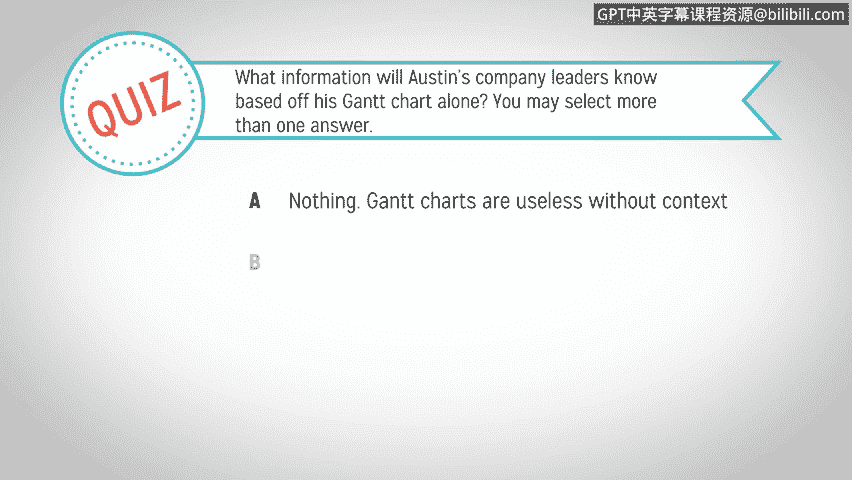

# 039：甘特图

欢迎来到下一节课。在上一节课中，我们介绍了使用“时间盒”技术来规划项目的价值。

在本节课中，我们将学习另一种项目规划技术：甘特图。与时间盒不同，甘特图并非组织时间的一般性方法，而是一种用于可视化展示项目计划工作的图表工具。甘特图能为你提供项目的长期和短期洞察，它们非常有价值，并能对项目的成功产生巨大影响。

## 什么是甘特图？📊

甘特图是一种用于可视化项目的简单工具。其基本理念是，它能在一个视图中同时展示项目的**计划**、**任务依赖关系**和**截止日期**。

一个基础的甘特图由**任务**和**日期**构成。

*   任务（通常来自工作分解结构）沿着图表的左侧纵向排列。
*   日期沿着图表的顶部横向排列。

每个任务被逐一列出，计划中第一个开始的任务位于最顶部。该任务的开始日期，由一条在对应顶部日期下方绘制的横条的起点表示。这条横条从开始日期延伸至该任务计划完成的日期。

当所有任务都布局好后，你就能清晰地看到每个独立任务计划于何时开始与结束。

## 甘特图与敏捷兼容吗？🤔

你可能会问：这难道不是非常不“敏捷”吗？如果甘特图只是一系列顺序排列的任务列表，那它岂不是更适合瀑布式流程？

答案是：如果你只是毫无上下文地一个接一个列出任务，那确实如此。然而，你可以在甘特图中添加更多信息。例如，你可以将图表的某些部分划分为不同的区块，并标记为“冲刺”。这种做法完全可行，并且只要你允许这个计划根据实际情况进行调整，它就同样是完全敏捷的。

你可以利用甘特图来获取关于项目的一些关键洞察。其中最明显的几点包括：你能够大致看到项目将于何时完成，以及哪些任务会同时进行。

## 案例分析：甘特图能展示什么？

奥斯汀是一位软件产品经理，正与软件开发团队合作。他选择使用甘特图向公司领导层展示项目计划，以说明项目进度安排。

基于奥斯汀的甘特图，公司领导层将能了解到哪些信息？（可多选）

A. 没有信息，没有上下文的甘特图毫无用处。
B. 项目任务依赖关系。
C. 预估的任务时长。
D. 项目预算。

正确答案是 **B 和 C**。甘特图使你能够看到项目的任务时长，同时也能展示任务之间的依赖关系。

接下来，让我们详细探讨一下任务依赖关系。

## 任务依赖关系与关键路径 🔗

甘特图不仅仅是日历和待办事项列表的混合体。如果你在甘特图中包含了任务依赖关系，它们会变得更有用。

以下是具体做法：

1.  在创建甘特图之前，先列出将要包含在图中的所有任务。
2.  找出哪些任务需要等待另一个任务完成后才能开始。例如，假设你有两个任务，如果第二个任务必须等到第一个任务完成后才能启动，那么我们就说第二个任务**依赖于**第一个任务。
3.  在你的任务列表中，在第二个任务旁做标记，注明它依赖于第一个任务。
4.  为所有任务及其依赖关系重复此过程，现在你就得到了一个通过依赖关系紧密关联的完整任务列表。

当你将这些信息转化为甘特图时，你仍然像之前一样列出所有任务及其起止日期。唯一的不同是，你现在知道某些任务必须等待其他任务完成后才能开始。在甘特图上，这通常用一个从被依赖任务指向依赖任务的箭头来表示。

将任务依赖关系如此清晰地展示出来的一个巨大好处是，你可以非常容易地看到项目的**关键路径**。这让你能够明确资源的最佳投入方向，并了解在什么时间需要完成什么工作。摩根将在下一个模块中更详细地讨论任务依赖关系和关键路径。

## 甘特图的应用层级 📈

需要指出的是，甘特图可以在“迭代”或“发布”层级使用。

*   在**迭代层级**，你可以用它来洞察当前冲刺时间盒内未来几天的任务安排。
*   在**发布层级**，你可以使用**用户故事**而非具体任务作为图表中的工作单元，从而对未来几个冲刺中的用户故事获得洞察。

## 总结

以上就是甘特图。它是一种用于可视化项目计划的超级简单的方法。市面上有大量工具可以帮助你创建甘特图。

在下一节课中，我将整合本模块讨论的许多内容，并介绍**发布计划**。发布计划是项目成功的关键方面，请不要错过。