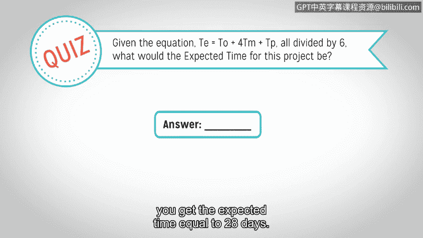

# 042：14_02_4-3-1a-任务时间估算


在本节课中，我们将学习一种使用公式来改进任务时间估算的方法。这种方法通过计算一个时间范围，而非单一数字，来更准确地反映项目时间的不确定性。

## 概述

由于项目执行中存在各种变数，一个估算值应该是一个范围，而不是一个单一的数字。本节将介绍一个基于三个关键时间点的公式，用于计算这个估算范围。

## 核心公式介绍

上一节我们介绍了多种估算方法，本节中我们来看看如何通过一个数学公式来生成更可靠的估算范围。这个公式基于三个时间点：

*   **最可能时间**：我们称之为 **TM**。这是你对任务或项目最可能花费时间的估计。
*   **乐观时间**：我们称之为 **TO**。这是在一切顺利、团队高效工作的情况下，完成任务所需的最短时间。
*   **悲观时间**：我们称之为 **TP**。这是在最坏情况下，完成任务所需的最长时间。

基于这三个数值，我们将计算两个关键结果：

1.  **期望时间**：我们称之为 **TE**。
2.  **偏差**：我们称之为 **σ**（西格玛）。在数学中，σ 常用来表示标准差或偏差。

偏差值越小，说明乐观时间和悲观时间之间的差距越小，你的估算范围也就越精确。

## 计算公式

以下是计算期望时间和偏差的具体步骤。

### 计算期望时间

期望时间 **TE** 的计算公式如下：

**TE = (TO + 4 × TM + TP) / 6**

这个公式为最可能时间赋予了更高的权重。

### 计算偏差

偏差 **σ** 的计算公式如下：

**σ = (TP - TO) / 6**

这个公式衡量了估算的不确定性范围。

### 计算估算范围

得到 **TE** 和 **σ** 后，你就可以计算估算范围了。

*   要得到范围的下限，用期望时间减去偏差：**TE - σ**
*   要得到范围的上限，用期望时间加上偏差：**TE + σ**

用数学术语表示，这个范围就是 **TE ± σ**。

这个范围（TE ± σ）意味着实际任务时间有 **68.3%** 的可能性落在此区间内。

如果你希望估算更加可靠，可以将偏差加倍，从而得到一个更宽的范围：**TE ± 2σ**。这个范围意味着实际任务时间有 **95.5%** 的可能性落在此区间内。

你需要根据项目情况决定哪个更重要：是一个范围更大但准确率高达95.5%的估算，还是一个范围更小但准确率只有68.3%的估算。

## 应用示例

让我们通过一个例子来具体应用这些公式。

假设我们有以下数据：
*   最可能时间 **TM** = 15 天
*   乐观时间 **TO** = 12 天
*   悲观时间 **TP** = 30 天

**第一步：计算期望时间 TE**
```
TE = (TO + 4 × TM + TP) / 6
   = (12 + 4 × 15 + 30) / 6
   = (12 + 60 + 30) / 6
   = 102 / 6
   = 17 天
```

**第二步：计算偏差 σ**
```
σ = (TP - TO) / 6
  = (30 - 12) / 6
  = 18 / 6
  = 3 天
```

**第三步：计算估算范围**

*   **68.3% 可能性范围**：TE ± σ = 17 ± 3 天 → **14 到 20 天**
*   **95.5% 可能性范围**：TE ± 2σ = 17 ± (2×3) 天 → **11 到 23 天**

可以看到，95.5%可能性对应的范围（11-23天）比68.3%可能性对应的范围（14-20天）更宽。



> **注意**：如果计算结果不是整数，**务必向上取整**。例如，54.5天取整为55天，6.9天取整为7天，23.1天取整为24天。

## 练习题

为了帮助你掌握这些公式，建议你完成课程提供的练习工作表。工作表包含了三个示例，并附有分步解答的答案页。亲自进行计算对于牢固掌握这一估算技巧至关重要。

## 总结

本节课我们一起学习了如何使用 **PERT（计划评审技术）** 公式进行任务时间估算。我们了解了如何通过**最可能时间（TM）、乐观时间（TO）和悲观时间（TP）** 来计算**期望时间（TE）** 和**偏差（σ）**，并据此生成具有不同置信水平（68.3% 或 95.5%）的估算范围。这是一种量化估算不确定性、提高规划可靠性的有效方法。

现在你已经学会了如何生成估算，接下来我们可以开始讨论迭代计划。在下一课中，我们将探讨任务依赖性以及如何在迭代规划中考虑它们。