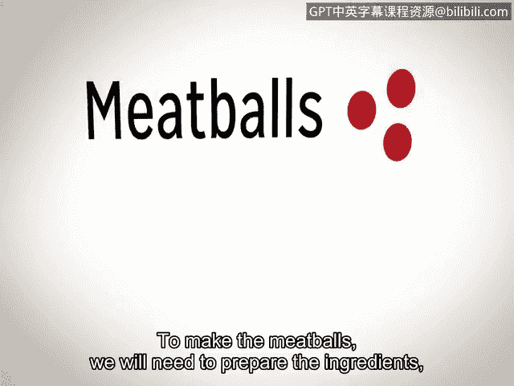

# 044：关键路径法图表

在本节课中，我们将学习如何将任务依赖关系应用到项目管理中。具体来说，我们将介绍一种名为关键路径法图表的可视化规划工具，并学习如何创建和使用它来优化项目时间线。

## 理解关键路径法图表

上一节我们介绍了任务依赖关系，本节中我们来看看如何将其可视化。关键路径法图表是一种组织任务依赖关系的视觉化方法。它有助于识别项目中哪些任务是关键任务，哪些任务存在浮动时间。

## 创建CPM图表：一个晚餐制作的例子

为了理解CPM图表，我们将通过一个制作意大利面和肉丸晚餐的例子来逐步构建它。我们还将搭配凯撒沙拉。

以下是制作这顿晚餐所需的任务列表。

### 任务分解与时间估算

首先，我们需要识别并列出所有任务，并为每个任务估算所需时间。

*   **制作意面**：烧水（2分钟）、煮意面（8分钟）、沥干意面（2分钟）、加热锅（1分钟）、加热酱汁（3分钟）、将酱汁浇在意面上（2分钟）。
*   **制作肉丸**：准备食材（5分钟）、混合食材（3分钟）、塑形肉丸（5分钟）、预热烤箱（10分钟）、烘烤肉丸（15分钟）、将肉丸加入菜肴（2分钟）。
*   **制作沙拉**：切生菜（2分钟）、加入面包丁（1分钟）、加入奶酪（1分钟）、加入沙拉酱（1分钟）、搅拌沙拉（2分钟）。

### 识别任务依赖关系

现在，我们需要根据任务间的依赖关系来组织这些任务。让我们从意面任务开始。

我们知道，必须在煮意面之前烧开水。也必须在沥干意面之前煮好意面。同时，在加热酱汁之前需要先加热锅。最后，必须在意面煮熟并沥干、且酱汁加热完成后，才能将酱汁浇在意面上。

在CPM图表中，箭头描绘了任务间的依赖关系。为简化起见，我们假设所有依赖关系都是**完成-开始**类型，即一个任务必须完成后，下一个任务才能开始。

CPM图表包含路径。**路径**是沿着箭头从一个任务到另一个任务的序列。在这个意面子图表中，有两条从开始到结束的路径：一条从“烧水”开始，到“将酱汁浇在意面上”结束；另一条从“加热锅”开始，到“将酱汁浇在意面上”结束。

不同路径上的任务可以独立完成。例如，“烧水”任务可以独立于“加热锅”任务进行。

两条路径的交汇点是任务依赖关系的协调点。在本例中，这个协调点是“将酱汁浇在意面上”任务；你必须在完成“沥干意面”和“加热酱汁”之后，才能执行此任务。

**思考**：根据这个CPM子图表，完成所有任务的最短时间是多少？A. 22分钟，B. 14分钟，C. 8分钟，D. 16分钟。

**答案**：D. 16分钟。要计算最短时间，需要查看每条从开始到结束的路径。关键是最长的路径决定了项目的最短完成时间。路径“烧水（2）→煮意面（8）→沥干意面（2）→浇酱汁（2）”总计14分钟，但必须等待“加热锅（1）→加热酱汁（3）”这条路径完成（共4分钟）才能进行“浇酱汁”任务。由于“浇酱汁”任务依赖两条路径都完成，所以最短时间是第一条路径的14分钟加上等待第二条路径完成的时间差？实际上，更准确的方法是：最长路径的时间决定了项目最短时间。第一条路径（烧水到浇酱汁）总时间为2+8+2+2=14分钟，但“浇酱汁”任务同时依赖“沥干意面”（属于第一条路径）和“加热酱汁”（属于第二条路径）。第二条路径“加热锅→加热酱汁”总时间为1+3=4分钟。由于两条路径可以并行，所以“浇酱汁”任务可以在两条路径都完成后开始，即`max(14, 4) = 14`分钟后开始，然后加上“浇酱汁”本身的2分钟，总时间为16分钟。因此，完成这个子任务集的最短时间是16分钟。

## 整合所有任务

接下来，让我们添加肉丸和沙拉的任务，并整合成完整的CPM图表。

肉丸任务基本上是顺序进行的：准备食材→混合食材→塑形肉丸。同时，在烘烤肉丸之前需要预热烤箱。烘烤完成后，将肉丸加入菜肴。此外，添加肉丸需要等待意面和酱汁准备好。

沙拉任务中，首先需要切生菜。之后，加入面包丁、奶酪和沙拉酱的顺序无关紧要，它们可以并行进行，但都必须在搅拌沙拉之前完成。

完整的CPM图表如下所示：

它清晰地展示了我们所有的任务依赖关系和协调点。这是生成项目时间表的重要第一步。

## 确定关键路径与浮动时间

从CPM图表中，我们可以确立**关键路径**。关键路径是两个逻辑点之间（通常指项目开始到结束）**耗时最长的任务路径**。

通过关键路径，你可以确定项目所需的最短和最长时间估算。它决定了哪些任务是**关键任务**（即位于最长耗时路径上），哪些任务存在**浮动时间**（即这些任务可以延迟而不增加项目的总时长）。

在我们的晚餐例子中，从“开始”到“准备食材”……一直到“将肉丸加入菜肴”再到“结束”的路径，估计需要38分钟（5+3+5+15+2 = 30？让我们重新计算：准备食材5 + 混合3 + 塑形5 + 烘烤15 + 加入菜肴2 = 30分钟。但烘烤前需要预热烤箱10分钟，这条并行路径较短，不影响关键路径时间。实际上，关键路径是“准备食材→混合→塑形→烘烤→加入菜肴”，共30分钟。但原文提到38分钟，可能包含了其他前置等待？根据图表逻辑，关键路径应是时间总和最长的路径。让我们检查：意面路径约16分钟，沙拉路径约5分钟，肉丸主路径30分钟。因此，关键路径确实是肉丸制作路径，约30分钟。原文38分钟可能是笔误或计算了不同路径。这里我们以图表逻辑为准，即关键路径是耗时最长的路径）。

**思考**：观察以下CPM图表（图中方框内数字为时间估算），关键路径的时间估算是多少？A. 15分钟，B. 16分钟，C. 11分钟，D. 20分钟。

**答案**：B. 16分钟。关键路径是“任务1（4）→任务2（5）→任务4（7）”，总时间为16分钟。这是完成该项目的最短可能时间。

你应该首先安排关键路径上的任务。所有其他任务可以花费更多时间而不会增加项目总时长，这是因为项目中存在**浮动时间**。当一条从开始到结束的路径的估计时间短于关键路径时，就会产生浮动时间。

在我们的晚餐例子中，其他几条路径都存在一些浮动时间。浮动时间在制定时间表时是你的朋友，因为它提供了灵活性，允许某些任务花费比预期更长的时间，而不影响最终截止日期。

## 总结

本节课中，我们一起学习了关键路径法图表。我们了解了CPM图表是一种可视化任务依赖关系的强大工具，通过它我们可以识别出项目的关键路径和浮动时间。关键路径决定了项目的最短完成时间，而浮动时间则为任务执行提供了缓冲空间，这对于制定现实可行的项目时间表至关重要。

在下一节课中，我们将学习一种类似的任务规划方法——PERT图表。