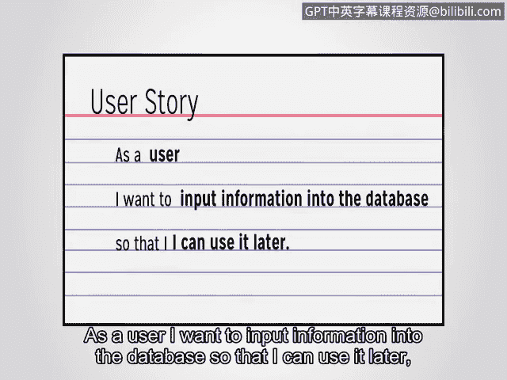
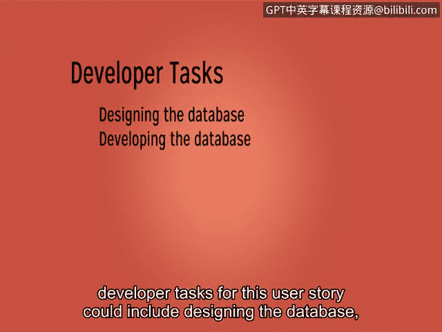
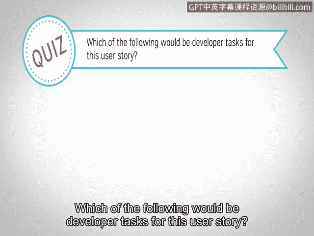

# 046：迭代规划 🗓️

在本节课中，我们将学习敏捷开发中的迭代规划。迭代规划是确保开发团队按计划推进工作的关键环节，它帮助团队维持一个高效且可持续的开发节奏。

## 什么是迭代规划？

上一节我们介绍了发布规划，本节中我们来看看更具体的迭代规划。

迭代规划对于确保开发人员专注于任务、项目按计划进行至关重要。它帮助开发团队避免在每个迭代中过度承诺或工作量不足，从而维持一个高效且可持续的开发节奏。

迭代规划是大多数敏捷方法的一部分。值得注意的是，Scrum和极限编程都使用迭代规划。在本课中，我们将使用来自Scrum的术语，例如冲刺、产品负责人和Scrum主管。这些术语在《软件过程与敏捷实践》课程中已作介绍。在这里，迭代和冲刺是同义词。

## 迭代规划会议

迭代计划在冲刺规划会议中生成。这些会议应该是限时的。这意味着会议时长在会议开始时就被固定下来，并且必须严格遵守。这可以防止会议偏离主题，并避免不必要的过度规划。对于首次冲刺规划会议，四小时通常是一个合适的限时。

以下是冲刺规划会议的关键步骤：

**1. 确立冲刺目标**
如果未在发布规划中完成，团队应在冲刺规划会议开始时确立一个冲刺目标。这是所规划冲刺的总体关注点，有助于保持开发工作聚焦于相关任务。

**2. 报告上一冲刺的项目速率**
这是一个重要步骤。本次冲刺的所有开发承诺都将基于此速率。但如果上一个冲刺是异常的，不能代表团队的实际开发速率呢？在这种情况下，应使用之前冲刺中的最低速率。

**思考题**
你和你的开发团队已进入项目的第四个冲刺。你正在为此冲刺举行规划会议。在第一个冲刺中，你的团队完成了待办事项列表中10个故事点的工作。在第二个迭代中，你的团队完成了12个故事点。在第三个冲刺中，你的团队遇到了硬件故障，导致损失了一些开发天数。故障现已修复，但你的团队只完成了为该冲刺计划的5个故事点的工作。你知道应该基于前一个冲刺来规划第四个冲刺的开发，但你认为它不能代表团队的开发速率。你查看发布计划，发现有13个故事点的用户故事被安排。你认为应该基于多少个故事点来做出承诺？A. 10个故事点，B. 12个故事点，C. 5个故事点，或D. 13个故事点。

**答案**
如果团队经历的冲刺速率与通常的开发速率相比是异常的，那么不应将该速率用于后续冲刺。它不能代表团队的通常产出。在这种情况下，应基于项目中先前的最低速率进行估算。在此示例中，先前的最低产出是10。在生成即将到来的冲刺的迭代计划时，应使用此值。因此，A是正确答案。

## 确定与分解任务

接下来，确定冲刺的所有潜在用户故事。这包括根据发布计划计划在此冲刺中完成的所有用户故事，也可能包括任何未完成但本应在上一迭代中完成的用户故事。这些未完成的用户故事是那些未满足团队“完成定义”的故事。团队遵守他们承诺的“完成定义”非常重要。这些用户故事可能包括任何未能通过验收测试的故事。

从潜在用户故事中，产品负责人将选择他们希望在此冲刺中完成的故事。请记住，这是基于先前的速率。因此，只要所选用户故事的故事点估算总和小于或等于速率，产品负责人就可以继续选择用户故事。所有其他未被选中的用户故事必须等到未来的冲刺。

然后，被选中的用户故事被分解为开发人员任务。这由开发团队完成，无需产品负责人参与。开发人员任务应足够小，以便能在一两天内完成。

以一个通用用户故事为例：
> 作为一个用户，我希望将信息输入数据库，以便以后可以使用它。

以下是此用户故事可能的开发人员任务：
*   设计数据库
*   开发数据库
*   在用户界面上创建输入字段
*   为此功能创建文档
*   为此功能编写测试
*   为此功能运行测试

**思考题**
你是一个音乐流媒体应用开发团队的软件产品经理。你的开发团队正在根据迭代的用户故事确定开发人员任务。你遇到了这个用户故事：“作为一名听众，我希望将歌曲保存到播放列表，以便以后可以轻松找到这些歌曲进行播放。”以下哪项是此用户故事的开发人员任务？
A. 编写测试以确保保存的歌曲出现在播放列表中。
B. 编写将歌曲保存到播放列表的功能程序。
C. 为应用程序生成线框图。
D. 向使用手册中添加将歌曲添加到播放列表的说明。

**答案**
编写测试、编程功能和创建文档都是源自用户故事的常见开发人员任务。因此，答案A、B和D都是正确的。应用程序的线框图应该已经在早期的需求或用户界面设计活动中确定。添加歌曲的功能不会显著改变用户界面，因此生成线框图不会是此用户故事的开发人员任务。

## 估算任务与调整承诺

接下来，开发人员需要共同估算他们认为每项任务需要多长时间。Scrum团队是跨职能的，因此任何开发人员都应该能够承担任何任务。然而，开发人员的工作节奏各不相同，因此每项任务估算实际上是团队商定的平均值。如果一项任务需要专业技能并且必须分配给特定人员，那么估算可以基于该人员。尽管如此，团队必须同意。

任务估算应以小时、半天或天为单位。小于一小时的小任务应分组在一起。此外，估计需要超过三天的大型任务应分解为更小的任务。

一旦完成任务估算，就需要重新审视为冲刺选择的用户故事。考虑到开发人员的总可用时间和任务估算，所选用户故事的开发人员任务能否在冲刺内合理安排并实际完成？如果无法完成所有用户故事，那么开发人员需要调整他们的承诺。产品负责人需要移除用户故事，直到剩余故事的任务总估算时间与开发人员的总可用时间相匹配。被移除用户故事的相关开发人员任务也从迭代计划中移除。

相反，如果用户故事可以完成且剩余大量时间，那么产品负责人可以选择额外的用户故事。开发人员仍然需要确定这些故事的相关开发人员任务。只要任务的总估算时间不超过开发人员的总可用时间，产品负责人就可以向冲刺添加用户故事。

在迭代级别生成的任务估算会覆盖在发布计划中生成的用户故事估算，因为它们更具体且可能更准确。你可能需要相应地调整发布计划。由于这种不确定性，发布计划通常只规划未来最多几个冲刺，并定期调整。

## 任务认领与总结

现在是你的开发团队认领任务的时候了。认识到他们自我分配任务很重要，而不是由经理进行分配。自我分配使开发人员从事他们感兴趣的任务，这带来了更快乐的开发人员和更好的软件。

与为冲刺选择用户故事的方式类似，开发人员应根据他们的可用时间自我分配和选择任务。这也允许开发人员考虑他们在工作中可能参与的其他承诺和项目。

现在，你、你的产品负责人和你的开发团队都对即将到来的冲刺中对他们有何期望达成了共识。你们基于速率、任务估算和可用时间生成了一个现实的承诺。开发人员都知道他们将完成什么以及对他们有何期望。你的产品负责人确切知道在下一次产品演示中可以期待什么。目前，在开发领域一切顺利。

在下一个模块中，Bradley将带你了解风险规划的基础知识。识别、缓解和准备风险是一个重要的规划步骤，可以使你的产品免受不可预见问题的影响。

**本节课中我们一起学习了迭代规划的完整流程，从召开限时会议、确立目标、基于速率选择用户故事，到将故事分解为任务、估算时间、调整承诺，最后让开发人员自我认领任务。这个过程确保了团队对冲刺工作有清晰、一致且现实的规划。**