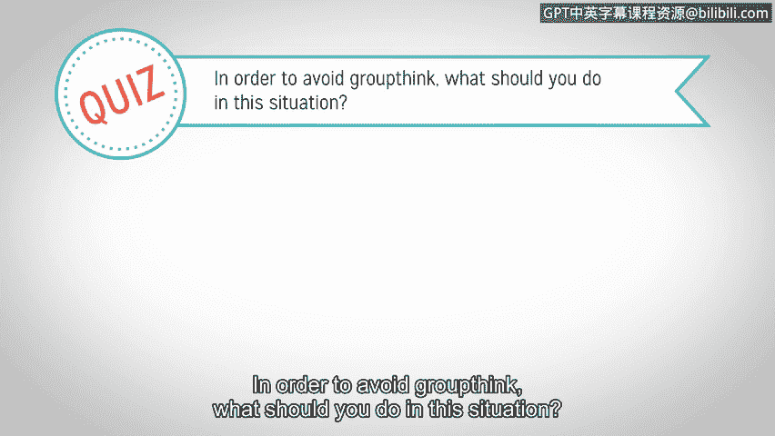

# 047：反模式

欢迎来到《面向软件产品的敏捷规划》课程的最后一个模块。

在前三个模块中，我们学习了制定优秀计划并为项目真正成功奠定基础所需的工具。这些工具非常有价值，请务必多加练习使用。

然而，还有一个关键部分缺失了。缺失的部分是如何处理那些可能导致一个规划完美的敏捷项目失控的个体风险。在本课程中，你们可能“知道自己不知道”的，正是运行软件项目所伴随的风险。简单来说，你知道有风险，但不确定具体是哪些风险。

本模块将重点揭示其中许多风险，并向你展示如何尽可能地减轻这些风险。

让我们开始吧。在本节课中，我将介绍反模式。

## 什么是反模式？

反模式本质上是指项目可能失败的常见方式。当然，你希望尽可能避免它们，而避免它们的最佳方法就是了解它们是什么。

**反模式** 是项目中一种常见的情况，它会带来负面后果。

存在大量不同的反模式。有些与编写代码有关，有些与软件架构有关，还有一些与软件项目管理方式有关。由于这是一门软件产品管理课程，我们将重点关注属于管理类别的那些反模式。

许多反模式被不同的作者赋予了不同的名称，但其核心思想是相同的。即使在管理层面，也存在许多不同的反模式。因此，我将只介绍其中的几个。

如果你想查看完整的反模式列表，请查阅课程资源。在那里，我列出了链接，供你根据需要探索更多反模式。

管理反模式主要围绕人展开。项目可能因个人或群体的行为方式而失败。

接下来，我们先从涉及群体的问题开始，然后再讨论与个人相关的问题。

## 群体反模式

以下是几种常见的群体反模式。

### 分析瘫痪

分析瘫痪通常发生在你的开发团队陷入项目的规范阶段时。客户或产品经理可能试图预先完全分析产品需求，并在该分析达到完美之前无法确定产品方向。

这对项目的进展和成功是有害的，因为它通常意味着你的开发团队停滞不前。由于在分析中“瘫痪”，项目最终会不必要地延迟。开发人员发现这种情况令人沮丧。他们已准备好开始开发，但你更害怕选错道路，而不是取得任何实际进展。

结果，你最终不是把事情做完，而是坐着等待更多信息才能取得进展。这不符合敏捷精神，你当然应该尽可能避免。

作为软件产品经理，避免这种情况的最佳方法是运行一个**增量发布**的敏捷项目。如果你在项目开始时并不了解所有事情，那没关系，你不需要预先知道一切，因为你在整个项目中为灵活性和变更留出了空间。如果每个人都理解项目将随着时间的推移而完善，无需预先了解一切，事情进展会快得多。

**示例场景**：Tanya 是一名软件产品经理。她和她的开发团队在过去一个月里一直试图与客户细化需求，以确保在开始构建之前一切都完美无缺。她掌握了所有需求的基本信息，其中一些已经可以开始，但整个产品尚未完全定义。考虑到她的产品没有完全定义，Tanya 的最佳行动方案是什么？

A. 向客户探寻更多信息。
B. 用她已有的信息开始开发。
C. 继续细化需求。
D. 放弃项目，没有希望了。

**正确答案是 B**。找出你的项目是否可行的唯一真正方法就是去构建它。Tanya 已经陷入了分析瘫痪。她最好继续前进。

### 本末倒置

这是一个常见的英语习语，讽刺做事顺序颠倒、事倍功半的做法。在软件产品管理中，“本末倒置”的定义与此非常相似。

**本末倒置** 指的是过分强调项目中应该稍后完成的部分。

一个很好的例子是，程序员被从开发一个关键功能中抽调出来，去开发一个目前并不需要的功能。通过本末倒置，团队可能会发现自己有很多重要性不一但开发不佳的功能。更好的选择是拥有少数几个开发良好且重要的功能。

为了避免本末倒置，开发团队必须将精力集中在**当前需要完成**的事情上，而不是未来需要完成的事情上。

### 群体思维

群体思维是一种可能使软件项目瘫痪的反模式。群体思维是社会科学中的一个术语，描述了人们倾向于追随群体的普遍意见，即使他们个人并不同意。这种现象导致了许多问题，不仅仅是在软件领域。糟糕的决策可能是群体思维的结果。

群体思维导致行动的一个很好的例子是，当一群开发人员协作设计产品架构时。如果你曾经是这样一个小组的一员，你可能已经注意到，一两个人的想法可能会主导会议。其他不那么健谈的开发人员为了**避免冲突**而保持沉默。这可能导致产品不佳。通常，存在一些小组没有讨论的选项。

如果以建设性的方式管理，冲突是可以接受的。避免群体思维的一种方法是**无声地**生成问题解决方案。

还记得《软件过程与敏捷实践》课程中的精益软件开发吗？精益通过将团队分成多个小组来解决这个问题，每个小组负责构想自己的解决方案。然后，当所有小组都制定出自己的解决方案后，团队再聚在一起，将这些解决方案结合起来。这是最小化群体思维影响的好方法。

我建议你在个人层面也这样做。与其让团队分成更小的小组，不如让每个人在纸上写下自己的解决方案，**不许交谈**。然后大家再聚在一起，团队可以依次讨论每个人的想法。这可以防止一两个人主导小组讨论。

**示例场景**：你是一名软件产品经理，正在与你的开发团队开会，试图找到解决客户问题的最佳方案。团队正在讨论解决方案，但你注意到你的一位开发人员对主流解决方案似乎感到不安。为了避免群体思维，在这种情况下你应该怎么做？

A. 什么都不做。如果开发人员有话要说，他们会说出来。
B. 让这位开发人员当场表态，挑战他说出自己的想法。
C. 引导小组在比较想法之前，先把所有想法写在纸上。
D. 把开发人员拉到一边，告诉他主流方案通常是最好的。

**这里的正确答案是 C**。为了避免针对任何人，一个好的策略是让你的开发人员各自离开，在纸上写下解决方案，然后再比较。这样，每个人的想法都能得到表达。

## 总结

在本节课中，我们一起学习了软件项目管理中的几种常见反模式。我们了解了**分析瘫痪**如何导致项目停滞，**本末倒置**如何分散团队对优先级的关注，以及**群体思维**如何抑制创新并导致次优决策。理解这些反模式是避免它们的第一步。通过采用增量开发、聚焦当前优先级以及鼓励独立思考等方法，我们可以有效地减轻这些风险，引导项目走向成功。