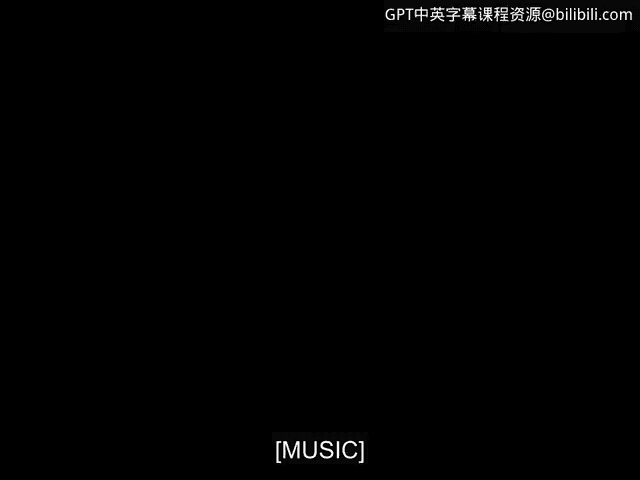
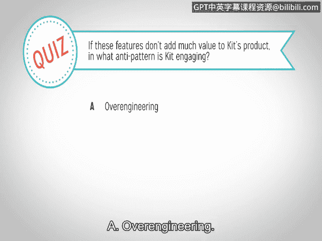

# 048：反模式

在本节课中，我们将要学习软件开发中常见的几种“反模式”。反模式指的是一些看似合理、但实际上会降低效率或导致问题的常见做法。了解并避免这些反模式，对于实施敏捷规划和构建成功的软件产品至关重要。

## 团队孤岛

上一节我们介绍了通过分组讨论来激发创意的方法。然而，在组织日常工作中，团队也可能被分割成独立的小组。

虽然独立的团队通常能高效地完成工作，但也容易导致这些团队之间失去联系。

当一个团队与其他团队失去联系时，我们称之为“团队孤岛”。

团队孤岛对软件开发组织是有害的。它代表了组织内部沟通的缺失。这很容易导致公司失去统一的形象，并让适得其反的管理策略有机可乘。开发人员不是与其他团队开放协作，而是在“真空”中开发功能。一个开发团队创造的产品，可能与走廊另一头的另一个团队的产品截然不同且互不兼容。

如果这两个团队在某个时间点需要合作，会发生什么？在没有定期沟通的情况下，这绝非易事。

有很多方法可以解决这个问题。最好的方法之一是减少组织中的管理层级。

如果你的组织拥有相对扁平的管理结构，就可以避免很多办公室官僚作风，并让人们直接交流，最好是面对面交流。

另一种避免孤岛的方法是，在组织内营造积极的跨团队沟通氛围。如果团队鼓励协作，项目成功的可能性将远高于大家对协作漠不关心的情况。

以下是关于团队沟通结构的选择题：

Abel是你的一名顶尖开发人员。他来找你，希望你能帮助他与一个开发团队沟通，该团队开发了他正在改进的产品。他已经尝试联系其他开发人员，但他们总是让他去找管理层。

Abel要获得所需信息，理想的组织结构是什么？
A. 横向：开发人员可以直接与其他开发人员交谈。
B. 纵向：开发人员与经理交谈，经理再与其他经理交谈。
C. 对角线：开发人员与其他团队的经理交谈。

正确答案是 **A**。如果允许Abel与最初编写他现在要改进的代码的人交谈，他将获得最有用的信息。与经理交谈是一种效率相当低下的做法，尽管这在组织中很常见。

## 供应商锁定

另一个常见的反模式叫做“供应商锁定”。顾名思义，当开发团队围绕单一技术解决方案或供应商创建产品并严重依赖它时，就会发生供应商锁定。

使用一项技术是因为它是最佳选择，这是一回事；使用一项技术是因为它是唯一可能的选择，则是另一回事。

在供应商锁定的情况下，开发团队会在不知不觉中导致他们的产品在未来依赖于一项技术。如果有一天该技术无法满足他们的需求，就会导致无法适应变化。

我见过最糟糕的供应商锁定案例之一，是一个使用供应商专有编程语言的软件项目。通过使用这种语言，该组织被迫使用该供应商提供的所有其他产品：专有文件格式、函数、数据格式等等。

最糟糕的是，该组织使用该系统的时间太长，以至于转向更好的解决方案的成本比维持现状还要高。该组织非但没有发展，反而被迫使用迅速过时且难以维护的技术，这对项目中的任何人来说都不是理想的情况。最终，情况发展到员工因为被迫使用该供应商不可靠的产品而离开组织。当这种情况发生时，组织意识到人员成本太高，并做出了适当的改变。

然而，情况并非总是如此。有时供应商锁定在组织中根深蒂固，以至于组织自身的健康都依赖于供应商。

那么，如何从一开始就避免供应商锁定呢？一种方法是在决定采用某项技术或解决方案之前，真正做好调研。这在当时可能看起来是一个微不足道的决定，但如果没有正确的信息，很容易陷入困境。在做出任何承诺（无论是财务上的还是其他方面的）之前，最好先了解所有选项。

以下是关于供应商选择的情景题：

Sandy是一名软件产品经理，正在启动一个新项目。一家供应商联系她，想向她推销他们的数据库产品。在与她的开发团队交谈后，她了解到这个产品对她的团队确实有用。

Sandy的下一步应该是什么？
A. 退出。如果她需要这个产品，她自己会找到。
B. 做更多调研。也许存在其他产品，或者当前产品有问题。
C. 购买该产品。它符合她开发团队的需求，无需再寻找。

答案是 **B，做更多调研**。为了避免被供应商锁定，在做出任何承诺之前，先研究一下你的选择总是一个好习惯。

## 过度工程与镀金

接下来的两个反模式——过度工程和镀金——与开发团队创建产品本身的方式有关。

过度工程指的是创建比实际需要更复杂的产品。例如，当开发团队在用户界面中塞入许多不必要或推测性的功能时，就会发生这种情况。这可能会将一个功能完善的产品变成一个臃肿的、带有太多额外功能的产品。产品最好会变得使用起来令人困惑，最坏则会变得完全无法使用。

这在旧系统中体现得尤为明显。想想你遇到过的一些过度设计的用户界面，例子很多：允许你选择播放速率和压缩率的音乐播放器；在让你看到图像之前，先带你经历一系列自定义选项的基本图片查看器，等等。

镀金指的是在项目中投入努力，直到达到收益递减点。在几乎所有的软件项目中，都存在一个临界点，超过这个点，你对某个功能投入的任何额外努力都不会真正为产品增加价值。这不一定意味着产品过度工程化，尽管也可能如此。镀金通常是软件开发团队为了给客户留下深刻印象而添加额外功能的结果。

从本专业之前的课程中你已经知道，用户需求应由客户指定并与开发团队讨论。有时，特别是在缺乏经验的开发团队中，团队希望超越他们的需求。尤其是当团队提前完成任务时，他们可能会觉得有必要添加他们认为会让客户印象深刻的额外功能。结果非但没有给客户留下深刻印象，反而让客户感到困惑和失望，开发人员的额外努力也白费了。

那么，如何避免过度工程和镀金呢？解决方案很简单：当产品运行良好时，就停止工作。那些花哨的额外功能很可能不需要添加。如果你真的认为需要添加，试着与客户建立一个新功能的审查流程。问问自己，这个功能是改进了产品，还是仅仅让界面更加混乱？它是否削弱了产品的主要功能？如果这些问题的答案是否定的，那么你可以考虑添加该功能。当然，这需要得到客户的同意。

另一种确保最终产品尽可能好的方法是进行用户研究。用户研究包括抽取一小部分用户样本，让他们试用新功能并给你反馈。这些反馈可以为你提供宝贵的见解，帮助你判断该功能是否有用、它如何影响你的用户界面、它是否具有广泛的吸引力以及如何改进它。

以下是关于镀金的情景题：

Kit正在开发一款改善小学教育的软件。她已经发布了产品，并完成了所有利益相关者建议她做的改进。她坐在电脑桌前，决定既然有时间就再添加一些功能。

如果这些功能没有为Kit的产品增加太多价值，Kit正在陷入哪种反模式？
A. 过度工程
B. 积压工作
C. 延迟
D. 镀金

答案是 **D，镀金**。Kit实际上是在做一些不会为她的产品增加太多额外价值的工作。她最好把精力集中在其他地方。

## 总结

本节课中我们一起学习了软件开发中几种常见的反模式：**团队孤岛**、**供应商锁定**、**过度工程**和**镀金**。我们了解了每种反模式的含义、产生的问题以及如何避免它们。关键在于保持开放的沟通、在技术决策前充分调研、专注于核心需求而非华而不实的功能，并与客户保持紧密合作。避免这些反模式将有助于团队更高效、更敏捷地交付有价值的软件产品。