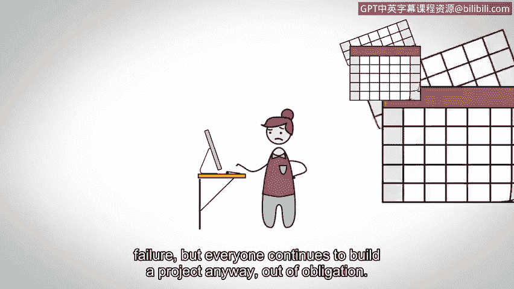

# 049：开发中的反模式

## 概述
在本节课程中，我们将学习软件开发过程中几种常见的反模式。这些模式看似是努力工作的表现，但实际上会损害项目效率与产品质量。我们将逐一分析“视图工程”、“消防演习”、“英雄主义”和“死亡行军”这四种反模式，并探讨其成因与规避方法。

---

## 视图工程：过度关注文档与演示

上一节我们讨论了“镀金”问题，即过度开发不重要的功能。本节中我们来看看另一种因努力方向错误而导致的反模式。

乍一看可能很奇怪，但在一个项目中投入过多精力也可能成为问题。然而，投入精力过少的情况又如何呢？这里指的不是雇佣懒惰的开发人员导致无法按期完成任务，那是另一个完全不同的问题。这里指的是那些让开发人员难以专注于开发工作的管理实践，因为他们被要求将大量精力投入到其他事务上。

敏捷软件开发强调**可工作的软件高于详尽的文档**，这是有原因的。原因是编写详尽的文档需要时间，而且是宝贵的开发人员时间。这并不是说完全不应该创建文档，那会带来它自己的问题。过度关注详尽的文档是一种被称为“视图工程”的反模式的例子。

与“镀金”类似，这是工作重心不明确或未聚焦于重要、高价值事务的结果。视图工程是指开发人员花费大量时间构建演示文稿、报告和文档，而不是编写代码，从而扼杀了自身的生产力。

这种情况通常发生在具有垂直管理结构的组织中。在这些组织中，为了证明一个概念的可行性，开发人员必须在推进之前对其潜力进行全面分析。这很像“分析瘫痪”，但发生在组织层面。

最佳的解决方案是消除阻碍开发人员进行产品开发的障碍。通常，用于创建所有必要报告和演示文稿的时间，足以创建一个基本的产品原型。原型通常比任何报告都能提供更多信息，并且还有一个额外的好处，即拥有一个可以在此基础上构建后续产品的可工作软件。如果最终确定该产品不值得开发人员投入时间，那么该原型也可以作为一个经验教训，为未来的项目提供借鉴。

以下是关于视图工程的一个思考题：
> 雷汉是一位软件产品经理，她要求她的开发人员在每周例会上使用幻灯片演示来汇报想法。她这样做是为了让每个人的想法都能被准确、清晰地表达。雷汉的这种期望存在什么问题？
> A. 开发人员的时间本应更好地用于编写代码。
> B. 没问题，这是一种良好的沟通实践。
> C. 软件开发人员不擅长制作幻灯片。
> D. 幻灯片无法展示问题的全貌。
> **答案是A。** 软件开发人员用于项目的时间是有限的。如果他们花时间制作演示文稿，那么用于创建实际产品的时间就会减少。

---

## 消防演习与英雄主义：突击与依赖

想象一下，你的开发团队专注于编码，并成功完成了所有工作。这是否足以说明项目是成功的？并不完全如此。那么，开发人员被迫加班以在项目截止日期前完成任务，这种太常见的情况又如何呢？这种情况时有发生。

这种反模式被称为“消防演习”。消防演习是指开发人员在项目的大部分时间里工作投入不足，然后在最后阶段突然需要全力冲刺。这可能是由于管理松懈或开发人员自身浪费时间的影响造成的。当与客户的期望没有妥善设定时，也可能发生这种情况。

消防演习是危险的，因为它通常会导致牺牲代码质量，以换取产品快速交付。一个本可以成为优秀的产品，最终却变得平庸，因为没有足够的时间来妥善构建它。

消防演习常常导致另一种被称为“英雄主义”的反模式。这是一种略带讽刺的说法，用来描述项目依赖某一位开发人员近乎超人的技术能力来完成的情况。这很危险。人们会变得依赖那个人来完成工作，甚至不仅在最后冲刺阶段。避免这种情况的最佳方法是在项目早期与客户建立明确的期望，并遵循敏捷软件开发实践。

你可以实施**时间盒**和其他规划技术，为你的开发人员提供按时完成任务所需的结构。当管理者及其开发团队都有同等的动力去完成项目时，也会有所帮助。如果每个人都能以稳定的节奏工作，就不需要消防演习或英雄主义。

以下是关于英雄主义的一个思考题：
> 以下哪项描述了软件开发中发生的“英雄主义”？
> A. 软件开发团队是获奖团队。
> B. 经常依赖一个人来解决他们的问题。
> C. 团队中包含一个被蒙蔽的人。
> D. 定期奖励良好行为。
> **答案是B。** 软件开发中的英雄主义并不是一件好事。它通常表明你的项目在流程或培训方面有待改进。

---

## 死亡行军：信念的缺失

那么，当开发团队和管理层意见不合时会发生什么？当管理层难以让开发团队相信他们正在做的工作时呢？这被称为“死亡行军”。开发团队中的每个人都知道项目注定会失败，但出于义务，每个人仍然继续构建项目。

想象一下这带来的可怕后果。导致这种情况发生的一些原因可能是：管理层出于财务原因将项目强加给开发团队；或者管理层可能固执己见，拒绝承认不可避免的失败。无论原因是什么，如果构建产品的人自己都不相信它，你几乎可以断定该产品无法达到其最佳状态。在死亡行军中，开发人员的士气低落，产品质量也因此受到影响。

## 总结
本节课我们一起学习了软件开发中四种需要警惕的反模式：
1.  **视图工程**：过度关注文档和演示而牺牲了实际的编码工作。
2.  **消防演习**：前期工作松懈，后期仓促突击，损害代码质量。
3.  **英雄主义**：过度依赖个别成员的“超常”能力，带来项目风险。
4.  **死亡行军**：团队在明知项目会失败的情况下仍被迫推进，士气与质量双输。

理解这些反模式有助于我们识别项目管理中的问题，并通过设定清晰期望、采用敏捷实践、保持稳定节奏和提升团队信念来避免它们，从而更有效地交付高质量的软件产品。