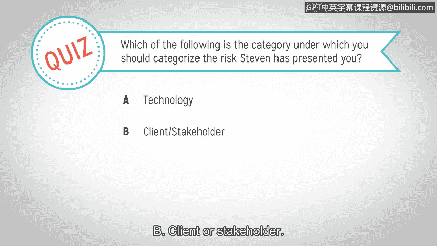
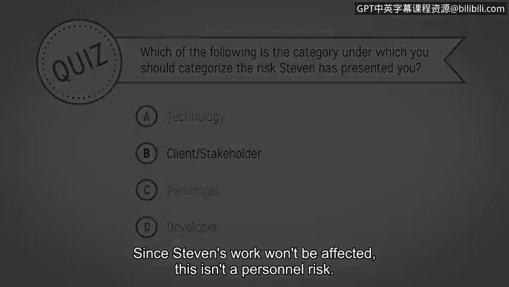

# 052：项目失败的常见原因

在本节课中，我们将探讨导致软件项目失败的常见原因，这些原因通常被称为项目风险。我们将了解不同类型的风险及其对项目的影响，并学习如何识别它们。

## 概述

上一节我们介绍了反模式。本节中，我们来看看一些不一定是模式，但同样常见的项目失败原因。这些通常被称为项目风险类型。风险是指可能最终导致项目失败的因素。

## 什么是项目风险？

风险存在于任何情境中，不仅仅是软件项目。事实上，你当前正在做的事情也存在风险。但不必立即改变你的做法，因为替代方案同样伴随着自身的风险。

## 常见的项目风险类型

以下是几种主要的项目风险类型。

### 范围风险

**范围风险**指的是涉及需求膨胀的风险。需求膨胀对任何项目都是危险，因此你应对此风险的方式决定了它对项目的影响程度。如果你有良好的变更控制措施，例如运行一个敏捷项目，就不必过于担心。然而，如果你的项目不善于应对变更，你可能需要考虑做出一些改变。

### 技术风险

**技术风险**是指你的技术发生故障的可能性。这不仅指硬件在客户手中起火。技术也可能意味着某个软件协议变得过时或不再受支持。它可能意味着你使用的技术无法很好地随客户业务扩展。也可能意味着你的团队根本不理解该技术，导致其基本无法使用。

### 客户与利益相关者风险

你的客户和利益相关者也可能给项目带来风险。有时客户承诺向你的团队提供启动所需的材料，但他们忘记了或交付延迟。这就是项目风险。有时客户变得漠不关心，或者你的主要联系人发生变更，这也是一个重大风险。

### 人员风险

**人员风险**是另一类风险。这可能表现为团队成员离开团队，如果离开的成员拥有其他成员不具备的知识，则风险尤其大。这也可能表现为你的团队不具备所需的才能、团队成员之间的冲突或沟通问题。上一节介绍的反模式“群体思维”也是一种人员风险。

### 其他风险

还存在许多其他风险。你的项目可能面临法律问题、安全问题，你的实体办公地点可能被毁。你的管理层或开发团队可能对项目失去兴趣。或者你可能需要应对工业间谍活动。无论何种风险，你都需要能够为其制定计划。

## 风险识别练习

你正在与一位名叫斯蒂芬的开发人员合作一个项目。他告诉你，他认识你的客户，并且他们关系不太好。斯蒂芬告诉你，他的工作不会受到影响，但他不确定客户是否乐意让他参与这个项目。斯蒂芬不确定是否应该让客户知道他参与项目，因为这可能会危及项目的成功。

以下哪个类别是你应该将斯蒂芬提出的风险归入的？
A. 技术风险
B. 客户或利益相关者风险
C. 人员风险
D. 开发人员风险

**正确答案是 B。** 这个问题属于客户风险。本质上，你的项目成功有可能因客户的行动而受到威胁。由于斯蒂芬的工作不会受到影响，所以这不是人员风险。

## 专家视角：常见且反复出现的风险

让我们听听一些可能影响产品成功的常见且反复出现的风险。

> 特别是在早期阶段的初创公司和一些IT项目中，很多风险与资金有关。人们严重低估了所需的努力和技能，因此常常资金不足。当资金紧张时，它会影响到一切：士气下降，人们担心自己的工作等等。这可能是真正的杀手，所以很多伟大的想法和项目就因为成本估算不当而夭折。
>
> 另一件事是人员问题，同样特别是在早期初创公司或公司里以前从未做过的早期项目中。有时你不得不与现有的人员合作，如果你没有从A点到达B点所需的正确技能类型，最终可能会产生很多问题，人们开始互相指责。你需要确保人员配置正确，拥有正确的技能组合和角色。
>
> 另一个我到处都能看到的大问题是缺乏规划。敏捷方法非常适合轻量级、大量客户互动、大量测试和好想法，但人们会产生一种感觉，认为我们要快速行动，所以不想规划。事实并非不规划，你需要有一个计划，一个能给你灵活性以保持敏捷的适当计划。但我看到的大多数情况是缺乏规划。技术团队会认为，如果他们遵循特定的流程或使用特定的软件解决方案，一切就会顺利运行，但事实并非如此。缺乏规划绝对是杀手。
>
> 在我看到的100%失败的项目中，它们都有一个共同点：规划不善。而那些成功的项目，它们都有计划。计划可能会经常变化，但当你思考问题、将其写下来并进行沟通时，确实有助于让人们达成一致并朝着正确的方向前进。

## 总结

本节课我们一起学习了项目失败的常见原因，即各种项目风险。我们了解了范围风险、技术风险、客户与利益相关者风险以及人员风险等主要类型，并通过一个练习加深了对客户风险的理解。最后，专家视角提醒我们，资金、人员技能和缺乏规划是实践中反复出现的关键风险点。

规划风险始于评估它们对项目可能产生影响的程度。在下一课中，我将介绍一种你可以用来进行这种评估的方法。我们下节课见。