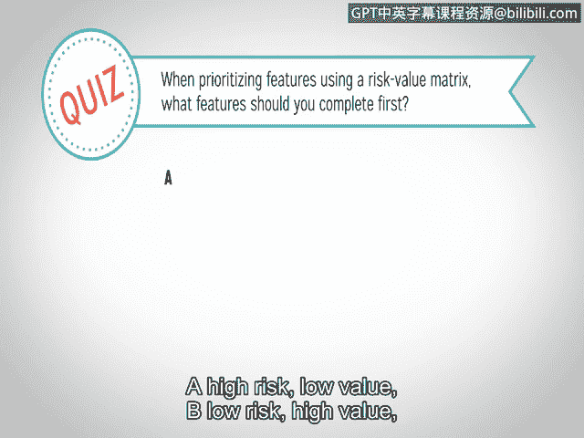

# 053：可能性与影响 📊

在本节课中，我们将学习如何评估项目中风险的可能性和影响。这是制定有效风险应对计划的关键第一步。

在关于反模式以及项目失败原因的课程中，我介绍了很多软件项目中常见的共性问题。

其中一些问题非常普遍，以至于业界将其称为“反模式”，即对项目成功产生负面影响的模式。如果你想了解更多，可以在课程资源中找到。那里不仅包含我提到的反模式，还有更多内容。

本节课，我将讨论如何评估项目中风险的可能性和影响。反模式代表了常见的风险，但从现在开始，让我们将风险视为任何可能导致项目失败的潜在因素。这些可能是反模式，但也可能包括项目特有的、并非在所有项目中都常见的风险。

风险代表了你的产品可能失败的潜在方式。显然，我们希望有能力采取措施来最小化风险。了解潜在的项目风险是第一步，为它们制定计划是下一步。

## 风险优先级矩阵

假设你已经有了一个潜在项目风险的列表。你如何决定如何处理它们？一种方法是成为一个积极主动的领导者，采取行动完全避免这种情况。当然，你无法为项目中的每一个风险都这样做。你将花费更多时间采取主动行动，而不是在产品上取得实际进展。

因此，我们需要某种方法来对风险进行优先级排序。这就是“影响与可能性矩阵”发挥作用的地方。

影响与可能性矩阵是一个二维图表，用于表示风险对项目的影响程度。它显示了你需要集中精力预防的事项。

一个影响与可能性矩阵看起来像这样：Y轴代表影响，从低到高；X轴代表可能性，从低到高。

要使用影响与可能性矩阵，只需为与项目相关的任何风险沿每个轴分配一个值。例如，假设存在“项目资金耗尽”的风险。这个风险对你的项目影响巨大，因为它将被迫关闭。因此，在影响维度上给它分配一个“高”值。假设你正在一个资金有限的初创公司工作，这可能是一个“资金耗尽”的项目风险，将其可能性设为“中等”。根据这两个值，你可以将“项目资金耗尽”放在矩阵的中上单元格中。

## 识别与定位风险

以下是项目风险吗？你可以选择多个答案。
A. 小行星摧毁地球。
B. 开发人员离职。
C. 技术故障。
D. 客户失去兴趣。

实际上，所有这些都是潜在的项目风险。它们都代表了项目可能失败的方式，尽管有些比其他更戏剧化。

以“小行星摧毁地球”这个风险为例。显然，这将是一个高影响事件。但鉴于我们不太可能在短期内看到任何小行星摧毁地球，其可能性很低。因此，“小行星摧毁地球”被放在你矩阵的右上角。

再看一个例子：你正在一个团队中工作，其中有一位名叫Gary的开发人员。Gary以在项目中途开发电脑死机而闻名。这是一个项目风险。“Gary的电脑死机”应该放在矩阵的哪个位置？如果还有其他机器可供Gary开发，这可能影响Gary，但项目可能没问题。因此，我们将其影响分配为“低”。然而，鉴于他的电脑死机几乎被认为是不可避免的，可能性是“高”。因此，“Gary的电脑死机”被放在你矩阵的左下角。

## 风险等级分类

让我们再看一下那个矩阵。看到矩阵每个单元格中的数字了吗？这些数字代表了根据每个风险在矩阵上的值确定的风险等级。

“项目资金耗尽”将获得等级“2”，因为它是高影响、中等可能性。
“小行星摧毁地球”将获得等级“3”，因为它是高影响、低可能性。
“Gary的电脑死机”将是等级“3”，因为它是低影响、高可能性。

现在，你有了一个风险列表，并且它们都被分配了风险等级。你该如何处理这些信息呢？

这个值实际上代表了风险对你项目的潜在影响程度。它告诉你应该对该风险采取什么级别的行动（如果需要采取任何行动的话）。

## 风险应对策略

以下是不同风险等级对应的行动指南：

*   **等级1（高影响、高可能性）**：应尽可能彻底地处理。由于影响高且很可能发生，最佳行动方案是采取措施尽可能减轻该风险。你现在应该采取任何能减轻此类风险影响的行动。
*   **等级2**：是你应该关注但不需要立即采取行动的事项。应该有一个详细的风险计划，即当风险发生时如何处理的策略。
*   **等级3**：是对你项目不太需要担心的事项，但你仍然应该关注它们。因此，你应该监控这些风险，但不要花太多时间思考如果它们发生会怎样。

实际上，这个排名系统还有其他变体。我们刚刚使用的例子只将等级1分配给高影响和高可能性的风险。更保守的项目可能会将等级1分配给高影响高可能性、高影响中等可能性或中等影响高可能性的风险。然后将等级2分配给这些单元格边缘的风险，等级3分配给其他所有风险。这样做只是将更高的优先级分配给某些风险。实际上，这意味着你正在降低项目的风险承受能力，如果你参与的是一个关键任务项目，你可能会对此感兴趣。

请注意，为风险采取行动将为你的项目计划增加活动。反过来，这会影响你项目的截止日期和成本。

## 应用实例

你是一名软件产品经理，收到警报称一场失控的野火正威胁着你团队关键任务数据所在的工业园区。火灾尚未蔓延到工业园区，但当局告诉该地区的工人要做好随时疏散的准备。如果你将此风险放在影响可能性矩阵上，以下哪个类别最能描述其等级？
A. 3
B. 2
C. 1

答案是C，等级1。这场自然灾害有可能通过中断电力、网络甚至数据中心本身来影响数据服务。由于影响可能很高，可能性也很高，因此该风险属于等级1。

## 将矩阵应用于功能优先级

将风险放在矩阵上的概念也可以应用于你项目的功能。为此，请为你的功能使用“风险价值矩阵”。

风险价值矩阵很像影响与可能性矩阵。不同之处在于，Y轴代表的是“风险”，而不是“影响”；X轴代表的是“功能对项目的价值”，而不是“可能性”。就像处理项目风险一样，你可以将功能放入此矩阵，这可以帮助你决定如何确定这些功能的优先级。

假设你正在构建一个使用面向用户的应用程序和数据库来存储数据的产品。你的开发团队在创建此类应用程序方面经验丰富，但在创建数据库方面经验很少。一般来说，涉及应用程序的功能将被置于相对低风险和高价值的位置。而涉及数据库的功能将是高价值和高风险。

你如何根据这个来确定优先级？当我第一次看到这个矩阵时，我自动认为你应该从创建高价值和低风险的功能开始。我这样想是因为它们可以快速为项目交付价值。然而，我很快了解到，首先构建高风险、高价值的功能要好得多。这是因为通过首先承担较大的风险，你将有效地解决对项目成功构成最大威胁的产品问题。如果你遇到导致项目延迟或取消的问题，最好尽早发现，而不是在项目后期才发现。

你可以使用与风险排名相同的原则来对功能进行排名并确定其开发优先级。

当使用风险价值矩阵确定功能优先级时，你应该首先完成哪些功能？
A. 高风险，低价值
B. 低风险，高价值
C. 低风险，低价值
D. 高价值，高风险

正确答案是D。你应该专注于首先开发高价值、高风险的功能。这里的理念是“快速失败”——如果出现问题，最好尽早发现。

## 总结

本节课中，我们一起学习了风险评估的核心方法。我们介绍了如何使用**影响与可能性矩阵**来识别、定位和分类项目风险，并学习了根据风险等级（如**等级1、2、3**）制定相应的应对策略。此外，我们还探讨了如何将类似的风险价值矩阵应用于功能优先级排序，强调了优先处理**高价值、高风险**功能以“快速失败”的重要性。

在下一节课中，我将向你展示如何创建本节课中提到的风险计划。稍后见。😊