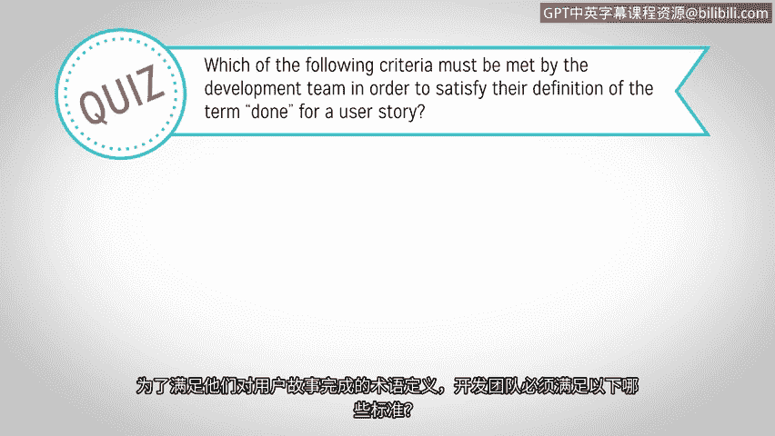

# 艾伯塔大学软件产品管理课程4：《面向软件产品的敏捷规划》｜agile-planning-for-software-products｜ - P10：9_第4.2.2节 速度估计.zh - GPT中英字幕课程资源 - BV14w411a7jH

🎼。😊。

In the last lesson， I introduce story pointss and how to use them to estimate the size of user stories。

I talked about how a storyPo is a relative estimate of how much effort a user story might take to create。

In this lesson， I'm going to talk about velocity and how it relates to your projects and estimates。

So what is velocity？Well， like the term is used in physics。

 velocity is a measure of how fast you're going。

In physics， average velocity is measured by taking distance traveled over a certain period of time。

So if you were taking a road trip， for example， you might calculate your velocity by taking the number of kilometers or miles you've traveled during the past hour。

For software projects， it's very similar。The only difference is that instead of distance traveled。

 you measure work accomplished， and the time unit is the length of your sprint。For instance。

 a software project velocity might be expressed as 15 story points per sprint。A sprint， by the way。

 is the same thing as iteration。They are both ways to time box your work in small chunks。

We'll talk about time boxing in the next lesson。You could measure productivity in different units。

Just like on a road trip， you might choose to use units of miles or kilometers。

 but they both give you a velocity。 It's just the way that you interpret the answer with changes。

In software projects， your measurement for productivity could be number of user stories completed or story pointss completed。

They both measure the amount of work completed in the project。

But they should be interpreted in different ways。Mixing user stories and story pointss could be as confusing as mixing kilometers and miles。

Although you'll see both user stories and story pointss used to calculate velocity in this course。

The productivity measurement I'm going to use in this lesson is a story point。

Since user stories can vary in size， the total number of their story pointss would better represent the work done for them than simply calculating the number of user stories。

Using user stories is analogous to counting the number of towns your road trip passes through。

There are likely a finite number of towns on your projected trip。

 but to say you've passed through three of nine towns doesn't give you reliable information about when you will reach your next town or your destination。

So now you know what velocity is， let's calculate it。As I said before。

 velocity is the amount of work done within a period of time you've spent doing that work。

Conventionally， in the Agile community， your team's velocity is measured using the number of story points completed for the user stories done within the duration of a sprint。

I just introduced velocity as a means of measuring your project's productivity。

What is the main unit of distance or work completed that we will be using to calculate velocity in this course？

A kilometers。B， user stories。C， hours or D story pointss。

The main unit of measurement we'll use in this course is story pointss， so D is a correct answer。

You could also use user stories， but as I explained before。

 they are a little too variable in size to be used reliably。

What does it mean to have a user story be marked as done？

A potential understanding is that the functionality for that user story is coded。However。

 with that definition， you could consider a user story done when the functionality required is completed。

This may be fine in a lot of circumstances， but how do you test that it's being completed？

To consider a user story done， at least in Scrum， the tests for that user story must pass。

That means the product must pass both unit tests and acceptance tests before you and the product owner can consider the user story done。

So stepping back， that means you cannot count a user story's story points towards your velocity unless all the tests for that story have been passed。

You'll hear references to user stories being considered done， done when you work in the field。

When you hear that， it's the same as when a user story is considered done in Scrum。

All the functionality must be built。All the tests must pass and it must be documented。

Why do you want to calculate velocity in the first place？Well。

 velocity helps you to create meaningful estimates of the amount of work which your team can finish throughout the project。

This is called velocity driven development。In velocity driven development。

 each sprint is planned based on the amount of work that has being completed or velocity achieved in previous sprints。

The premise here is that the only way for a development team to know how much work they can get done in any given sprint is by seeing what they've done before。

You can't very well estimate how much effort something new might take if you have no clear idea of how much effort it has taken you to do something similar in the past。

Etimating your team's velocity for planning requires a certain amount of stability in their past velocity then。

You need to know that your history for getting work done is steady。

It may take a few sprints from the start of the project for that to happen。

Without a reliable estimate of how productive your team is。

 you can't reliably use it to estimate future work。

Steve is developing a software product for his client with a team of developers。

His developers create a velocity estimate for them。

 which is based on user stories that they have marked as done。

Steve and the team agreed that their definition of done for a user story was that it was coded and that the code is readable。

Which of the following criteria must be met by the development team in order to satisfy their definition of the term done for a user story？

A， the code runs on multiple platforms。B， the acceptance tests have passed。C。

 the unit tests have passed。D， the client was notified of completion or E， none of the above。

The answer is E， none of the above。If a team defines done to mean that the code is readable。

 then producing readable code is all that is needed to satisfy their definition of done。

If this definition works for Steve and his team， then nothing more is required。However。

 for more completeness， a team's definition of done should include having to pass acceptance tests and unit tests。

Assume that your team's velocity is constant and stable。

How do you use it to estimate your future work？Well。

 this is actually about using your past actual velocities to estimate future velocity。

You're taking the amount of work done in each previous sprint to predict how much work can be done in the next sprint。

You're going to find yourself in either one of two circumstances。Either。

 you'll have just started your project and don't have any velocity data from which you can base your estimate。

Or you'll be in the middle of your project with at least some amount of past data。

At the beginning of your project， it's difficult to estimate your velocity because you have no prior work on which you can base your estimates。

So you can expect your velocity estimates at the beginning of any given project to be inaccurate。

You just don't know how productive you can be。Well， from an objective standpoint， that is。

When you're in the middle of a project， you will have more data to work with。😡，However。

 it's worth noting that most projects don't start off with a steady velocity。

It takes a little bit of time for the team to find its groove。So in the beginning。

 you may still have to deal with a certain amount of inaccuracy。However。

 as things smooth out over time， you should be able to get better estimates。

Now that I've spoken about velocity and how to use it as an estimation tool。

 let's start a bit of a discussion。There's a little bit of controversy over whether velocity estimates are accurate or even useful。

Check out the discussion forum and discuss your thoughts on this topic。

 I'll provide some starters there。That's velocity， it's a means to track your team's productivity and estimate effort achievable on future work。

In theory， it's incredibly powerful， in practice， it has some potential drawbacks。Regardless。

 it's still useful to know how to calculate your team's velocity because knowing your team's approximate productivity is still valuable。

In the next lesson， I'm going to talk about time boxing。 See you soon。

