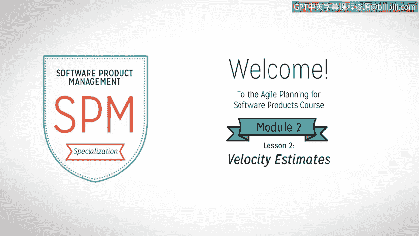
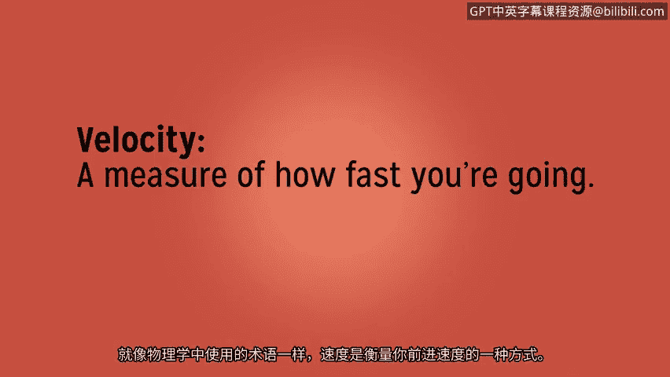
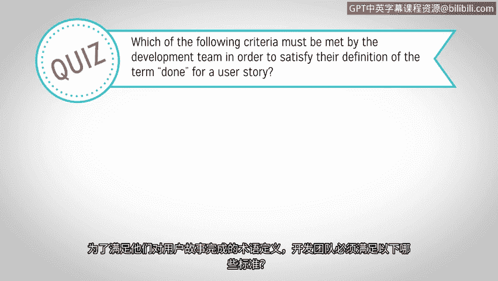

# 艾伯塔大学软件产品管理课程4：《面向软件产品的敏捷规划》：4.2.2：速度估计

在本节课中，我们将要学习敏捷规划中的一个核心概念：速度。我们将了解速度的定义、如何计算它，以及如何利用它来预测团队未来的工作量。

## 什么是速度？

上一节我们介绍了故事点及其在估算用户故事规模时的应用。本节中，我们来看看如何衡量团队完成这些故事点的效率，这就是“速度”。

在物理学中，速度衡量的是物体在单位时间内移动的距离。在软件项目中，速度的概念非常相似，它衡量的是团队在单位时间内完成的工作量。这里的“单位时间”通常指一个冲刺的周期。

例如，一个软件项目的速度可以表示为“每个冲刺完成15个故事点”。冲刺与迭代是同一概念，都是将工作划分为固定时长的周期，我们将在下一课详细讨论时间盒。

## 如何衡量工作量？

就像公路旅行中可以选择用英里或公里来衡量距离一样，在软件项目中，你也可以选择不同的单位来衡量生产力。

以下是两种常见的衡量单位：

*   **完成的用户故事数量**：直接计算完成的功能项。
*   **完成的故事点总数**：计算所有已完成用户故事的故事点总和。

虽然两者都能衡量项目完成的工作量，但解释方式不同。混合使用用户故事和故事点，就像混合使用公里和英里一样容易造成混淆。由于用户故事的规模可能差异很大，使用故事点总数能比单纯计算用户故事数量更准确地反映实际完成的工作量。

使用用户故事数量，类似于计算公路旅行中经过的城镇数量。这并不能可靠地告诉你何时能到达下一个城镇或最终目的地。

## 如何计算速度？

现在你知道了速度是什么，让我们来计算它。如前所述，速度是你在特定时间段内完成的工作量。

在敏捷社区中，团队的**速度**通常通过计算在一个冲刺周期内完成的用户故事所对应的**故事点总数**来衡量。

**速度 = 一个冲刺内完成的故事点总数**

## “完成”的定义

一个用户故事被标记为“完成”意味着什么？一个可能的理解是所需功能已编码实现。然而，在Scrum等框架中，定义更为严格。

要认为一个用户故事“完成”，该故事的**所有测试必须通过**。这意味着产品必须通过单元测试和验收测试，产品负责人和团队才能将其视为完成。

因此，**只有当一个用户故事的所有测试都通过后，其故事点才能计入当前冲刺的速度中**。在实践中，你可能会听到“完成，完成”的说法，这通常意味着：功能已构建、所有测试已通过、并且已完成相关文档。

## 速度的作用：预测未来工作

为什么要计算速度？速度能帮助你创建有意义的估算，预测团队在整个项目中能完成多少工作。这种方法被称为**速度驱动开发**。

在速度驱动开发中，每个冲刺的计划都基于团队在以往冲刺中完成的工作量或达到的速度。其前提是，开发团队了解自己在未来冲刺中能完成多少工作的唯一可靠方法，就是参考他们过去的表现。

使用速度进行未来估算时，你通常处于以下两种情况之一：

1.  **项目刚开始，没有历史速度数据**：此时很难准确估算速度，预计估算会不准确。
2.  **项目进行中，拥有一些历史数据**：你可以使用过去的实际速度来预测未来的速度。需要注意的是，大多数项目在开始时速度并不稳定，团队需要一些时间来找到节奏。随着时间推移，估算会越来越准确。

## 关于速度的讨论

现在我们已经讨论了速度及其作为估算工具的用法，值得指出的是，关于速度估算是否准确甚至有用，存在一些争议。在实践中，它功能强大，但也存在一些潜在的缺点。无论如何，了解如何计算团队的速度仍然很有价值，因为大致了解团队的生产力对于规划和管理期望至关重要。

## 总结

本节课中我们一起学习了敏捷规划中的“速度”。我们了解到，速度是衡量团队在单个冲刺内完成工作（通常以故事点计）的效率指标。它基于“完成”的严格定义，并用于根据过去的表现来预测未来的工作能力。虽然其实用性存在讨论，但掌握速度的计算和应用，是进行有效敏捷规划的重要基础。

在下一课中，我将讨论时间盒的概念。