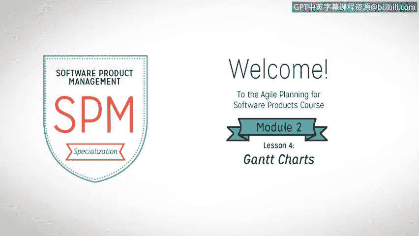
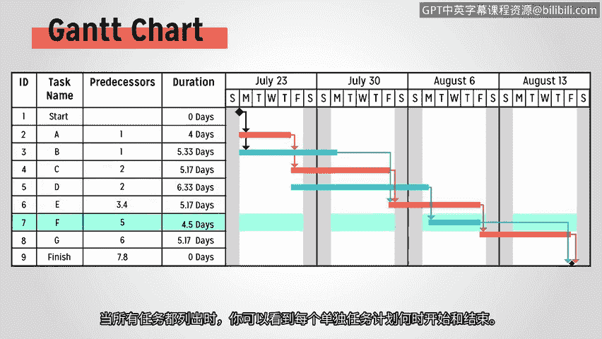
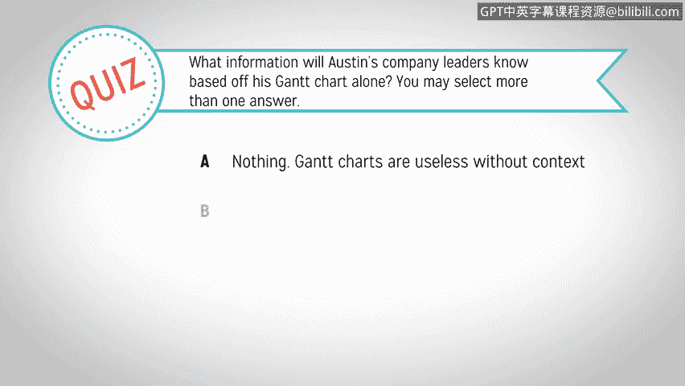

# 艾伯塔大学软件产品管理课程4：《面向软件产品的敏捷规划》｜agile-planning-for-software-products｜ - P12：11_第4.2.4节 甘特图.zh - GPT中英字幕课程资源 - BV14w411a7jH

🎼。😊。

Welcome to the next lesson In the previous lesson， I showed you the value of planning your projects by using a technique called timeboxing。

In this lesson， I'm going to teach you another technique for planning your projects， the GAP chart。

Unlike time boxing， this isn't a general technique for how to organize your time。

 it's a visual way to represent the work you plan on doing during your project。

Gant charts give you long term and short term insight into your project。

 they're super valuable and can have a huge impact on your project' success。

A GantN chart is a really simple tool for visualizing your project。

The basic idea is that they show your project's plan， task dependencies。

 and deadlines all in one place。A basic Gant chart consists of tasks and dates。

Tasks from the work breakdown structure run along the left hand side of the chart。

 and dates run along the top。Each task is listed one by one。

 starting with the first scheduled task at the top。

That task start date is then represented by the start of a bar drawn underneath the corresponding date listed at the top of the chart。

This bar begins at the start date and is extended to the date on which the task is scheduled to be completed。

When all of the tasks are laid out， you can see when each individual task is scheduled to begin。

And end。But wait， isn't that incredibly non agile？If GA charts are just a list of sequential tasks。

 doesn't that make them more suited for waterfall processes？Well， yes， if you just listed your tasks。

 one after another without any context。However， you could add a little more information to your Gantt charts。

What if you sectioned off parts of your chart and labeled them as sprints？Well。

 this is perfectly fine， and if you allow this plan to change， it's also perfectly agile。

You can use this to glean some key insights into your project。

A few of the most obvious ones are that you'll be able to see approximately when your project will be completed。

 as well as what tasks will be happening at the same time。

Austin is a software product manager working with the software development team。

He has chosen to use Gt charts to display his project to his company leaders in order to show them the project schedule。

What information will Austin's company leaders know based off his Gantt chart loan。

 you may select more than one answer。A， nothing， getting in charts are useless without context。B。

 project task dependencies。

C， estimated task length。And or D， project budget。The correct answers are B and C。

GA charts give you the ability to see your project's task lengths， but also task dependencies。

Let's talk about that， next。Gant charts aren't just a hybrid of a calendar and a to do list。

If you include task dependencies in your Gt charts， they become even more useful。

Here's how to do that。Before you create your Gt chart。

 list out the tasks that you're going to include in your chart。

Then find out what tasks require another task to be finished first。So say you have two tasks。

If the second task can't be started until the first task is complete。

 then you would say that the second task depends on the first task。So on your list of tasks。

 you put a note beside the second task， saying that it depends on the first。

Do this for all of your tasks and their dependencies。

 and now you have a full list of tasks which are intricately related through dependencies。

Then when you translate this information into your GP chart。

 you list all your tasks with the same start and end dates as you would before。

The only difference is that now you know that some tasks can't be started until another is completed。

On a Gantt chart， this is represented by an arrow flowing into the dependent task from the one on which it depends。

What's great about having your task dependencies laid out like this is that you can see your project's critical path really easily。

This allows you to see where your best focus is for your resources and see what needs to get done at what time。

Morgan will talk more about task dependencies and critical path in the next module。

I want to note that Gant charts can be used at the iteration or the release level。

So at the iteration level， you could gain insights on the tasks for the next few days within your current sprint time box。

At the release level， you could use user stories instead of tasks as the pieces of work to do in the chart。

And gain insights on these user stories for the next few sprints。And that's the Gantt chart。

 It's a super simple method for visualizing your project plan。

There are a ton of tools out there that allow you to create Gantt charts。In the next lesson。

 I'm going to pull together a lot of what I talked about in this module and introduce the release plan。

Release plans are a critical aspect to project success， so don't miss it。

