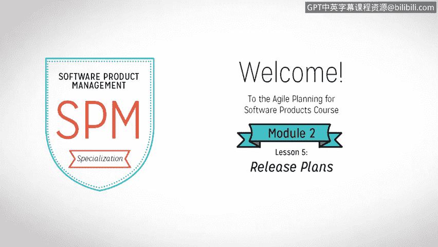
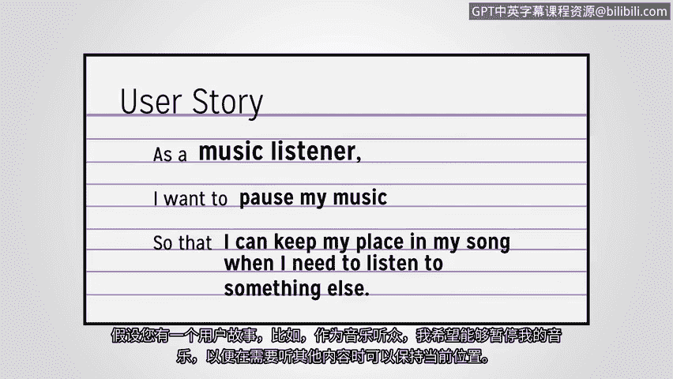
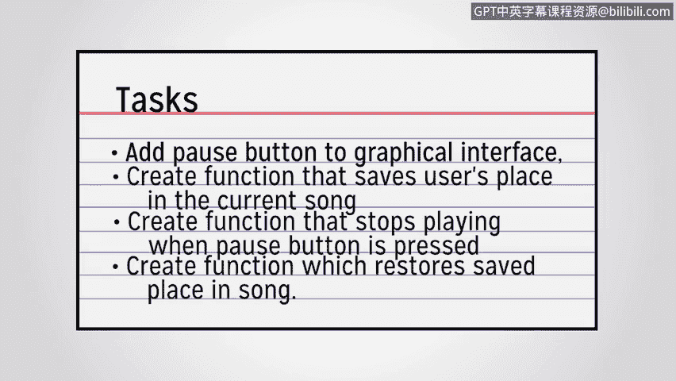
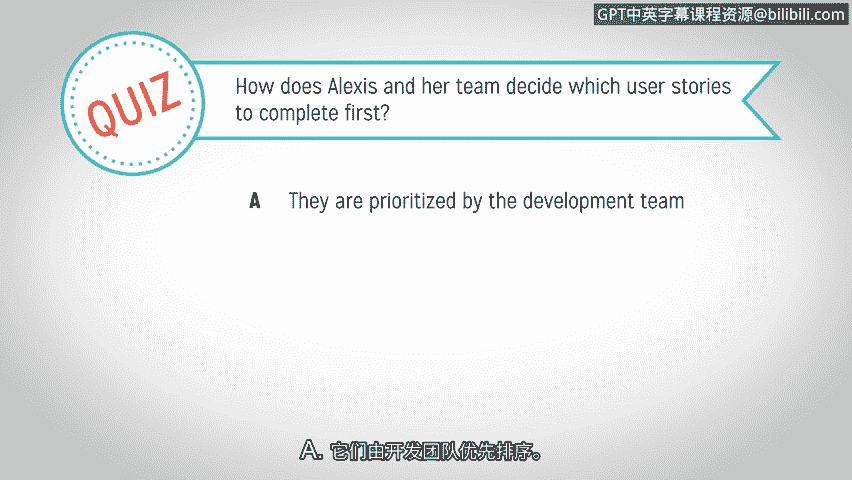
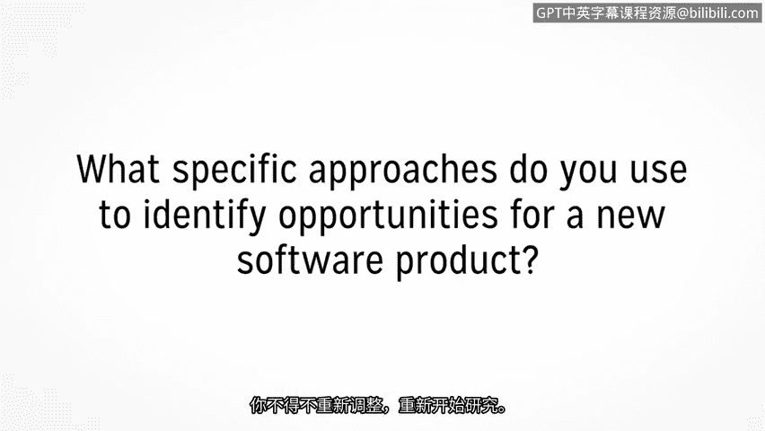

# 艾伯塔大学软件产品管理课程4：《面向软件产品的敏捷规划》：4.2.5：发布计划 📅

## 概述
在本节课中，我们将要学习敏捷规划中的**发布计划**。发布计划是一种更高层级的规划，用于确定在未来的多个迭代（或冲刺）中，哪些用户故事应该被完成和发布。我们将了解如何从产品待办事项列表中提取用户故事，并根据优先级将它们分配到各个冲刺中，从而构建一个清晰的发布路线图。

---

欢迎来到本模块的最后一课。在上一课中，我们介绍了甘特图作为项目规划的工具。它是一种可视化项目并了解工作何时完成的绝佳方式。在讨论甘特图时，我也提到它可以用于迭代层面和发布层面的规划。这被称为**两级规划**。

迭代规划是细粒度的，处理的是作为工作单元的任务。发布规划则是更粗粒度的，处理的是作为工作单元的用户故事。在这两种情况下，迭代或冲刺的概念都很重要。我在之前的课程中讨论过**时间盒**。冲刺是一个小的、固定长度的时间盒，工作在其中被组织起来。

在本节中，我们将逐步构建发布计划的概念。

## 迭代与发布规划的关系
在Scrum中，我们有被称为冲刺的时间盒迭代。在一个冲刺开始时，会有一个冲刺规划会议，用于创建迭代计划。在迭代计划中，开发任务被安排在冲刺内完成。这些任务被列在冲刺待办事项列表中。任务在工作开始前由开发人员自行认领。

在一个冲刺结束时，还会有一个冲刺评审会议。这时，可工作的软件会展示给客户或产品负责人。理想情况下，可工作的软件在每个冲刺结束时都应该是可发布的。

然而，迭代规划是非常短期的，因此发布计划被用来确定在接下来几个冲刺中，哪些用户故事应该在每个冲刺结束时完成并发布。

## 从用户故事到任务
用户故事来自产品待办事项列表，并根据其优先级被安排到即将到来的冲刺中。自然地，你需要在开始第一个冲刺及其迭代规划之前，先进行发布计划，将用户故事分配到各个冲刺中。

假设你有一个用户故事：“作为一个音乐听众，我希望能够暂停我的音乐，以便在我需要听其他东西时能保持在歌曲中的位置。”

这对于一个开发人员来说太大了，无法直接完成。为了使其更易于管理，你必须将这个故事转化为一组任务。这些任务应该与单个开发人员能在几小时内编程完成的工作量相匹配。

考虑到这一点，为管理这个用户故事，你可能会创建以下几个任务：
*   在图形界面添加一个暂停按钮。
*   创建保存用户在当前歌曲中位置的功能。
*   创建当按下暂停按钮时停止播放的功能。
*   创建恢复歌曲中保存位置的功能。

所有这些任务都是开发人员可以创建的可执行项。它们共同促成了其来源用户故事的总体完成。

## 如何构建发布计划
在发布计划中，你如何确保在正确的时间规划了正确的工作？哪个用户故事应该在哪个冲刺中被发布并由产品负责人或客户评审？这实际上是一个优先级问题。我在“客户需求与软件需求”课程中讨论过产品待办事项列表中用户故事的优先级排序。

发布计划是通过从产品待办事项列表中提取用户故事，并将它们分配到各个冲刺中来构建的。用户故事在冲刺间的分配应该有其逻辑。否则，用户故事的随意堆积可能导致冲刺混乱无序。

首先，你从中提取用户故事的待办事项列表应该已经由你的产品负责人或客户排定了优先级。最高优先级的用户故事被标记为“必须做”，中等优先级的标记为“应该做”，低优先级的标记为“可以做”。这样，在进入开发之前，你就能很好地了解客户眼中的优先级。

然后，从优先级列表的顶部开始，将已排定优先级的用户故事分配到你的发布计划中的各个冲刺里，直到每个冲刺都填充了适量的工作。

## 确定“适量工作”
“适量的工作”在这里有点难以准确把握。了解多少工作是合适的最佳方式是通过经验和数据。你的团队在估算工作方面做得越好，你就越能知道他们在给定时间内能完成多少工作。

知道了你的团队在一个冲刺中可以完成的工作量以及每个用户故事的估算时间，你就可以根据用户故事的估算来填充可用时间，直到你的任何一个冲刺都无法容纳更多工作为止。

如果做得好，你最终会对未来几个冲刺结束时产品应该是什么样子有一个相当准确的看法。这是与你的产品负责人或客户设定期望并提升开发人员士气的好方法。每个人都喜欢看到进展和对未来的愿景。发布计划是提供这种愿景的绝佳方式。

## 知识检查
亚历克西斯是一名软件产品经理，她正与她的开发团队一起规划项目。他们正在创建一个发布计划，并选择要包含在第一个冲刺中的用户故事。亚历克西斯和她的团队如何决定首先完成哪些用户故事？

A. 由开发团队确定优先级。
B. 随机分配以避免偏见。
C. 由客户确定优先级。
D. 由用户确定优先级。

在敏捷中，用户故事由客户或在Scrum中由产品负责人确定优先级。因此，发布计划应反映这些优先级。所以，正确答案是 **C**。

## 行业视角：路线图规划
发布计划是工具箱中的一项宝贵技术。它不仅是一个极好的规划工具，还能起到提振士气的作用。当你的开发人员能在上下文中看到他们的工作时，他们很容易保持动力。让我们听听行业专业人士如何管理长期规划。

> “路线图是一份战略文件，规划了我们产品或服务的进程。路线图是产品经理可以使用的最重要的工具之一，因为它有助于在不同团队之间达成一致，这些团队可能对应该做什么有不同的看法。因此，制定和定义一个路线图是一项艰巨的任务，可能相当耗时。这需要大量的研究，与不同的人交谈和协商，确保他们的观点被听取。对于路线图本身，我关注三个领域：当前开发、近期开发和未来。对于当前，我们正在做什么，这非常具体。随着我们走向未来，它变得更加抽象，并在我们需要时给我们更多改变的空间。”
>
> “这份文件是一份活的文件，当有充分的理由（无论是技术、业务还是市场原因）需要改变时，我们会更新它。但我们努力坚持它，以帮助构建我们正在构建的内容的背景：我们如何为特定用户解决一个或一系列问题？我们的差异化是什么？我们与其他人有何不同？我分享这份路线图，确保它是可见的，并帮助构建我们的规划。如果我们是一个敏捷团队，我们为冲刺做规划，每个冲刺，我们都会查看路线图，确保我们所做的符合路线图的目标。”
>
> “路线图是这一切的起点。当我创建路线图时，这是一个非常协作的过程。我必须让每个人都参与进来并同意它。我需要为每个人加入一点东西，这样他们才能认同它，并感到自己的意见被听取，他们的观点将在产品中实现。我极力推动的一件事是差异化。很多人构建的产品是别人的复制品，你投入了大量资源，然后去和朋友喝咖啡时说‘我们构建了这个东西’，他们会说‘哦，我正在使用这个竞争产品，你们有什么不同？’然后你开始谈论‘我们使用这个最新的JavaScript框架，使用这个数据库……’他们的眼睛会翻白眼，他们不在乎。所以差异化真的很重要。我关注三个领域：一是‘基本要求’，即我们需要提供的最低限度的东西，才能在这个市场领域被认真对待。接下来是‘差异化’，我们做什么与其他人不同？我们要确保我们正在增强这一点，并且我们添加的功能是差异化的一部分。另一件事我喜欢称之为‘微小而精彩的瞬间’，即一些小惊喜。我想确保在构建东西时，我们加入一些快捷方式、一些有趣的东西、一些在上下文中有效的东西，当有人使用软件时，他们会得到一个小惊喜。”
>
> “很多技术团队会专注于解决方案，而远见者则考虑五年后的事情。所以他们经常会提出想法。这里的关键是确保我们坚持路线图并管理队列。我经常花时间与技术团队在一起，确保我们按照路线图交付，但也会花时间与远见者在一起，让他们自由发挥和头脑风暴，我们可能会也可能不会纳入这些想法。然后，如果你需要改变方向，你需要有一个流程。CEO或项目发起人总是可以否决，但我会警告他们这样做的后果。你不想太频繁地改变，但如果我们需要改变，我会建立一个可以推翻原计划的流程，建立一个否决流程，因为很多远见者有直觉，而且他们往往是对的。因此，专注于路线图，保护团队免受那些可能不会在短期内被纳入的想法的干扰，是确保你正在构建你需要构建的东西的重要部分。”
>
> “我会看市场，看团队在做什么，看重要利益相关者的反馈。总的来说，通过观察许多小事情，你会对大局需要改变有一种感觉。有时，会出现一些极具颠覆性的事情，要么是一个大客户或重要客户有一个真正需要解决的问题，要么是其他人提出了什么并扰乱了市场，要么是出现经济力量如衰退或商品价格变化，要么是发生一些世界事件，让我们所有人都措手不及，这时你必须重新调整，开始研究……”
>
> “就个人而言，市场情报是一个持续进行的事情。你从一个项目到另一个项目地看市场情报，但我也从更大的视角、更全球化的视角来看待它。因此，了解有哪些技术能力、什么受欢迎、人们对什么感兴趣、人们正在解决什么样的问题，然后最关键的是走出去，发现人们需要解决的问题，我们可以用现有技术来解决这些问题。与人交谈并观察他们。很多时候，人们认为你只需要让客户告诉你该构建什么，但他们并不总是有词汇，或者可能有错误的想法。他们可能会说‘我希望你构建这个’，但当你观察他们时，会发现另一个缺口。所以当你指出存在一个缺口，并告诉他们可以用技术解决时，他们常常会对此感到非常惊喜。这需要一些研究，走出去看看需要解决什么问题。我镇上有一位同事丹·沙瓦尼，他是一名产品经理，他说他总是在寻找‘杀手级问题’。这些问题对人们来说可能看起来是小问题，但当人们的问题可以通过技术解决时，看到那种契合感——‘啊哈，我们知道如何为你解决这个问题，我们可以让你的生活更轻松’——真的是一种很棒的感觉。”

---

## 总结
本节课中我们一起学习了**发布计划**。发布计划是一种在更广泛层面上规划项目的方法，它将用户故事分配到项目内的计划冲刺中。通过本模块学到的知识，你可以运行一个组织相当良好的软件项目。但这还不是全部，还有更多需要了解和发现。

在本模块中，我们学习了如何在冲刺之间进行规划。在下一个模块中，摩根将更深入地探讨如何在冲刺内进行规划。她期待向你展示，我们也非常希望在那里见到你。