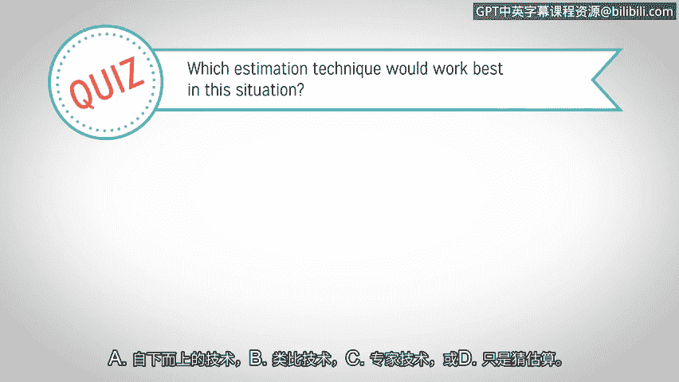

# 艾伯塔大学软件产品管理课程4：《面向软件产品的敏捷规划》｜agile-planning-for-software-products｜ - P14：13_第4.3.1节 任务时间估计.zh - GPT中英字幕课程资源 - BV14w411a7jH

Estimation is a topic that we've talked a lot about in this specialization。

You've already learned that making good estimates is essential for creating schedules and meeting your targets。

Well， now it's time to get some experience in creating estimates。

We're going to start off by looking at the project as a whole。

Where and when are your estimates most accurate。Then we are going to examine some different ways of creating estimates。

There are many approaches that you can take， and this lesson is going to take you through some of those。

So let's get started。First， I'm going to introduce you to the cone of uncertainty。

It is not surprising to say that uncertainty is high at the beginning of a project。

 and uncertainty is low at the end of a project。This is something that we discussed when we talked about uncertainty space。

If you make estimates when uncertainty is high， chances are。

 your estimates are going to be widely inaccurate。As the project progresses and your requirements and development pace become more clear。

 it is much easier to make accurate estimates。This is what the cone of uncertainty demonstrates。

Before we talk about the cone of uncertainty in more detail。

 let's see if you can interpret what the graph is showing us。

Which of the following points on the graph would have the highest variability？A， circle A， B。

 circle B。C， circle C， or D， circle D。On the cone of uncertainty graph。

 variability is the highest when the vertical intervals are the largest。As time progresses。

 variability becomes less and less。 therefore， circle A， which is at the start of the project。

 has the highest variability。An estimate then might be four times too small or too large。 Therefore。

 answer A is the correct answer。On the Y axis， we have the variability。

These are the factors by which an estimate could vary。The larger the interval。

 the greater the variability。So you can see from the graph as time progresses along the x axis。

 we have our variability becoming smaller and smaller。This forms a cone shape。

 hence the name cone of uncertainty。So how can you apply this to a project？As it proceeds。

 uncertainties are resolved， so the variability of an estimate becomes smaller。

You start a project with the initial product definition。

This is where the initial idea for the product is formed。You have a general concept in your head。

 but no real solution。Variability is quite high at this point in time。

If you are making estimates at this early point， you may need to have a significant range。

As you progress to the requirements elicitation activity。The variability becomes smaller。

At this point in time， the features of the product are better known。

 so it is easier to make accurate estimates， and your ranges can be smaller。

You then formulate potential approaches and the variability becomes smaller。

Once the architecture design and eventually the detailed design occur。

 the variability is much smaller， and your estimates are more reliable。

You can use thesevariabilities to make your estimates for your project。

Depending on where you are in your project timeline。

 you can multiply an estimate by the correspondingvariabil to get a more accurate range。For example。

 say you had a task that you guessed would take four hours to complete。

If you are in the requirements elicitation activity。

 this chart estimates that thevariabilities are 2 and 0。5。

So you can multiply your guests of four hours by 2 and 0。

5 to get an estimated range of2 to8 hours to complete the task。By now。

 you have learned what estimates are， how they are used， and when they have the least variability。

But you haven't learned how to estimate。So let's cover that now。

There are many approaches that you can take to generate estimates。

We previously said that estimates should be non negotiable。

They should also be based on some sort of data。One approach you can take is called the bottom up technique。

In this technique， you need to break down the project into small， manageable tasks。

 like we did with the work breakdown structure earlier in this course。

It's easier and more accurate to estimate for small tasks than it is for an entire project。

Once you've broken up the tasks， you generate an estimate for each of those tasks。

Then you add them all up and that becomes your project estimate。This approach has pros and cons。

The approach is based off of small estimates。Which should be less uncertain。However。

 the estimates for those tasks may not be based on any actual data。

You may want to combine this technique with another to get the most accurate results。Next。

 let's look at the analogy technique。In this technique。

 you estimate using experience with a similar project。This technique is applicable， of course。

 if you and your team have already completed a similar project。

You want to make sure the work process and the technologies that you are using are similar to what you have used previously。

A pro to this technique is that it's easy to use and understand。

It can also provide accurate results based on the work done by your team。

 This is only the case if the team is exactly the same。

And the project is similar to what you have seen in the past。This can be a rare occurrence。

Each software project has unique requirements and subsequently unique issues that arise。

So this technique definitely has many downfalls。Another technique that you could try is the experts technique。

In this approach， you converge estimates from multiple estimators。

This technique can be very costly if you are getting multiple estimators to look specifically at your project。

However， you would be getting more accurate results。

If you are using estimates from experts that were for a similar project。

 then just be aware that your project may have its own unique issues and therefore will not align with the estimates perfectly。

You are the software product manager working on a small mobile application。

You have just completed a similar mobile application project。

Two of the developers from your previous project are on your team for this project。😊。

You have eight developers total。You have already created a work breakdown structure。

You have some estimates from experts， but they were based on a larger mobile application。

You need to create estimates for your project。Your client wants the estimates within the hour。

 so you only have time to complete one technique。Which estimation technique would work best in this situation？

A bottom up technique， B analogy technique， C Exp technique， or D， just guessing the estimates。

Ideally， you would be able to use all the information at your disposal to generate accurate estimates。

If you were to pick one technique in this situation。

 your best bet would be to use the bottom up technique。Therefore， answer A is the best answer。

 since you already have a work breakdown structure for you to use。

The analogy technique is not ideal here， since the team is very different from the previous team you had。

New developers may take more or less time to develop this product。

Since the expert's estimates were based on a larger mobile application。

 they may not be accurate for you。And you never want to just guess estimates。

