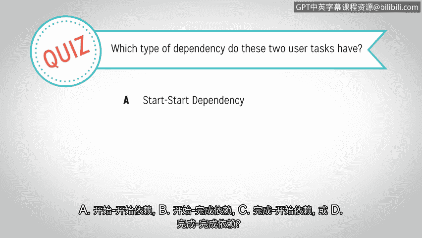

# 艾伯塔大学软件产品管理课程4：《面向软件产品的敏捷规划》｜agile-planning-for-software-products｜ - P16：15_第4.3.2节 任务依赖关系.zh - GPT中英字幕课程资源 - BV14w411a7jH

🎼。😊。

We mentioned task dependencies in the course on software processes and agile practices。

 as well as briefly in the first lesson of this course。

Task dependencies are when one task is dependent on another task or tasks。

We're going to look at this occurrence in more detail because it's a very important aspect to consider when you start scheduling。

There are four types of dependencies that can occur between two tasks。

We'll consider the state of the first task in relation to the state of a second task。

That is how the second task depends on the first。These types of dependencies are start， start。

 start finish。Finish， start and finish finish。Let's begin with the start start type of dependency。

These dependencies relate the starts of two tasks。In particular。

 the first task must start before the second task can start。

This type of dependency doesn't say anything about when a task finishes。

Imagine this start start dependency is a two person race in which one runner。

 let's call her runner A， gets a head start。Runner B must start running after runner A has already started running。

The dependency does not say who finishes the race first。In a more concrete example。

 imagine you have a task to write a textbook and a task to create a glossary for the textbook。

The tasks can happen concurrently。But you must start writing the textbook and identify important terms in the book before you can add them to the glossary。

Therefore， you must start writing the textbook before you start writing the glossary。

It doesn't matter if you finish writing the textbook and are still adding terms to the glossary。

Similarly， it doesn't matter if you have completed the glossary but are not quite done the book。

 as long as there are no new terms to be added。Next。

 let's look at the start finish type of dependency。Here。

 the first task must start before the second task can finish。

This does not say anything about the start of the second task。

Start finished dependencies can occur when there is some sort of overlapping handover。

Think of a security guard working a night shift。Another security guard to relieve them must start before they can finish their shift。

Similarly， suppose you have a weekly sprints that start on a Wednesday and end on the subsequent Tuesday。

In sprint planning， you may want to plan the next sprint during the current sprint that you are in。

This way， the developers can effectively begin their tasks for the next sprint right on the Wednesday。

Therefore， planning the next sprint needs to start before the current sprint ends。

Or you would say planning the next sprint is start finished dependent on the current sprint。

Ronald is a baker who is making a cake for a wedding。He has to design the cake， bake the cake。

 decorate the cake， and deliver the cake to the customer。Which of these tasks are start。

 start dependent？A， designing the cake and baking the cake。

Be baking the cake and decorating the cake。C， designing the cake and decorating the cake， or D。

 decorating the cake and delivering the cake。Ronald must begin designing the cake before he starts to bake the cake so that he knows which type of batter to bake and approximately how much cake to make。

He can continue design the cake while the cake is baking。

And complete the design before or after the cake is done baking。

It doesn't make a difference because this is a start start dependency， therefore。

 a is the correct answer。Next， let's look at the finished start type of dependency。

This is the most common task dependency that you will encounter。

Most dependencies that you will look at will fall into this category。

This is when the first task must finish before the second task can start。For example。

 you have to finish putting gas in your car before you can start to drive your car。

Or in the sense of software development， you have to finish designing a feature and knowing what it will do before you start to write the user or training manual for the product。

Finally， let's look at the finished finished dependency。As I'm sure you can guess by now。

 this is where the first task must finish before the second task can finish。For example。

 you must finish billing the customer for a product before you finish handing off the product to avoid not being compensated for your work。

Your development team has created a database program that stores patient information for a doctor's office。

Users can enter patient information into the database， and users can search for patients by name。

Which type of dependency do these two user tasks have？A start， start dependency。

B， start finish dependency， C， finish start dependency or D， finish finished dependency。

To search the database， patient information will need to be added already。Therefore。

 searching for patients is start start dependent on entering patient information into the database。

It does not matter how or when these tasks finish。The users do not need to have all the patient information before they can use the search feature。

Therefore， a is the correct answer。Now that you know the types of task dependencies。

 you need to look at how these dependencies fit into a schedule。

We're going to be looking at planning techniques that organize tasks based on dependencies in the rest of this module。

We're going to start with the critical Pa method chart or CPM chart in our next lesson。

