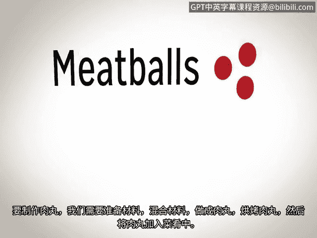

# 艾伯塔大学软件产品管理课程4：《面向软件产品的敏捷规划》｜agile-planning-for-software-products｜ - P17：16_第4.3.3节 CPM图.zh - GPT中英字幕课程资源 - BV14w411a7jH

🎼。😊。

Now that you've learned about dependencies， how do you apply them to a project？

When you think of a large software project， there are many tasks that will have dependencies that must be accounted for in the plan。

While there are many task planning methods， we are going to look at one that I like to use in this lesson。

Let's talk about the critical Pa method chart， more commonly known as the CPM chart。

A CPM chart is a visual way to organize task dependencies。Let's start by looking at an example。

 then we'll get into the details on how to make a CPM chart for your projects。

We'll make a CPM chart for making a spaghetti and meatball dinner。

We're going to serve our spaghetti and meatballs with Caesar salad。

Let's start off by identifying the task that we will need to complete to make this dinner。

To make the pasta， we will need to cook the pasta， strain the pasta， heat the sauce。

 and put the sauce on the pasta。To make the meatballs， we will need to prepare the ingredients。

 mix the ingredients， form the meatballs， bake the meatballs， and then add the meatballs to the dish。

Finally， to make the salad， we will need to cut the lettuce， add the croutons， add the cheese。

 add the dressing， and then toss the salad。Here is what our work breakdown structure would look like。

You'll notice I added a couple extra tasks that are associated with the cooking tasks。

To cook the pasta， we'll need to boil the water。To heat the sauce， we'll need to heat the pan。

 and to bake the meatballs， we'll need to preheat the oven。Now。

 we need to add an estimate of time in minutes for each of these tasks for simplicity will use a singular expected time value rather than arrange range。

Now we need to start organizing the tasks by their dependencies。Let's start with our pasta tasks。

We know we need to boil the water before we cook the pasta。

We also need to cook the pasta before we strain the pasta。Independently of those tasks。

 we need to heat the pan before we heat the sauce。We need to have both the pasta cooked and strained and the sauce heated before we can put the sauce on the pasta。

So this is what it would look like in a CPM chart。The arrows depict the test dependencies。

For simplicity， assume these are all finished start dependencies。

 so a task must finish before the next task can start。CPM charts have paths；

 a path is a sequence following the arrows that you can take from one task to another。

In this particular segment of a CPM chart， there are two beginning to end paths。

This means the paths go from the beginning to the end of the chart。

One begins with boiling the water and ends with putting sauce on the pasta。

The other begins with heating the pan and ends with putting sauce on the pasta。

Tasks on different beginning to end paths can be completed independently。For example。

 the task to boil the water can happen independently of the task to heat the pan。

Note that where the two beginning to end paths meet is a coordination point for the task dependencies。

In the example， this coordination point would be the put the sauce on the pasta task；

 you must strain the pasta and heat the sauce before you can put the sauce on the pasta。Therefore。

 you must coordinate the tasks of straining the pasta and heating the sauce。

Given this segment of a CPM chart。What is the minimum time that you could complete all tasks？A。

22 minutes， B，14 minutes， C，8 minutes， or D，16 minutes。When you're looking at a CPM chart。

 you want to look at each beginning to end path individually。

We could heat the pan and heat the sauce while the water is boiling or the past is cooking。

But we cannot speed up the process of boiling the water， cooking the pasta， strainening the pasta。

 and putting sauce on the pasta， since each of these tasks have a finished start dependency with the next task。

If we add up the time estimates of the tasks in that path， we get 16 minutes；

 therefore D is the correct answer。Next， let's look at the meatball tasks。

 These tasks are pretty sequential。We're going to need to prepare the ingredients before we mix the ingredients。

We're also going to need to mix the ingredients before we form the meatballs。

And we're going to need to form the meatballs before we bake the meatballs。

We are also going to need to preheat the oven before we bake the meatballs。

 Then we're going to need to add the meatballs to the dish after we bake the meatballs。

We are also going to need to wait until the pasta and sauce is ready。

So let's see what our CPM chart looks like now。As you can see。

 we now have four beginning to end paths。We also have coordination points at put the sauce on the pasta。

 bake the meatballs， and add meatballs to the dish。Now that planning our main dish is complete。

 let's add our salad。First， we need to cut our lettuce。

Then it doesn't matter which order the croutons， cheese and dressing get added to the salad。

They can each be their own path， but they all must be added before we toss the salad。

Let's look at this solid task plan individually。There are three beginning to end paths in this section of the CPM chart。

You would be able to complete this entire chart in five minutes if you had the addition of croutons。

 cheese and dressing， all happening simultaneously。

We would say that those three tasks are happening in parallel。

It would take two minutes for the lettuce， one minute for our parallel tasks。

 and then two minutes to toss the salad。Now we can combine our charts。

Here we have our full c pM chart。😊，It illustrates all of our task dependencies and points of coordination。

This is a great first step towards generating a schedule。From a CPM chart。

 you establish a critical path。A critical path is the longest duration path of tasks between two logical points。

From this， you can determine the shortest and longest time estimates that the project will take。

It determines which tasks are critical， which means they reside on the longest duration path。

And those which have Slack， which means that these tasks can be delayed without adding additional time to the project。

When you are looking for your critical path， paths from beginning to end of the project are important。

For example， begin to boil the water to cook the pasta， to strain the pasta， to put on sauce。

 to add meatballs to the dish to the end is a path。

The critical path is the path from beginning to end that has the greatest time estimate associated with it。

In our example， going from begin to prepare ingredients to mix ingredients， to form the meatballs。

 to bake the meatballs， to add meatballs to the dish to the end is estimated to take 38 minutes。

 this is the path of the greatest time estimate。So 38 minutes is the minimum time that it could take to complete this project。

If you recall from our work breakdown structure， when we added up all our estimates。

 it said that it should take us 77 minutes to complete。

This would be assuming that we are completing each task one after the other。

A CPM chart shows us what tasks can happen in parallel。

We can make our salad at the same time that we are making the meatballs and the pasta。

A critical path will show you the minimum time that you could complete all the tasks。

This might have to involve additional people to take on parallel work。

Consider the CPM chart where the numbers in the boxes are time estimates。

What would be the time estimate of the critical path？A， 15 minutes， B， 16 minutes， C。

 11 minutes or D 20 minutes。Here is where the critical path would be。When you add up those estimates。

 you get 16 minutes。So 16 minutes would be the minimum amount of time that you could complete this project。

 therefore B is the correct answer。You want to schedule the tasks in the critical path first。

All the other tasks can take more time without adding time to the project。

This is because there is slack in the project。Slack occurs when a path from beginning to end has a smaller estimated time than the critical path。

In our example， we have four other such paths with some slack。

Slack will be your friend when you are making a schedule because it gives you flexibility to have certain tasks take more time than expected。

 yet not affect meeting the target date。In the next lesson。

 we're going to look at a similar task planning method called the perRT chart。

