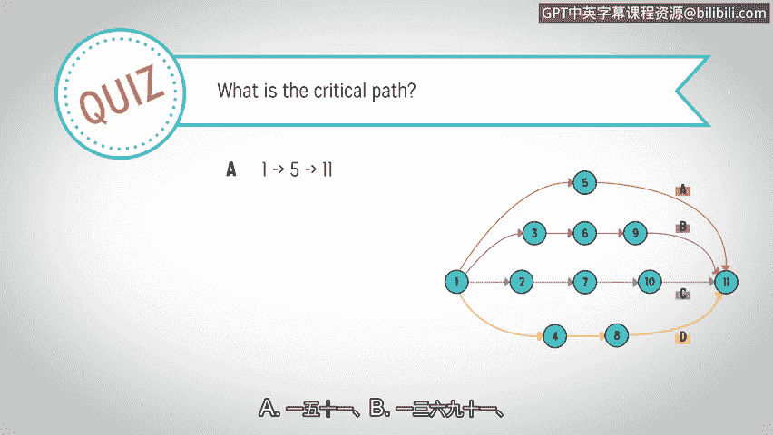

# 软件产品管理：4：面向软件产品的敏捷规划

## 第4.3.4节 PERT图 📊

在本节中，我们将学习一种与关键路径法图表非常相似的任务规划工具——PERT图。我们将了解它的构成、如何解读以及如何利用它来优化项目时间管理。

---

### PERT图简介

PERT图，全称为**计划评审技术**图。它由美国海军在20世纪50年代开发，用于管理北极星潜艇导弹项目。

与关键路径法图表类似，PERT图是项目的可视化表示。它描绘了一个由节点和边构成的网络或图。边是连接节点的线。

在PERT图中，节点（在关键路径法图表中代表任务）现在代表**里程碑**。我们在课程早期讨论过里程碑，它们不是基于时间的，因此每个节点代表某个事件的发生，通常是一个工作产品的产出或某个事件的发生。**任务则由边来表示**。

箭头的方向代表任务必须完成的顺序，这与关键路径法图表相同。在这里，一系列依赖任务由沿着箭头方向的边构成的路径来表示。每条边都标有任务名称和时间估算。

---

### PERT图的构成与解读

上一节我们介绍了PERT图的基本元素，本节中我们来看看如何具体解读图中的路径关系。

当从一个节点引出多条独立的路径时，这表明任务可以**并行**执行。这意味着如果资源充足，这些并行路径可以同时完成，因为跨路径的任务之间没有依赖关系。

相反，当有多条路径汇聚到一个节点时，这表明这些路径需要**同步**。这意味着在进入从该节点引出的路径之前，所有汇聚的路径都必须完成。

让我们再次以意大利面和肉丸为例，这次我们将其转化为PERT图。

我们同样从制作意大利面开始。你可以看到，边同时标有任务和时间估算。节点则为了参考和简洁，仅用数字标记。与关键路径法图表类似，你可以看到路径1-2-4-5中的任务可以独立于路径1-3-5中的任务完成。

PERT图让依赖关系更容易看清。我们知道，在节点5之前必须完成两项任务。

在这个简化的PERT图中，任务X直接依赖于多少个不同的任务？
A. 1
B. 3
C. 8
D. 9

由于有三条边指向节点8（即任务X之前的节点），因此任务X直接依赖于三个任务。所以，B是正确答案。任务X也依赖于其他更早的任务，但那些是间接依赖。

---

### 识别关键路径与计算时差

现在让我们看看肉丸任务部分。在这个PERT图部分，一条关键路径是7-8-9-10-11-12。但还有另一条路径7-10-11-12。

接下来是我们的沙拉部分。这个PERT图展示了有时存在一些顺序独立但必须在进入下一步之前全部完成的任务。在这个例子中，添加面包丁、奶酪和调料都是顺序独立的，但必须在搅拌沙拉之前全部完成。

现在让我们合并我们的PERT图，为整个项目制作一个图表。

以下是完成后的PERT图的样子。合并图表时，一些共同的节点必须被连接起来。我保留了原始的编号，以便你能看到节点在哪里被连接。使用什么排序方案并不重要，我喜欢从左到右编号，这样当我提到一条路径时，节点编号总是递增的。

与关键路径法图表类似，**关键路径**在PERT图中非常重要。在PERT图中，你希望你的关键路径在图表中水平描绘。所有其他路径可以画在关键路径的上方或下方。

在这个PERT图中，哪条是关键路径？
A. 1-5-11
B. 1-3-6-9-11
C. 1-2-7-10-11
D. 1-4-8-11
E. 需要更多信息

在PERT图中，关键路径在图表中水平描绘，因此我们不需要更多信息。我们知道路径1-2-7-10-11是关键路径，即使我们不知道任务的时间估算。因此，C是正确答案。

你可以用我们在关键路径法图表中讨论的相同方式来使用关键路径，以计算完成项目所需的最短时间。由于完成关键路径比完成任何其他路径花费的时间都长，因此在安排不属于关键路径的任务时，你有一些灵活性。只要其他从头到尾的路径在关键路径完成之前完成，就不会影响整个项目的时间。

当你有任务不在关键路径上，并且可以延迟而不增加项目时间线时，我们说这些任务存在**时差**。

如果我们看示例PERT图，如果你累加完成关键路径上所有任务所需的时间，需要38分钟。这是项目可能花费的最短时间。这要求我们按顺序完成关键路径上的所有任务，中间没有间隔，并且我们能够完全多任务处理，在完成关键路径的同时完成所有其他任务。

由于没有其他路径像关键路径一样长，我们在安排时间上有一些灵活性或时差。例如，完成沙拉路径需要5分钟：切生菜2分钟，并行添加面包丁、奶酪和调料1分钟，然后搅拌沙拉2分钟。我们可以在完成关键路径所需的38分钟内的任何时间点安排制作沙拉。无论我们在38分钟内何时安排，都不会给项目增加额外时间。我们可以在准备食材时开始，或者在烤制肉丸时全部完成。这是因为存在时差。

如果我们延长完成关键路径上某个任务的时间，将会增加完成项目的最短时间。例如，如果我们在混合食材和制作肉丸之间有5分钟的休息时间，那么我们的最短时间现在就变成了43分钟。这是因为关键路径上没有时差。

---

### CPM图与PERT图的对比与选择

现在你既了解了关键路径法图表，也了解了PERT图，你应该使用哪一个？

这实际上取决于个人偏好以及你试图做什么。在这个例子以及你将面对的大多数情况下，两者都很好用。关键路径法图表更侧重于任务，你可以向任务添加更多信息，如成本，然后创建一个基于时间的关键路径和一个基于成本的关键路径。

如果你的项目是基于事件或里程碑的，PERT图效果更好。它向你展示了在一个事件之前需要完成的所有任务。

无论你选择哪种方法，两者都是完成你任务规划的重要步骤。

---

### 总结与下节预告

本节课中，我们一起学习了PERT图。我们了解了它的历史、构成元素（节点代表里程碑，边代表任务），以及如何用它来识别关键路径和计算任务时差。PERT图特别适合以里程碑为导向的项目规划，能清晰展示任务依赖关系和并行工作机会。

在本模块的下一个也是最后一个课程中，我们将学习**迭代计划**。这将是你经常用来管理冲刺内任务的日程表。