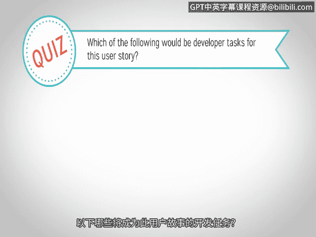

# 艾伯塔大学软件产品管理课程4：《面向软件产品的敏捷规划》：4.3.5：迭代计划 📋

在本节中，我们将学习迭代计划。迭代计划是敏捷开发中的关键活动，它确保开发团队能够以可持续的节奏高效工作，并按时交付产品功能。我们将了解如何召开迭代计划会议、如何基于团队速率选择用户故事、如何将用户故事分解为开发任务，以及如何让团队自主认领任务。

---

## 什么是迭代计划？

迭代计划对于确保开发人员专注于任务以及项目按计划进行至关重要。

迭代计划有助于确保您的开发团队在每个迭代中既不会过度承诺，也不会工作量不足。这能使开发保持在一个有效且可持续的节奏上。

迭代计划是大多数敏捷方法的一部分。值得注意的是，Scrum和极限编程都使用迭代计划。在本课中，我们将使用来自Scrum的术语，例如冲刺、产品负责人和Scrum主管。这些术语在《软件过程与敏捷实践》课程中已作介绍。在这里，术语“迭代”和“冲刺”是同义词。

---

## 迭代计划会议

迭代计划在冲刺计划会议中生成。这些会议应该是限时的。这意味着会议的长度在会议开始时就被固定下来，并且应该严格遵守。这可以防止您的会议偏离主题，并避免不必要的过度规划。对于第一次冲刺计划会议，四小时通常是一个合适的限时。

---

## 设定冲刺目标

在冲刺计划会议开始时，团队应确立一个冲刺目标（如果您在发布计划中尚未这样做）。我们在学习Scrum时讨论过这一点。这是所规划冲刺的总体关注点。这有助于使开发专注于相关任务。

---

## 报告项目速率

接下来，您需要报告上一个冲刺的项目速率。这是一个重要的步骤。本次冲刺的所有开发承诺都将基于这个速率。

但是，如果您上一个冲刺是一个异常冲刺，不能代表团队的实际开发速率呢？在这种情况下，请使用您之前冲刺中的最低速率。

**示例：**
您和您的开发团队已经进入了项目的第四个冲刺。您正在为这个冲刺召开冲刺计划会议。
*   在第一个冲刺中，您的开发团队能够完成待办事项列表中价值10个故事点的工作。
*   在第二个迭代中，您的团队完成了12个故事点。
*   在第三个冲刺中，您的团队遇到了硬件故障，导致损失了一些开发天数。此故障现已修复。然而，您的团队只完成了为该冲刺计划的5个故事点的工作。

您知道应该基于前一个冲刺来规划第四个冲刺的开发。但您认为它不能代表团队的开发速率。您查看发布计划，发现有13个故事点的用户故事被安排在此次冲刺。

**问题：** 您认为应该基于多少个故事点的用户故事来做出承诺？
A. 10个故事点， B. 12个故事点， C. 5个故事点，或 D. 13个故事点。

**答案：** 如果您的团队经历了一个与通常开发速率相比异常的冲刺，那么您不应该将该速率用于后续冲刺。它不能代表团队的通常产出。在这种情况下，您应该基于项目中先前的最低速率来估算。在此示例中，先前的最低产出是10。在为您即将到来的冲刺生成迭代计划时，应使用此值。因此，A是正确答案。

---

## 确定冲刺的潜在用户故事

接下来，您将确定冲刺的所有潜在用户故事。这将包括根据发布计划计划在此冲刺中完成的所有用户故事。这也可能包括任何未完成但本应在上一个迭代中完成的用户故事。这些未完成的用户故事是那些未满足团队“完成的定义”的故事。重要的是，您的团队要遵守他们承诺的“完成的定义”。这些用户故事可能包括任何未能通过其验收测试的故事。

---

## 选择用户故事

从潜在用户故事中，您的产品负责人将选择他们希望在此冲刺中完成的故事。请记住，这是基于先前的速率。因此，只要所选用户故事的故事点估算总和小于或等于速率，产品负责人就可以继续选择用户故事。所有其他未被选中的用户故事将不得不等到未来的冲刺。

---

## 将用户故事分解为开发任务

选定的用户故事随后被分解为开发任务。这是由开发团队在没有产品负责人参与的情况下完成的。开发任务应该足够小，以便能在一两天内完成。

如果您有一个通用的用户故事，例如：
> 作为一个用户，我希望将信息输入数据库，以便我以后可以使用它。

此用户故事的开发任务可能包括：
*   设计数据库
*   开发数据库
*   在用户界面上创建输入字段
*   为此功能创建文档
*   为此功能编写测试
*   为此功能运行测试

**示例：**
您是开发音乐流媒体应用程序的团队的软件产品经理。您的开发团队正在根据迭代的用户故事确定开发任务。您遇到了以下用户故事：
> 作为一名听众，我希望将歌曲保存到播放列表，以便我可以轻松找到这些歌曲以便稍后播放。

**问题：** 以下哪些是此用户故事的开发任务？
A. 编写测试以确保保存的歌曲出现在播放列表中。
B. 编写将歌曲保存到播放列表的功能程序。
C. 为应用程序生成线框图。
D. 向使用手册中添加将歌曲添加到播放列表的说明。

**答案：** 编写测试、编写功能程序和创建文档都是源自用户故事的常见开发任务。因此，答案A、B和D都是正确的。应用程序的线框图应该已经在早期的需求或用户界面设计活动中确定。添加歌曲的功能不会对用户界面有太大改变（可能是一个添加歌曲的按钮和一个到播放列表的链接），因此不会对用户界面构成重大更改。生成线框图不是此用户故事的开发任务。

---

## 估算任务时间

接下来，开发人员需要共同估算他们认为每项任务需要多长时间。Scrum团队是跨职能的，因此任何开发人员都应该能够承担任何任务。然而，开发人员的速度各不相同，因此每项任务估算实际上是团队商定的平均值。如果一项任务需要专业技能并且必须分配给特定人员，那么估算可以基于该人员。尽管如此，团队必须同意该估算。

任务估算应以小时、半天或天为单位。小于一小时的小任务应分组在一起。此外，估计需要超过三天的大型任务应分解为更小的任务。

---

## 调整用户故事承诺

一旦完成任务估算，您将需要重新审视为冲刺选择的用户故事。考虑到开发人员的总可用时间和任务估算，所选用户故事的开发任务能否在冲刺内合理完成？

如果无法完成所有用户故事，那么开发人员需要调整他们的承诺。产品负责人需要移除用户故事，直到剩余故事的任务总估算时间与开发人员的总可用时间相匹配。被移除用户故事的相关开发任务也从迭代计划中移除。

相反，如果用户故事可以在有大量剩余时间的情况下完成，那么产品负责人可以选择额外的用户故事。开发人员仍然需要确定这些故事的相关开发任务。只要任务的总估算时间不超过开发人员的总可用时间，产品负责人就可以向冲刺中添加用户故事。

在迭代级别生成的任务估算会覆盖在发布计划中生成的用户故事估算，因为它们更具体且可能更准确。您可能需要相应地调整您的发布计划。由于这种不确定性，发布计划通常只规划最多未来几个冲刺，并定期进行调整。

---

## 开发人员认领任务

现在是您的开发团队认领任务的时候了。认识到让他们自主分配任务而管理者不进行分配是很重要的。自主分配使开发人员能够从事他们感兴趣的任务。这带来了更快乐的开发人员以及更好的软件。

与为冲刺选择用户故事的方式类似，开发人员应根据他们的可用时间自主分配和选择任务。这也允许开发人员考虑他们在工作中可能涉及的其他承诺和项目。

---

## 总结

现在，您、您的产品负责人和您的开发团队都对即将到来的冲刺中对他们有何期望达成了共识。您已经基于速率、任务估算和可用时间生成了一个现实的承诺。开发人员都知道他们将完成什么以及对他们有何期望。您的产品负责人确切知道在下一次产品演示中可以期待什么。目前，在开发领域一切顺利。

在下一个模块中，Bradley将带您了解风险规划的基础知识。识别、缓解和准备应对风险是一个重要的规划步骤，可以使您的产品免于 unforeseen 的问题。