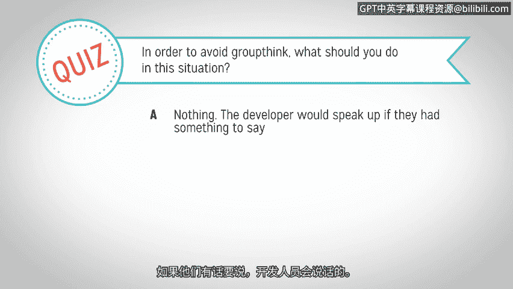

# 艾伯塔大学软件产品管理课程4：《面向软件产品的敏捷规划》｜agile-planning-for-software-products｜ - P20：19_第4.4.1节 反面模式.zh - GPT中英字幕课程资源 - BV14w411a7jH

Welcome to the final module of our Agile Planning for Software Products Co。

The three previous modules have given you the tools you need to create great plans and set your project up for real success。

These tools are valuable， so make sure you practice using them as much as you can。

There is something missing， though。What's missing is how you deal with the individual risks that can make a perfectly planned Agile project spin out of control。

In this course， those things many of you probably know you don't know are the associated risks with running a software project。

Basically， you know there are risks， but you don't know exactly what they could be。

This module is all about highlighting many of those risks and showing you how to mitigate those risks as much as possible。

Let's get started。In this lesson， I'm going to introduce antipatterns。

Antipatterns are essentially common ways that projects can fail。Of course。

 you want to avoid them as much as possible and the best way to avoid them to know what they are。

An anti patterntter is a commonly occurring situation in a project that comes with negative consequences。

There are a ton of different antipatterns out there。 Some relate to writing code。

 some to software architecture， and others relate to how software projects are managed。

This being a software product management course， we're going to focus on those anti patternstters that fall under the management category。

Many entry patterns are given different names by different authors。

 but the general idea is still the same。Even at the management level。

 there are a lot of different antipatterns。 So I'm going to cover just a few of them。

If you would like to see a full list of antipatterns， check out the course resources there。

 I've listed links for you to explore more antipatterns as you wish。

Management antipatterns primarily revolve around people。

There are ways in which projects can fail due to the behavior of individuals or groups of people。

Let's start with issues that involve groups of people and then move into the ones where individuals are concerned later。

The first group anti patterntter that I'm going to cover is called analysis paralysis。

Analysis paralysis usually happens when your development team gets stuck in the specification phase of your project。

Clients or product managers can get stuck trying to fully analyze the product requirements up front and can't decide on a direction for the product until that analysis is perfected。

This is detrimental to your project's progress and success because it can often mean your development team is stalled。

So paralyzed in analysis， projects end up being delayed unnecessarily。

Developers find it frustrating to have this happen。They're ready to start developing。

 but you're more afraid of choosing the wrong path than making any actual progress。

Instead of getting things done， you end up sitting around waiting for more information before making progress。

This isn't in a spirit of agile， and you should certainly avoid it as much as possible。

The best way to avoid this as a software product manager is to run an Agile project with incremental releases。

If you don't know everything at the start of your project， that's okay。

 you don't have to know everything up front because you leave room for flexibility and change throughout the project。

If everyone has a shared understanding that the project will be refined over time without having to know everything up front。

 things go much faster。Tanya is a software product manager。

She and her development team have been trying to refine requirements with her client for the past month to make sure everything is perfect before they start to build。

She has the basics of all the requirements， and some of them are good to go。

 but the whole product hasn't yet been defined。What is the best course of action for Tanya。

 given that her product isn't fully defined？A， probe the client for more information。B。

 start development with the information she has。C， continue to refine requirements。

Or D abandon the project， there's no hope。The correct answer is B。

 The only real way to find out if your project will work or not is to build it。

Tana is already stuck in analysis， paralysis。 It's best that she moves on。

Another antipattern is called putting the cart before the horse。

This is a common English idiom that jokes at the common practice of doing things in a counterproductive order。

The definition of putting the cart before the horse in soccer product management is very much the same。

Putting the cart before the horse refers to placing too much emphasis on a part of the project that should be done later。

A good example of this is when programmers are pulled from the development of a critical feature for one that isn't required at the moment。

By putting the car before the horse， a team can find themselves with a lot of poorly developed features of varying importance。

A better alternative would be to have a few well developed， important ones。

To avoid putting the cart before the horse， it's important for development teams to focus their efforts on what needs to get done right now。

 rather than what needs to get done down the road。Group Think is an antipattern that can cripple a software project。

Group Think is a term from the social sciences that describes how people tend to follow the general opinions of a group。

Even if they disagree individually。This phenomenon has contributed to a lot of problems and not just in software。

Poor decisions can happen as a result of group think。

A great example of group thinking connection action is when a group of developers collaborate to design a product's architecture。

😊，If you've ever been a part of such a group， you may have noticed that ideas from one or two voices can dominate a meeting。

The other， less vocal developers， remain quiet in order to avoid conflict。

This can lead to a poor product。Often， there are options that the group is not discussing。

Conflict is fine， if managed constructively。One way to avoid group Think is to generate solutions to problems silently。

Remember leanan software development from the softwareftware processescesses and Agile Practices course。

Lean solves the issue by having the team separated into multiple groups responsible for imagining their own solutions。

Then the team comes back together when all the groups have all formulated their solutions。

And the solutions are then combined。This is a great way to minimize the impact of group Think。

I suggest。That you do this at the individual level as well。

Instead of having teams break off into smaller groups。

 let individuals come up with their own solutions on paper， no talking。

Then everyone comes back together and the team can discuss each person's ideas in turn。

This prevents one or two people from dominating group discussions。

You are a software product manager meeting with your development team。

 trying to find the best solution to a client's problem。The team is discussing the solutions。

 but you notice that one of your developers seems uncomfortable with a predominant solution。

In order to avoid group think， what should you do in this situation？A， nothing。

 the developer would speak up if they had something to say。

B， put the developer on the spot and challenge them to speak their mind。C。

 redirect the group to get all their ideas on paper before comparing ideas。Or D。

 pull the developer aside and tell them that the dominant solution is usually the best。

The correct answer here is C。To avoid singling anyone out。

 a good tactic is to have your developers go off on their own and write down solutions on paper before comparing notes。

That way， everyone's ideas can get expressed。