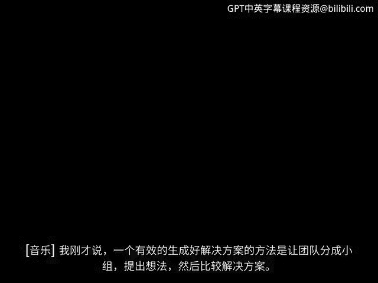
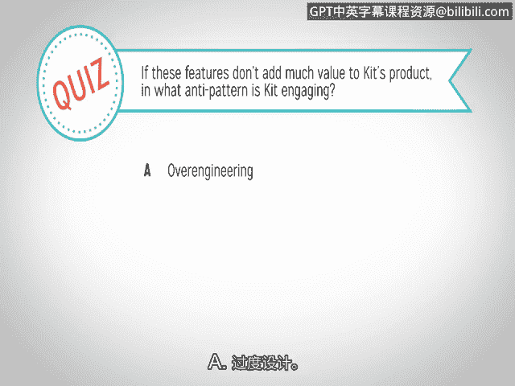

# 艾伯塔大学软件产品管理课程4：《面向软件产品的敏捷规划》｜agile-planning-for-software-products｜ - P21：20_第4.4.1a节 反面模式团队.zh - GPT中英字幕课程资源 - BV14w411a7jH

🎼。😊。

I just said that a useful way to generate good solutions is to have the team split off into groups and come up with ideas before coming back and comparing solutions。

This is a useful way to get development done as well。

Organizations are often split into small groups for different project needs。

Although separate groups can often get work done efficiently。

 it also makes it easy for these groups to lose touch。When this happens。

 when a team loses touch with other teams， we call this working in silos。

Sillos are poisonous to software development organizations。

They represent a lack of communication among the organization。

This makes it easy for the company to lose a unified image and for counterproductive management strategies to take hold。

Instead of developers collaborating openly with other teams， they develop features in a vacuum。

The product that one development team creates could be drastically different and incompatible with that of another team across the hall。

What happens if either of these teams need to come together at some point？

Not an easy task without regular communication。There are a lot of ways to solve this problem。

One of the best is by reducing the amount of management in the organization。

If your organization has a relatively flat management structure。

 you can avoid a lot of office bureaucracy and get people talking directly， ideally， face to face。

Another way to avoid silos is to encourage a positive atmosphere around inter team communication within the organization。

If teams encourage collaboration， project success is far more likely to happen than if everyone was apathetic about it。

Abel is one of your top developers。 He has come to you asking for you to help him communicate with a development team that built the product he is now improving。

😊，He has tried reaching out to other developers， but they keep deter turing to management。

What is the ideal organizational structure for Appal to get the information he needs。

A horizontal developers can speak to other developers。B， vertical。

 developers talk to managers who then talk to other managers。Or C， diagonal。

 developers talk to managers of other teams。The correct answer is A Abelash would get the most useful information if he was allowed to talk to the person who originally wrote the code that he's now improving。

Talking to managers is a rather inefficient practice， despite how common it is in organizations。

Another common antipattern is called vendor lockin。This is exactly how it sounds。

 Venor lockin happens when a development team creates a product around a single technology solution or vendor and depends heavily on it。

😊，It's one thing to use a technology because it's the best option。

 It's another to use a technology because it's the only option possible。

What happens in cases of vendor lockkin is the development team unwittingly causes their product to rely on one technology as they go into the future。

If one day the technology can't cover what they need， that causes an inability to adapt a change。

One of the worst cases of vendor lockin that I have seen was on a software project that used a vendor's proprietary programming language。

By using this language， this organization was forced to use all the other products that the vendor provided。

 proprietary file formats， functions， data formats， everything。

The worst part about this was that the organization had been using the system for so long that switching to a better solution would have cost more than keeping what they had。

Instead of growing， that organization was forced to deal with technology that was quickly becoming outdated and unmatainable。

 not a desirable place to be for anyone on the project。Eventually。

 it got to the point where staff was leaving the organization over being forced to use this vendor's unreliable products。

When this happened， the organization realized that the cost in people was too great and made the appropriate changes。

However， this isn't always the case， Sometimes Bennder Lockkin is so ingrained in an organization that the organization's health itself depends on the vendor。

So how do you avoid vendor lockin to begin with？One way is to really do your research before committing to a technology or solution。

It may seem like a trivial decision at the time， but without the proper information。

 it can be easy to get trapped into a bad situation。

It's far better to know all your options before making any commitments， financially or otherwise。

Sandy is a software product manager starting a new project。

She's been contacted by a vendor who wants to sell her their database product。

After talking to her development team， she learns that this product would actually be useful for her team。

What should Sandy's next step be？A， back out， if she needed the product。

 she would have found it herself。B， do more research。 perhaps another product exists。

 or the current product has problems。Or C， purchase the product。

 It suits her development team's needs， and there is no need to look further。The answer is B。

 do more research。To avoid getting locked into a vendor。

 it's always a good practice to look into your options before making any commitments。

The next two antipatterns overeng and gold plating relate to how a development team creates the product itself。

Over engineering refers to the practice of creating a product that is more complex than it needs to be。

For example， it happens when a development team packs the user interface with a lot of needless or speculative features。

This can turn a perfectly functional product into a bloated one with too many extra features。😊。

The product becomes at best， confusing to use， and at worst， completely unusable。

This is really exemplified in older systems。Think about some user interfaces that you've encountered。

 which were over engineered。There are plenty of examples。

 music players that allow you to choose playback rates and compression。

Basic photo viewers that take you through a list of customizations before letting you see your image。

 The list goes on。Gold plating refers to the effort put into a project to a point of diminishing returns。

On nearly all software projects， there is a point at which any extra effort that you put into a feature does not really contribute to the value of the product。

This doesn't necessarily imply overengineering the product。

 although it could certainly mean that too。Gold plating is usually a result of the software development team putting in extra features in order to impress the client。

You know from previous courses in this specialization that user requirements should be specified by the client and discussed with the development team。

Sometimes， especially on inexperienced development teams。

 the team wants to go above and beyond their requirements。Especially when the team finishes early。

 they might feel compelled to add extra features that they think will impress the client。

Instead of impressing the client， the client just ends up confused and disappointed。

 and the developer's extra effort is in vain。So how do you avoid overengineering and gold plating？

The solution is pretty simple。 Stop working when the product functions well。

Those fancy extra features probably don't need to be added。

If you really think they do need to be added， try to establish a vetting process for new features with your client。

Ask yourself whether the feature improves upon the product or if it just makes the interface more confusing。

Does it take away from the main functionality of the product？If the answer to these questions is no。

 then you might consider adding the feature。With your client's consent， of course。

Another way of making sure that your end product is the best it can be is by conducting a user study。

A user study involves taking a small sample of your users and asking them to try out the new feature and give you feedback。

This feedback can give you valuable insights into whether that feature is useful。

How it affects your user interface。Whether it is broadly appealing and how it can be improved。

Kit is working on a piece of software that improves education in grade school。

She has launched her product and has made all the improvements that her stakeholders suggested she make。

She is sitting at her computer desk and has decided to add a few more features since she has time。

If these features don't add much value to Kit's product， in what antipattern is kit engaging？

A over engineering。

B， backlogging。C， delaying。Or D， gold plating。The answer is D， gold plating。

Kit is effectively doing work that won't add much extra value to her product。

 It's far better if she focuses her efforts somewhere else。

