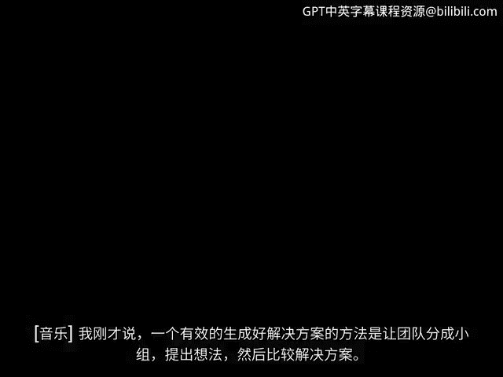
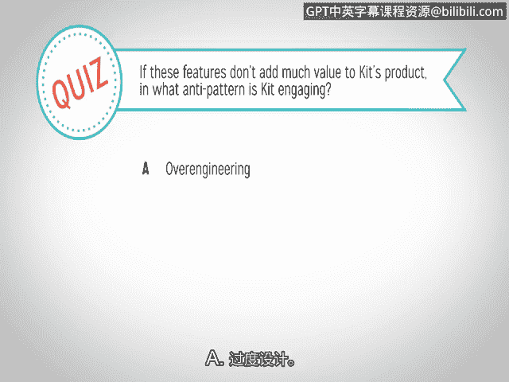

# 艾伯塔大学软件产品管理课程4：《面向软件产品的敏捷规划》：4.4.1a：反面模式团队

## 概述
在本节课中，我们将要学习软件开发中几种常见的“反面模式”。这些模式描述了团队在规划与开发过程中可能陷入的低效或有害的工作方式。理解并避免这些模式，对于构建高效、协作的团队和成功的产品至关重要。

---

上一节我们介绍了团队协作的重要性，本节中我们来看看几种阻碍团队效率和产品质量的常见模式。

### 筒仓效应
一种有效完成开发工作的方式，是让团队分成小组提出想法，然后回来比较解决方案。组织也常因不同项目需求而分成小组。虽然独立小组通常能高效完成工作，但也容易导致这些小组之间失去联系。当一个团队与其他团队失去联系时，我们称之为在“筒仓”中工作。

筒仓对软件开发组织是有害的。它代表了组织内部缺乏沟通。这容易导致公司失去统一的形象，并让适得其反的管理策略占据主导。开发者不是与其他团队公开协作，而是在真空中开发功能。一个开发团队创建的产品，可能与走廊另一头的另一个团队的产品截然不同且互不兼容。

如果这些团队需要在某个时间点合作，会发生什么？没有定期沟通，这将不是一项容易的任务。

以下是解决此问题的一些方法：
*   **减少管理层级**：如果你的组织拥有相对扁平的管理结构，就可以避免许多办公室官僚作风，并让人们直接（最好是面对面）交流。
*   **鼓励积极氛围**：在组织内鼓励积极的团队间沟通氛围。如果团队鼓励协作，项目成功的可能性远高于每个人对此漠不关心的情况。

**情景练习**：
Abel是你的一名顶级开发人员。他来找你，希望你能帮助他与一个开发团队沟通，该团队开发了他正在改进的产品。他曾尝试联系其他开发人员，但他们总是让他去找管理层。

Abel要获得所需信息，理想的组织结构是什么？
A. 横向：开发人员直接与其他开发人员交谈。
B. 纵向：开发人员与经理交谈，经理再与其他经理交谈。
C. 对角线：开发人员与其他团队的经理交谈。

**正确答案是 A**。Abel如果能与最初编写他正在改进的代码的人交谈，将获得最有用的信息。与经理交谈是一种相当低效的做法，尽管这在组织中很常见。

---

### 供应商锁定
另一个常见的反面模式称为“供应商锁定”。顾名思义，当开发团队围绕单一技术解决方案或供应商创建产品并严重依赖它时，就会发生供应商锁定。

使用一项技术是因为它是最佳选择，这是一回事；使用一项技术是因为它是唯一可能的选择，则是另一回事。在供应商锁定的情况下，开发团队会在未来发展中无意中导致其产品依赖一项技术。如果有一天该技术无法满足他们的需求，就会导致无法适应变化。

我见过最糟糕的供应商锁定案例之一，是一个使用供应商专有编程语言的软件项目。通过使用这种语言，该组织被迫使用该供应商提供的所有其他产品：专有文件格式、函数、数据格式等一切。最糟糕的是，该组织使用该系统的时间太长，以至于转向更好的解决方案的成本将高于维持现状。该组织非但没有发展，反而被迫处理迅速过时且难以维护的技术，这对项目中的任何人来说都不是理想的情况。最终，员工开始因为被迫使用该供应商不可靠的产品而离开组织。当这种情况发生时，组织意识到人员成本太高，并做出了适当的改变。然而，情况并非总是如此。有时，供应商锁定在组织中根深蒂固，以至于组织自身的健康也依赖于该供应商。

那么，如何从一开始就避免供应商锁定呢？一种方法是在决定采用某项技术或解决方案之前，真正做好研究。当时这可能看起来是一个微不足道的决定，但如果没有正确的信息，很容易陷入困境。在做出任何财务或其他方面的承诺之前，最好了解所有选项。

**情景练习**：
Sandy是一名软件产品经理，正在启动一个新项目。一家供应商联系她，想向她销售他们的数据库产品。在与她的开发团队交谈后，她了解到该产品对她的团队确实有用。

Sandy的下一步应该是什么？
A. 退出。如果她需要这个产品，她自己会找到。
B. 做更多研究。也许存在其他产品，或者当前产品有问题。
C. 购买该产品。它符合她开发团队的需求，无需进一步寻找。

**答案是 B，做更多研究**。为避免被供应商锁定，在做出任何承诺之前，研究你的选项总是一个好习惯。

---

### 过度工程与镀金
接下来的两个反面模式——过度工程和镀金——与开发团队创建产品本身的方式有关。

**过度工程**指的是创建比实际需要更复杂的产品。例如，当开发团队在用户界面中塞入许多不必要或推测性的功能时，就会发生这种情况。这可能会将一个功能完善的产品变成一个臃肿的、带有太多额外功能的产品。产品最好会变得使用起来令人困惑，最坏则会完全无法使用。这在旧系统中体现得尤为明显。想想你遇到过的一些过度设计的用户界面，例子很多：允许你选择播放速率和压缩率的音乐播放器；在让你看到图像之前带你经历一系列自定义设置的基本图片查看器，等等。

**镀金**指的是在项目中投入努力，直到达到收益递减点。在几乎所有的软件项目中，都存在一个点，超过这个点后，你对某个功能投入的任何额外努力都不会真正为产品增加价值。这不一定意味着产品过度工程化，尽管也可能如此。镀金通常是软件开发团队为了给客户留下深刻印象而添加额外功能的结果。

从本专业之前的课程中你知道，用户需求应由客户指定并与开发团队讨论。有时，特别是在缺乏经验的开发团队中，团队希望超越他们的需求。尤其是当团队提前完成任务时，他们可能会觉得有必要添加他们认为会让客户印象深刻的额外功能。结果非但没有给客户留下深刻印象，反而让客户感到困惑和失望，开发人员的额外努力也白费了。

那么，如何避免过度工程和镀金呢？解决方案很简单：**当产品运行良好时，就停止工作**。那些花哨的额外功能可能不需要添加。如果你真的认为需要添加，尝试与客户建立一个新功能的审查流程。问问自己，这个功能是改进了产品，还是仅仅让界面更混乱？它是否削弱了产品的主要功能？如果这些问题的答案是否定的，那么你可以考虑添加该功能。当然，这需要得到客户的同意。

确保最终产品尽可能好的另一种方法是进行用户研究。用户研究涉及抽取一小部分用户样本，让他们试用新功能并给你反馈。这些反馈可以为你提供宝贵的见解，了解该功能是否有用、它如何影响你的用户界面、它是否具有广泛的吸引力以及如何改进它。

**情景练习**：
Kit正在开发一款改善小学教育的软件。她已经发布了产品，并完成了所有利益相关者建议她做的改进。她坐在电脑桌前，决定既然有时间就再添加一些功能。

如果这些功能没有为Kit的产品增加太多价值，Kit陷入了哪种反面模式？
A. 过度工程
B. 积压工作
C. 延迟
D. 镀金

**答案是 D，镀金**。Kit实际上是在做不会为她的产品增加太多额外价值的工作。她最好将精力集中在其他地方。

---

## 总结
本节课中我们一起学习了软件开发中几种关键的反面模式：**筒仓效应**阻碍了团队间的有效沟通；**供应商锁定**使产品过度依赖单一技术，限制了未来发展；**过度工程**和**镀金**则导致产品变得臃肿或投入了无价值的额外努力。识别并避免这些模式，是进行高效敏捷规划和构建成功软件产品的重要基础。