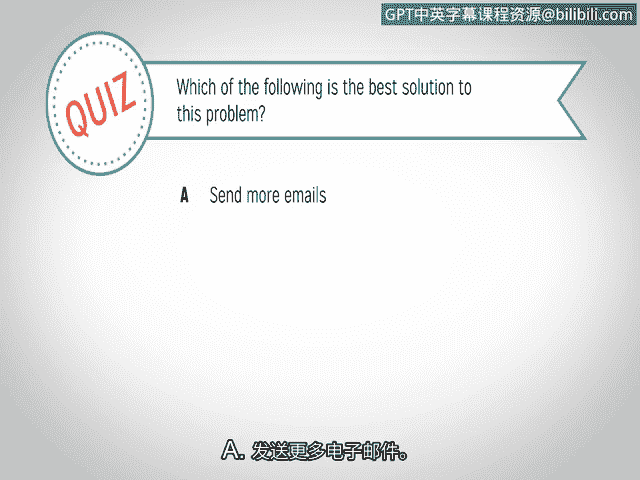

# 艾伯塔大学软件产品管理课程4：《面向软件产品的敏捷规划》｜agile-planning-for-software-products｜ - P23：22_第4.4.1c节 反面模式管理.zh - GPT中英字幕课程资源 - BV14w411a7jH

🎼。😊。

Anti patternstters， as I said before， can arise from group behavior or individual behavior。

Many of these antipatterns that arise from individual behavior are easy for onlookers to identify。

 but difficult for the perpetrator to see。It's easy to criticize when the problem doesn't arise with us。

But this very same attitude can make us blind to our own missteps。

In order to address many of the anti patternstter that I'm about to describe。

 it's important to encourage a culture of open mindedness， self reflection and improvement。

Let's start with one of the best known antipatterns， micromanagement。Micromanage is so common。

 it's almost a buzzword。It's a very real issue that many organizations face。

Micromanage is what happens when someone in a management position tends to want to be involved in every little detail of a project。

They're usually the people who ask to be CCed on every email coming to and from their team and feel the need to offer their opinion on every decision made or perspective shared in the workplace。

Micromans are the people who want to know where the developers are at every minute and what they're doing。

In essence， micromanage is about control。Micromanagement stems from a lack of trust in one way or another。

This doesn't mean that this mistrust is grounded in anything real or that the micromanager's fears are realistic。

Micromanagement is usually a symptom of the manager's own fears， insecurities and stresses。

Micromanagers don't micromanage with the intention of bringing their developers morale down。

They do it because they feel as though without their intervention。

 the whole project would fall apart。Maybe they do it because of overly ambitious timelines。

Poor product quality， or simply a fear that they don't have the right people for the job。

Whatever the reason， it's important to realize that the micromanager is the source of the problem。

Often， those who are managed by this person take the blame for their behavior。

Not only is this bad for team morale， it's bad for the product。As I've shown before。

 developer morale doesn't just affect the individual developer。

 It also affects their ability to work productively and collaborate with their colleagues。

Nobody at any level of an organization wants to work in an environment where their mental health is at risk。

So how is the problem of a micromanager solved？Ultimately。

 the solution has to come from the micromanager themselves。

Like any of these antipatterns at an individual level， there's no quick or easy fix。

To really address this issue， the manager who exhibits this behavior must be willing to admit that their behavior has a negative impact on the team and take steps toward improvement。

This could mean seeking further management training or making an effort to be more self aware and adjust their behavior。

Which of the following is not a behavior exhibited by micromanagers？

A asking to be CCed on all project correspondence。B， giving unsolicited advice to their team members。

C， having short daily meetings to assess project status or D。

 constantly focusing on how the project can fail。The answer is C。

 micromanags exhibit a lot of these behaviors， but short daily status meetings aren't the cause for concern。

 In fact， they're common on scrum projects。 They're just daily standups。

An anti patterntter that's closely related to the micromanager is the Sgel manager。

someone you don't see until a problem arises， at which point the manager flies in。

 makes a lot of noise， Gumps on everyone then flies out。To quote Ken Blanchard。

 a writer in the field。It's funny， but it happens。These are a different breed of manager from the micromanage。

 and their motivations for their behavior are very different。

A seagull manager can cause just as much commotion and stress within the development team as a micromanager。

They may even inadvertently become the cause of a project turning into a fire drill project。

It's stressful for development teams to constantly live in fear of when the next dump will be。

Like the micromanager， the Sgel manager's distinctive style is usually caused by a busy schedule。

 inadequate planning， and a great deal of stress。The behavior of a Sgugel manager could be addressed similarly to the micromanager。

 but often the best way to address the problem is to allow the manager to lighten their workload。

Of course， as a software product manager， this may not be within your scope。

If you suspect that you might be exhibiting signs of SGL management。

 it might be time to reevaluate your schedule and how you interact with your teams。

That last point about reevaluating how you interact with your teams is important on its own。

Sometimes a manager can become a Sgugel manager in the way that they interact with the team。

Dropping their workload won't do much if the team still feels as though they aren't able to communicate with their manager properly。

The biggest culprit for this。Disjointed communication is email。

Email communication can turn a well intentioned manager sour very quickly。

The problem with email is that there's often no context。 They're too formal for most communications。

 and it's easy to misinterpret what the writer says。

This is such a common problem that email as a primary means of communication has actually been identified as an anti patternttern as well。

This one's an easy fix。 Take the time to communicate in person on remote teams where this is impossible。

 Try other solutions such as online team chat services， video conferencing and phone calls。

Take the time to give the people your attention。And your investment will pay back with dividends。

Serena is having problems getting her team to respond to her emails about the project status。

Which of the following is the best solution to this problem？A， send more emails。

B， call theDevelops team lead。C， nothing or D， talk to the developers in person。

The best option is for Serena to talk to her developers in person。

Email can be divisive and is easily misunderstood。 The correct answer is D。

