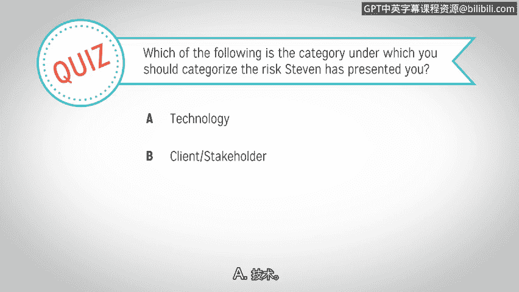
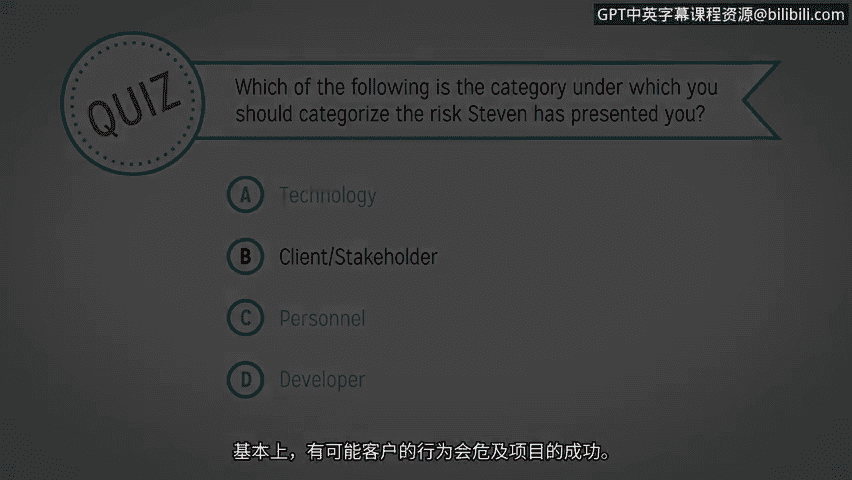

# 艾伯塔大学软件产品管理课程4：《面向软件产品的敏捷规划》｜agile-planning-for-software-products｜ - P25：24_第4.4.2节 常见失败原因.zh - GPT中英字幕课程资源 - BV14w411a7jH

🎼。😊。

In the last lesson， I talked about anti patterns。In this lesson。

 I'm going to talk about some common causes of project failures that aren't necessarily patterns。

These are usually referred to as types of project risks。

A risk is something that could potentially cause your project to fail。

You can probably think of a bunch just off the top of your head。Risks are present in any situation。

 not just software projects。😡，In fact， there are risks to doing what you're doing right now。

But don't change what you're doing just yet。 Alternatives come with their own risks。

The first kind of risk I'm going to cover is a scope risk。

This refers to risks that involve expanding requirements。

Expanding requirements is a danger for any project。

 so it's how you deal with this risk that affects its impact on your project。

If you have good change control measures， such as running an Agile project。

 you don't have to worry about it too much。However， if your project doesn't deal well with change。

 you might want to change something。There are also technology risks。

Technology risks are how likely your technology is to fail。

It's not just about your hardware catching fire in your client's hands。

Technology could mean a certain software protocol that becomes obsolete or unsupported。

It could mean that technology you're using doesn't scale well with the client's business。

It could also mean that your team just doesn't understand the technology and essentially renders it unusable。

Your customers and stakeholders can also pose risks to your project。

Sometimes customers make promises to provide your team with materials needed to get going。

 but they forget or are late in the delivery。This is a project risk。

Sometimes clients become apathetic or your main point of contact changes， another big risk。

Personnel risks are another set of risks。These could manifest themselves as team members leaving the team。

 especially risky if a departing team member possesses knowledge that no other team member has。

This could also be manifested in your team not having the talent it needs。

Conflicts between team members or communication issues。Group think。

 an an patterntter I introduced in the last lesson is another personnel risk。

There are a bunch of other risks。Your project could face legal issues， security problems。

 your physical location could be destroyed。 Your management or your development team could lose interest in the project。

Or you could deal with industrial espionage。 whatever the risk， you need to be able to plan for it。

You're working on a project with one of your developers， Stephen。

He tells you that he knows your client and that they aren't on very good terms。

Stepeven tells you that his work won't be affected。

 but he's not sure if your client would be okay with him working on the project。

Stephen isn't sure if the client should know that he's working on the project because it might jeopardize the project's success。

Which of the following is the category under which you should categorize the risks Stephen has presented to you。

A technology。B client or stakeholder。

C， personnel or D developer。The correct answer is B。 This issue is a client risk。Basically。

 there's a possibility that your project's success is jeopardized by your client's action。

Since Steven's work won't be affected， this isn't a personnel risk。

Let's hear about some common and recurring risks that could affect the success of a product。🎼，🎼，🎼不知。

Well， on early stage of。Startups in particular and with some IT projects a lot of it is funding people grossly underestimate how much effort and skill is required and so there's often not enough funding so when money gets tight it just affects everything people's morale gets lower people are worried about their jobs and things like that so it can be a real killer so a lot of great。

🎼Ideas and projects just die on the vine because people didn't cost them properly Another thing is personnel。

 particularly again， early stage startups or early projects at a company that haven't been done before you sometimes you have to deal with the people you have and if you don't have the right type of skill to go from point A to point B you can end up with a lot of problems and people start to blame each other know I thought you could deliver this and you know people might have bit off a it more than they can choose so you need to make sure that you're staffing things correctly and have the right mix of skill and the right roles and then another big one that I see everywhere is a lack of planning so the agile methods are great for you know lightweight lots of customer interaction。

 lots of testing lots of good ideas but people get the feeling that we're gonna to remove really fast and we don't want to plan Well it's not that you don't plan you need to have a plan it's appropriate that gives you some flexibility to still be agile congruent。

But most of what I see is a lack of planning so technical teams will think that if they follow a particular process or they use particular software solutions that it'll just work。

 well it doesn't work so a lack of planning is an absolute killer。

 100% of the projects that I see fail， I all have poor planning in common and the projects that do succeed。

 they have a plan now the plan may change a lot but when you there's something that comes out of thinking about things。

 writing it down， communicating that really helps get people aligned and moving in the right direction。

Planning for risks starts with assessing the magnitude with which they can affect your project。

In the next lesson， I'm going to go over a way in which you can do this。 I'll see you there。

