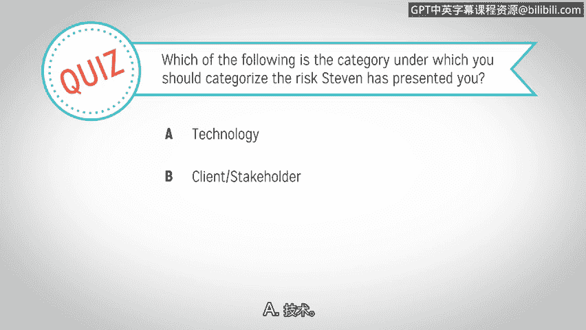
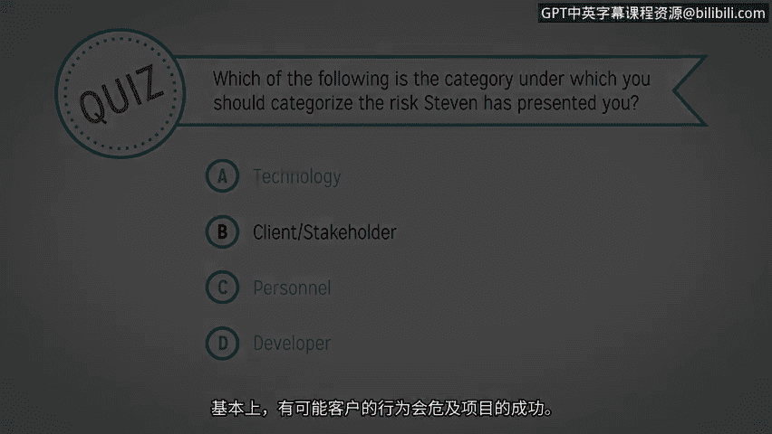

# 艾伯塔大学软件产品管理课程4：《面向软件产品的敏捷规划》：4.4.2：常见失败原因

## 概述
在本节课中，我们将学习软件项目中常见的失败原因，这些原因通常被称为项目风险。我们将探讨不同类型的风险，并了解它们如何影响项目的成功。

## 课程内容

上一节我们介绍了反模式，本节中我们来看看一些常见的、不一定是模式的项目失败原因。这些通常被称为项目风险类型。

风险是指可能导致项目失败的因素。在任何情况下都存在风险，不仅仅是软件项目。事实上，你现在正在做的事情也存在风险。但暂时不要改变你的做法，因为替代方案也有其自身的风险。

### 范围风险
我将介绍的第一种风险是范围风险。这指的是涉及需求扩展的风险。需求扩展对任何项目都是危险，因此你处理这种风险的方式会影响它对项目的影响。如果你有良好的变更控制措施，例如运行敏捷项目，就不必过于担心。然而，如果你的项目不能很好地处理变更，你可能需要考虑改变一些做法。

### 技术风险
技术风险是指你的技术失败的可能性。这不仅仅指硬件在客户手中起火。技术可能意味着某个软件协议变得过时或不再受支持。可能意味着你使用的技术无法很好地随客户业务扩展。也可能意味着你的团队根本不理解这项技术，导致其基本无法使用。

### 客户与利益相关者风险
你的客户和利益相关者也可能给你的项目带来风险。有时客户承诺向你的团队提供启动所需的材料，但他们忘记了或交付延迟。这是一个项目风险。有时客户变得冷漠，或者你的主要联系人发生变化，这是另一个重大风险。

### 人员风险
人员风险是另一组风险。这可能表现为团队成员离开团队，如果离开的成员拥有其他成员不具备的知识，则风险尤其大。这也可能表现为你的团队缺乏所需的才能。团队成员之间的冲突或沟通问题。群体思维，即我在上一课中介绍的一种反模式，也是一种人员风险。

### 其他风险
还存在许多其他风险。你的项目可能面临法律问题、安全问题，你的实体位置可能被摧毁。你的管理层或开发团队可能对项目失去兴趣。或者你可能需要处理工业间谍活动。无论风险是什么，你都需要能够为其制定计划。

## 风险识别练习
你正在与你的开发人员之一斯蒂芬合作一个项目。他告诉你他认识你的客户，并且他们关系不太好。斯蒂芬告诉你，他的工作不会受到影响，但他不确定客户是否同意他参与这个项目。斯蒂芬不确定是否应该让客户知道他正在参与这个项目，因为这可能会危及项目的成功。

以下是斯蒂芬向你提出的风险应归入哪一类？
A. 技术
B. 客户或利益相关者
C. 人员
D. 开发人员

正确答案是 **B**。这个问题属于客户风险。基本上，你的项目成功有可能因客户的行为而受到威胁。由于斯蒂芬的工作不会受到影响，所以这不是人员风险。

## 常见风险分析
现在，让我们听听一些可能影响产品成功的常见且反复出现的风险。

特别是在早期阶段的初创公司和一些IT项目中，很多风险与资金有关。人们严重低估了所需的努力和技能，因此常常资金不足。当资金紧张时，它会影响到一切：人们的士气下降，人们担心自己的工作等等。因此，资金问题可能是一个真正的杀手。许多伟大的想法和项目因为成本估算不当而夭折。

另一个问题是人员，尤其是在早期初创公司或公司里以前从未做过的早期项目中。有时你不得不与现有的人员合作，如果你没有从A点到B点所需的正确技能类型，最终可能会遇到很多问题，人们开始互相指责。你需要确保人员配置正确，并拥有正确的技能组合和角色。

我到处都能看到的另一个大问题是缺乏规划。敏捷方法非常适合轻量级、大量的客户互动、大量的测试和很多好想法，但人们会产生一种感觉，认为我们要快速行动，不想做计划。事实并非如此，你不需要一个僵化的计划，但你需要一个能给你灵活性以保持敏捷的适当计划。但我看到的大多数情况是缺乏规划。技术团队会认为，如果他们遵循特定的流程或使用特定的软件解决方案，一切就会顺利进行，但事实并非如此。因此，缺乏规划绝对是项目杀手。在我看到的100%失败的项目中，它们都有一个共同点：规划不善。而那些成功的项目，它们都有计划。计划可能会经常变化，但当你思考问题、将其写下来并进行沟通时，确实有助于让人们达成一致并朝着正确的方向前进。

## 风险规划
为风险做规划始于评估它们对项目可能产生影响的程度。在下一课中，我将介绍一种你可以用来做这件事的方法。我们下节课见。

## 总结
本节课中，我们一起学习了软件项目中常见的失败原因，即项目风险。我们探讨了范围风险、技术风险、客户与利益相关者风险以及人员风险等不同类型，并通过一个练习加深了对风险分类的理解。最后，我们了解到缺乏规划是项目失败的一个普遍且关键的因素，强调了即使在敏捷环境中，适当的规划也至关重要。