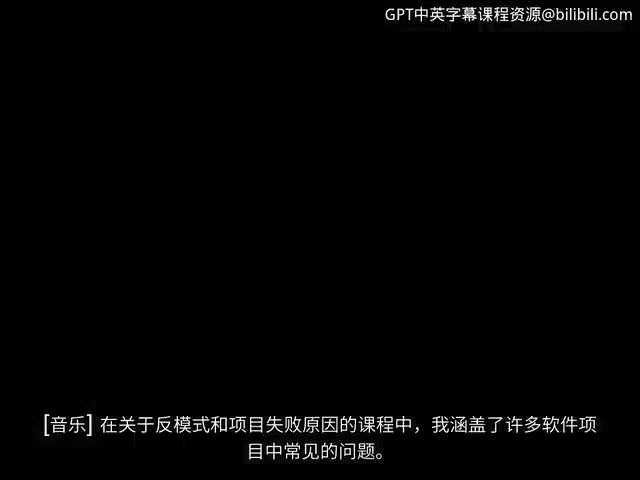
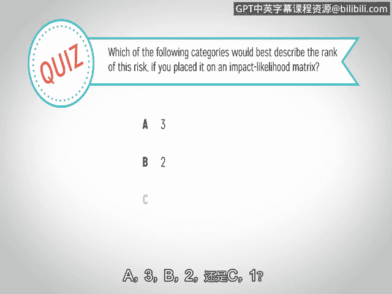

# 艾伯塔大学软件产品管理课程4：《面向软件产品的敏捷规划》｜agile-planning-for-software-products｜ - P26：25_第4.4.3节 风险评估概率和影响.zh - GPT中英字幕课程资源 - BV14w411a7jH

In the lesson on anti patternstters and the lesson on causes of project failure。

 I covered a lot of common problems that crop up for software projects。

Some of them are so common that the industry has termed them anti patternss。

Patterns that negatively impact project success。If you want more。

 you can find them in the course resources。There， you'll see more than just the antipatterns about which I talked。

In this lesson， I'm going to talk about how to assess the likelihood and impact of risks in your project。

Antipatterns represent common risks， but from this point onward。

 let's think of risks as anything that could potentially cause your project to fail。

Those could be anti patterns， but they could also include project specific risks that might not be common across projects。

Risks represent potential ways in which your product could fail。Clearly。

 we want to be able to do something about minimizing risks。

Knowing potential project risks is the first step。Planning for them is the next。

Say you already have a list of potential project risks。How do you determine what to do about them？

Well， one way is to be a proactive leader and take action to avoid the situation entirely。Of course。

 you can't do this for every risk on the project。You would spend more time taking proactive action than making real progress on the product。

So we need some way of prioritizing risks。That's where the impact versus likelihood matrix comes into play。

An impact versus likelihood matrix is a 2D representation of the amount of influence a risk has on the project。

It shows what you need to focus your efforts on preventing。

An impact versus likelihood matrix looks like this。

You have impact running along the Y axis from low to high。

And likelihood running along the X axis from low to high。To use the impact versus likelihood matrix。

 simply assign any risks associated with your project of value along each axis。For example。

 say you had the risk of project runs out of funding。

This risk would have a huge impact on your project because it would be forced to shut down。

Assign this risk a high on the impact domain。Say you're working on a startup with limited funds。

This could be the project risk of running out of money and put it at a medium。With these two values。

 you can place project runs out of funding in the upper middle cell of your matrix。

Which of the following are project risks。 You may select more than one answer。

A asteroid destroys the earth。B， developer quits。C， technology fails。And or D， client loses interest。

Actually， all of these are potential project risks。

They all present ways in which your project could fail， although some are more dramatic than others。

How about the risk asteroid destroys the earth。Clearly， this would be a high impact event。

But given that we aren't likely to see any asteroids destroying Earth anytime soon。

 the likelihood is low。So asteroids destroying the Earth gets put in the top right corner of your matrix。

One more， you're working on a team with a developer named Gary。

Gary is notorious for having his development computer die on him halfway through the projects。

This is a project risk。Where would Gary's computer dies， sit on your matrix？Well。

 if there are other machines on which Gary could develop， it might impact Gary。

 but the project will probably be okay。So we'll assign its impact as low， however。

 since his computer dyinging has been established as nearly inescapable， the likelihood is high。

Therefore， Gary's computer dyinging is placed on the bottom left hand corner of your matrix。

Let's look at that matrix again。See those numbers in each of the matrix cells。

Those represent a risk category as determined by each risk's value on the matrix。

The project running out of funding would receive a value of a two because its high impact with the medium likelihood。

Asteroids destroying the Earth would receive a three because its high impact with low likelihood。

And Gary's computer dying would be a three。 Well， because his's low impact and highly likely。Great。😊。

Now， you have a list of risks， and they're all assigned risk categories。 What do you do with this。

Well， this value really represents the potential magnitude of a risk on your project。

It tells you what level of action you should take regarding the risk if you need to take any action at all。

A one or high impact， high likelihood risk should be addressed as thoroughly as possible。

Since the impact would be high and it's also likely to happen。

 the best course of action is to take steps towards mitigating that risk as much as possible。

Any actions you take right now， you should do。😡，If that action mitigates the influence of a category one risk。

A two would be something you should be concerned about。

 but don't need to do anything about right now。There should be a thorough risk plan。

 a strategy for how to deal with that risk when it occurs。

A three is something that isn't a very much concern to your project。

 but you should still keep an eye on it。So you should monitor these risks。

 but don't spend too much time thinking about what would happen if they were to occur。

There are actually other variations on this ranking system。

The example we just used assign a one to only risks that are high impact and high likelihood。

More conservative projects may assign a one to risks that are high impact， high likelihood。

 high impact， medium likelihood， or medium impact and high likelihood。

Then a two will be distributed along the edges of those cells and a three to everything else。

All this does is assign a higher importance to some risks。Effectively。

 this means that you're decreasing your project's risk tolerance。

 something that you may be interested in doing if you're involved in a mission critical project。

Just be aware that taking actions for risks will add activities to your project plan。In turn。

 this will influence your project's deadlines and costs。You're a software product manager。

 and you receive an alert that an out of control wildfire is threatening the industrial park where your team's mission critical data is located。

The fire has not yet encroached on the industrial park。

 but authorities are telling workers in the area to prepare for an evacuation on short notice。

Which of the following categories would best describe the rank of this risk if you placed it on an impact likelihood matrix。

A3。B2。Or C，1。

The answer is C， category1。This natural disaster has the potential to affect the data service by taking down power。

 networks， or even the data center itself。Since the impact could be high and the likelihood is high。

 this risk is a category1。This concept of placing risks on a matrix can also be applied to your project's features。

To do this， use a risk value matrix for your features。

A risk value matrix is a lot like an impact versus likelihood matrix。

Instead of having impact on the li axis， you would have risk。And instead of likelihood on the X axis。

 you would have the features's value to the project。Like you did with project risks。

 you can put features into this matrix， which can help you decide how to prioritize these features。

Say you're building a product that uses a user facing app and a database to store data。

Your development team has a lot of experience with creating apps like this。

 but has very little experience with creating databases。In general。

 features that involve the app will be placed in a relatively low risk and high value。

And features that involve the database would be high value and also high risk。

How do you assign a priority based on this？Well， when I first saw the matrix。

 I automatically assumed that you should start by creating features with high value and low risk。

I thought this because they would deliver value quickly to the project。However。

 I soon learned that it's far better to build your high risk， high value features first。

This is because by taking the larger risk first， you will effectively tackle the problems with the product that pose the most danger to the project's success。

If you run into issues that force the project to be delayed or canceled。

 it's better to find them early rather than later on in the project。😡。

You can use the same principle for ranking risks to rank features and prioritize their development。

When prioritizing features using a risk value matrix， what features should you complete first？A。

 high risk， low value。B， low risk， high value。C， low risk， low value， or D， high value， high risk。

The correct answer is D。 You should focus on getting high value， high risk features developed first。

The idea here is to fail fast if something were to go wrong。

 it's best to find out as early as possible。And that's risk assessment。 In the next lesson。

 I'm going to show you how to create the risk plans that I talked about in this lesson。

 See you shortly。😊。