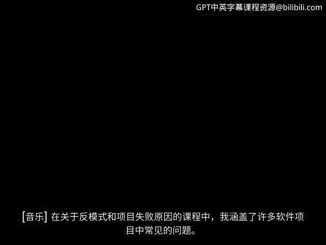
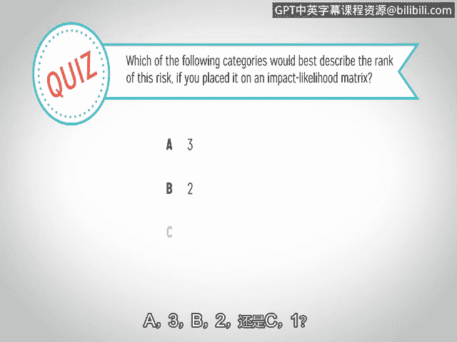

# 艾伯塔大学软件产品管理课程4：《面向软件产品的敏捷规划》：4.4.3：风险评估概率和影响 📊

在本节课中，我们将要学习如何评估项目中风险的发生概率和影响程度。我们将使用一个名为“影响与概率矩阵”的工具来对风险进行优先级排序，并了解如何将类似的概念应用于产品功能的优先级排序。

---

在关于反模式以及项目失败原因的课程中，我介绍了很多软件项目中常见的共性问题。

其中一些问题非常普遍，以至于行业将其称为“反模式”，即对项目成功产生负面影响的模式。如果你想了解更多，可以在课程资源中找到。那里不仅包含我提到的反模式，还有更多内容。

本节课，我将讨论如何评估项目中风险的发生概率和影响程度。反模式代表了常见的风险，但从现在开始，让我们将风险视为任何可能导致项目失败的因素。这些可能是反模式，也可能包括项目特有的、并非普遍存在的风险。

风险代表了你的产品可能失败的潜在方式。显然，我们希望有能力采取措施来最小化风险。了解潜在的项目风险是第一步，为它们制定计划是下一步。

假设你已经有了一个潜在项目风险的列表。你如何决定如何处理它们？一种方法是成为一个积极主动的领导者，采取行动完全避免这种情况。当然，你无法为项目中的每一个风险都这样做。你将花费更多时间采取预防性行动，而不是在产品上取得实际进展。

因此，我们需要某种方法来对风险进行优先级排序。这就是“影响与概率矩阵”发挥作用的地方。

**影响与概率矩阵**是一个二维图表，用于表示风险对项目的影响程度。它显示了你需要集中精力预防的事项。

一个影响与概率矩阵看起来像这样：Y轴代表影响，从低到高；X轴代表概率，从低到高。

要使用影响与概率矩阵，只需为项目中相关的每个风险在两条轴上分配一个值。例如，假设存在“项目资金耗尽”的风险。这个风险对你的项目影响巨大，因为它将导致项目被迫关闭。因此，在影响维度上给它分配一个“高”值。假设你正在一个资金有限的初创公司工作，这个风险的概率可能是“中”。有了这两个值，你就可以将“项目资金耗尽”放在矩阵中上方的单元格里。

以下是项目风险吗？你可以选择多个答案。
A. 小行星摧毁地球。
B. 开发人员离职。
C. 技术故障。
D. 客户失去兴趣。

实际上，所有这些都是潜在的项目风险。它们都代表了项目可能失败的方式，尽管有些比其他更戏剧化。

以“小行星摧毁地球”这个风险为例。显然，这将是一个高影响事件。但考虑到我们近期不太可能看到任何小行星摧毁地球，其概率很低。因此，“小行星摧毁地球”应放在你矩阵的右上角。

再看一个例子：你所在的团队中有一位名叫Gary的开发人员。Gary以其开发电脑在项目中途死机而闻名。这是一个项目风险。“Gary的电脑死机”应该放在矩阵的哪个位置？如果团队还有其他电脑可供Gary使用，这可能影响Gary本人，但项目可能不会有大问题。因此，我们将其影响分配为“低”。然而，鉴于他的电脑死机几乎被认为是不可避免的，其概率是“高”。因此，“Gary的电脑死机”应放在矩阵的左下角。

让我们再看一下那个矩阵。注意矩阵每个单元格中的数字。这些数字代表了根据每个风险在矩阵上的值所确定的风险类别。

“项目资金耗尽”将获得值“2”，因为它是高影响、中概率。
“小行星摧毁地球”将获得值“3”，因为它是高影响、低概率。
“Gary的电脑死机”将获得值“3”，因为它是低影响、高概率。

很好。现在，你有了一个风险列表，并且它们都被分配了风险类别。你该如何处理这些信息呢？

这个值实际上代表了风险对你项目的潜在影响程度。它告诉你应该对该风险采取何种级别的行动（如果需要采取任何行动的话）。

*   **类别1（高影响、高概率）** 的风险应尽可能彻底地处理。由于影响大且很可能发生，最佳行动方针是尽可能采取措施减轻该风险。任何你现在可以采取的行动，都应该去做。如果该行动能减轻类别1风险的影响，就值得做。
*   **类别2** 的风险是你应该关注但不需要立即采取行动的。应该有一个详尽的风险计划，即当风险发生时如何应对的策略。
*   **类别3** 的风险对你的项目不太构成威胁，但你仍然应该留意。因此，你应该监控这些风险，但不必花费太多时间思考如果它们发生会怎样。

实际上，这种排名系统还有其他变体。我们刚刚使用的例子只将“1”分配给高影响、高概率的风险。更保守的项目可能会将“1”分配给高影响高概率、高影响中概率或中影响高概率的风险。然后将“2”分配给这些单元格边缘的风险，将“3”分配给其他所有风险。这样做只是将更高的重要性分配给某些风险。实际上，这意味着你降低了项目的风险承受能力，如果你参与的是一个关键任务项目，你可能会对此感兴趣。

请注意，为风险采取行动会为你的项目计划增加活动。反过来，这会影响你项目的截止日期和成本。

假设你是一名软件产品经理，收到警报称一场失控的野火正威胁着你团队关键任务数据所在的工业园。火灾尚未蔓延到工业园，但当局告知该地区的工人要做好随时疏散的准备。如果你将此风险放在影响概率矩阵上，以下哪个类别最能描述其等级？
A. 3
B. 2
C. 1

答案是C，类别1。这场自然灾害有可能通过中断电力、网络甚至数据中心本身来影响数据服务。由于影响可能很高且概率很高，此风险属于类别1。

这种将风险置于矩阵的概念也可以应用于你项目的功能。为此，请为你的功能使用**风险价值矩阵**。

风险价值矩阵很像影响与概率矩阵。不同之处在于，Y轴代表的是“风险”，而不是“影响”；X轴代表的是“功能对项目的价值”。就像处理项目风险一样，你可以将功能放入此矩阵，这可以帮助你决定如何对这些功能进行优先级排序。

假设你正在构建一个使用面向用户的应用程序和数据库来存储数据的产品。你的开发团队在创建此类应用程序方面经验丰富，但在创建数据库方面经验很少。一般来说，涉及应用程序的功能将被置于相对低风险、高价值的位置。而涉及数据库的功能将是高价值且高风险。

你如何基于此分配优先级？当我第一次看到这个矩阵时，我自动假设你应该从创建高价值、低风险的功能开始。我这样想是因为它们可以快速为项目交付价值。然而，我很快了解到，首先构建高风险、高价值的功能要好得多。这是因为通过首先承担较大的风险，你将有效地解决对项目成功构成最大威胁的产品问题。如果你遇到导致项目延迟或取消的问题，最好在项目早期而不是后期发现它们。

你可以使用与风险排名相同的原则来对功能进行排名并确定其开发优先级。

当使用风险价值矩阵确定功能优先级时，你应该首先完成哪些功能？
A. 高风险、低价值
B. 低风险、高价值
C. 低风险、低价值
D. 高价值、高风险

正确答案是D。你应该专注于首先开发高价值、高风险的功能。这里的理念是“快速失败”——如果出现问题，最好尽早发现。

---

本节课中我们一起学习了风险评估。我们了解了如何使用影响与概率矩阵来识别和优先处理项目风险，以及如何将类似的风险价值矩阵应用于功能优先级排序，特别是强调应优先处理高价值、高风险的功能以尽早发现重大问题。

在下一节课中，我将向你展示如何创建我在本节课中提到的风险计划。