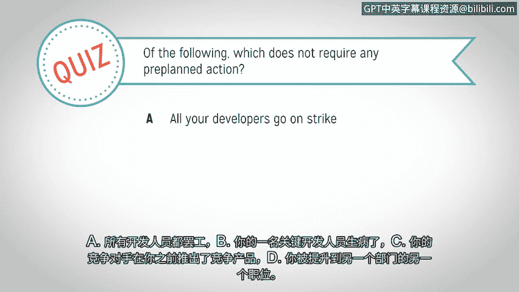
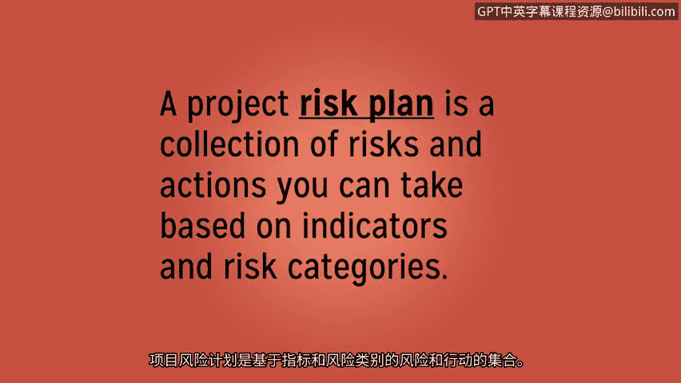

# 软件产品管理课程4：《面向软件产品的敏捷规划》：4.4.4：风险策略：应急与缓解

## 概述

在本节课中，我们将学习如何制定风险计划。上一节我们介绍了如何使用影响与可能性矩阵来评估项目风险，本节中我们来看看如何将这些评估转化为具体的行动计划。

## 什么是风险计划？

风险计划，或称风险管理计划，包含一系列潜在的项目风险、其相关的影响与可能性，以及当风险出现时计划采取的应对措施。

你可以将风险管理计划写成一个简单的表格，如下所示：

以下是风险计划表格的构成要素：

*   **风险**：我们整个模块讨论的对象，即可能导致项目失败的事件。
*   **等级/类别**：根据影响与可能性矩阵为风险分配的优先级。
*   **指标**：用于识别可能面临此风险的迹象描述。
*   **应对措施**：当通过指标发现项目面临风险时应采取的行动。

## 风险类别与应对策略

当我讨论影响与可能性矩阵时，我定义了三个风险类别，分别称为1、2和3类。

*   **第1类风险**：应尽快处理的风险，对项目构成最大威胁。这些风险被纳入项目计划，相关的应对措施通常是立即执行。
*   **第2类风险**：严重性较低，但仍需列入风险计划。这些风险对项目构成中等威胁，因此任何应对措施都应认真规划，但程度不及第1类风险。
*   **第3类风险**：基本无需规划，因为它们对项目的威胁很低。

## 风险计划实例分析

让我们通过几个例子来看看风险如何具体呈现。

**实例一：版权获取风险**

在我们的音乐播放器应用中，客户需要为其提供给用户的内容获取版权许可。你将此风险放入矩阵评估，确定客户无法获取版权的风险属于第2类风险（影响高，但可能性中等）。

以下是针对此风险的计划条目：

*   **风险**：客户无法为应用内容获取艺术家版权。
*   **等级**：2
*   **指标**：客户向你传达此问题，或表现出对应用失去兴趣的迹象。
*   **应对措施**：确保开发团队以增量方式交付产品，让客户看到进展；妥善结算项目财务，并确保已完成的工作能得到补偿。有时，为了项目成功，产品经理帮助客户获取版权也可能是审慎之举。

**实例二：未经验证的算法风险**

你的开发团队决定使用一种特殊的压缩算法来提高应用内容的加载速度。然而，该算法是开发人员前一晚在酒店房间构思的，基本上未经测试，细节不明，团队不确定其是否有效。你评估此风险为第1类风险（影响高，可能性高）。

以下是针对此风险的计划条目：

*   **风险**：团队无法实现该压缩算法。
*   **等级**：1
*   **指标**：团队在一周的开发中毫无进展；开发团队直接告知算法工作无法推进。
*   **应对措施**：告知客户正在尝试的算法可能不成熟且无法工作，优先管理客户期望；制定备用计划，例如与开发团队约定，若开发人员开始工作一周后仍无进展，则改用标准压缩算法；务必告知客户此备用计划。

## 处理未知风险

如果你为项目中所有评估为第1类或第2类的风险都制定了上述计划，项目成功的可能性将大大增加。然而，那些未知的风险呢？遗憾的是，你无法为未知之事做计划。项目中总会出现无法预见的风险。有时项目的成功取决于你如何即时应对这些风险。这并非说你不应规划项目，而是你无法为一切做好计划。处理未知风险是产品经理应培养的一项技能，其重要性不亚于处理已知风险。

## 行业实践

为了缓解项目风险，我们会考虑几个不同的因素。我们会创建所谓的“头脑风暴研讨会”，来识别和集思广益与特定项目及不同技术相关的风险。我们会明确谁愿意负责不同的风险，制定风险应对策略，包括规避策略、缓解策略、转移风险或直接接受风险。我们还会更好地理解每个风险的影响和概率，以便评估需要何种应对措施，确定由谁负责这些风险以及时间线。

## 总结

本节课中，我们一起学习了如何制定风险计划。一个项目风险计划是基于指标和风险类别，对风险及可采取行动的集合。通过预先识别、评估和规划应对措施，你可以更有效地驾驭项目中的不确定性，提高成功的几率。

---

**课程回顾**

在本课程中，我们涵盖了大量提高项目成功几率的不同技巧：

*   **第一模块**：Morgan介绍了规划的概念，描述了工作分解结构、不确定性空间，并定义了估算、目标和承诺等术语。
*   **第二模块**：我描述了如何在发布级别规划项目，以及使用时间盒来协调小块时间内的项目开发。接着介绍了甘特图作为可视化项目进度和依赖关系的手段，并逐步讲解了如何创建发布计划。
*   **第三模块**：Morgan深入到迭代级别，描述了如何估算任务时间，展示了任务依赖关系，并举例说明了规划项目时使用的两种图表：关键路径法图和PERT图。该模块以展示如何创建迭代计划结束。
*   **第四模块（本模块）**：我通过描述常见的项目风险，向你展示了项目中可能出现的问题。然后我们使用影响与可能性矩阵评估并确定了这些风险的优先级，并通过使用风险计划来规划如何应对风险。

你可以将这些技巧中的任何一种应用到你的下一个软件项目中。没有什么能阻止你将它们也应用到当前的项目中。更重要的是，这些方法不仅限于软件领域。规划方法已被广泛应用于从家庭琐事管理到建造宇宙飞船的各个方面。

如果你将这些技巧应用到你的项目中，请回来分享你的经验。我将为此开设一个讨论论坛。

这是我们专项课程的第四门课。你的下一步是学习我们的第五门课：《软件改进的评审与度量》。在那里，我们将向你展示如何监控项目，并确保你始终走在成功的道路上。我们课堂上见。