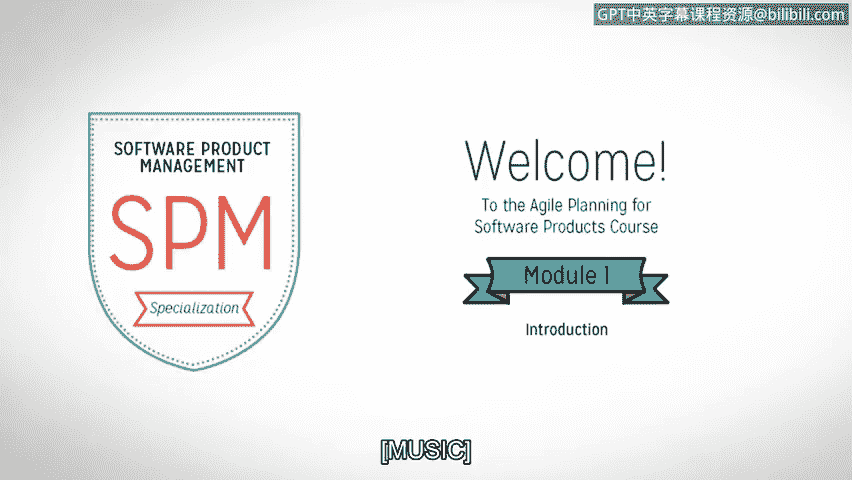

# 艾伯塔大学软件产品管理课程4：《面向软件产品的敏捷规划》｜agile-planning-for-software-products｜ - P29：1_05_introduction-to-agile-planning-for-software-products.en_subtitled - GPT中英字幕课程资源 - BV14w411a7jH

Hi， I'm Ken Wang。

Welcome to the Agile Planning for Software Product Cour。

The fourth in the software Part management specialization。

This course is intended to be taken after you have completed the course on software processes and agile practices。

Plus， the course on client needs and suffer requirements。

Those two courses serve as their legs in an oaksh that depicts a structure of a specialization。

This course then will serve as the body of the inocsh。

 placed upon the legs to further complete the structure。In this segment。

 I'll give you a preview of the Agile Planning for softwareftware products course。

 I previously said that making better software involves three goals。😊，The right product。

 done right and managed right。This course focuses on agile plant techniques so that the project for the software product is managed properly。

Its about organizing work effectively while being adaptive to change。

Through the techniques we will share with you in this course。

 the software processes and agile practices are done right to ultimately achieve the right product。

This course brings together many fundamentals from the prior two courses。For example。

 you'll recognize the concepts of user stories from software requirements。

Sprints from the scrub methodology， and tie to pans from processes。

This course builds upon those concepts。Whether you manage a team of people directly or through others。

 you will appreciate three key types of planning involved in software projects。Release planning。

 iteration planning， and risk planning。We will cover these in modules two， three。

 and four of this course。In the first module， Morgan pets out wildlife uncertainties that projects need to resolve。

She also show how to break down work into manageable pieces。

She will also explain the difference between an estimate， a target， and a commitment。

In the second module， Bli Poette will explain how to use story points to estimate the size of a requirement。

It will also explain how estimates relate to velocity as a way to measure the productivity of development team。

It will show how to use timeboxing as a basis for planning work。

Which could then be made into a G chart。This leads then to constructing a release plan to map out the delivery of user stories over the upcoming sprints。

In the third module， Morgan returns describe how to estimate task times and determine task dependencies。

She will show how to use CPM diagrams and per charts to plan work at the task level。

This leads to constructing aiteration plan to map out the tasks to be done within the next sprint。

In the fourth module， Brad will detail problems or risks that could cause a project to fail。

He will describe a number of anti patternstters， which are situations with negative consequences for a project and his people。

You will outline how to assess risks and determine what level of action is needed。

These leads to constructing a risk plan to map out what to do should a risk occur。

By the end of the course， you will gained an effective set techniques to help you plan your next project and to create a great software product。

 one that is managed right。