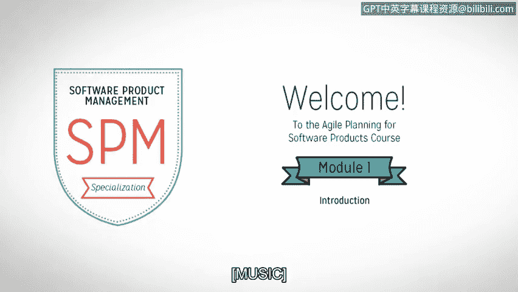

# 艾伯塔大学软件产品管理课程4：《面向软件产品的敏捷规划》｜agile-planning-for-software-products｜ - P29：1_05_introduction-to-agile-planning-for-software-products.en_subtitled - GPT中英字幕课程资源 - BV14w411a7jH

## 课程概述 📋

大家好，我是 Ken Wang。欢迎来到《面向软件产品的敏捷规划》课程。这是软件产品管理专项课程的第四门课。本课程旨在您完成《软件流程与敏捷实践》以及《客户需求与软件需求》两门课程后学习。前两门课程构成了专项课程结构的“两条腿”，而本课程将作为“躯干”，放置于“腿”之上，进一步完善整个知识体系。

在本课程中，我们将学习如何运用敏捷规划技术，以确保软件产品项目得到妥善管理。核心在于有效组织工作，同时适应变化。通过本课程分享的技术，我们可以确保软件流程和敏捷实践得以正确执行，最终实现“正确的产品”。

## 课程内容预览 🧭

我之前提到过，打造更好的软件涉及三个目标：**正确的产品**、**正确地完成**以及**正确地管理**。本课程重点在于敏捷规划技术，以确保软件产品项目得到妥善管理。

本课程融合了前两门课程的许多基础知识。例如，您将识别出软件需求中的**用户故事**概念、Scrum方法论中的**冲刺**，以及流程中的**时间盒**。本课程将在此基础上进行构建。

无论您是直接管理团队还是通过他人管理，您都会认识到软件项目涉及的三种关键规划类型：**发布规划**、**迭代规划**和**风险规划**。我们将在本课程的第二、三、四模块中分别介绍这些内容。

## 模块详解 📚

以下是本课程各模块的核心内容介绍。

### 模块一：工作分解与估算基础

在第一个模块中，Morgan Patzelt 将阐述项目需要解决的各种不确定性。她还将展示如何将工作分解为可管理的部分。此外，她会解释**估算**、**目标**和**承诺**之间的区别。

### 模块二：发布规划与故事点估算

在第二个模块中，Blaine Price 将解释如何使用**故事点**来估算需求的规模。他还会说明估算如何与**速率**相关联，以此作为衡量开发团队生产力的方式。他将展示如何以**时间盒**作为规划工作的基础，进而可以制作成**燃尽图**。这最终导向构建一个**发布计划**，以规划在即将到来的冲刺中交付哪些用户故事。

### 模块三：迭代规划与任务管理

在第三个模块中，Morgan Patzelt 将回归，描述如何估算**任务时间**并确定**任务依赖关系**。她将展示如何使用**关键路径法图**和**甘特图**在任务级别规划工作。这导向构建一个**迭代计划**，以规划在下一个冲刺中需要完成的任务。

### 模块四：风险识别与管理

在第四个模块中，Brad 将详细说明可能导致项目失败的问题或**风险**。他将描述一系列**反模式**，即对项目及其人员产生负面后果的情况。您将学习如何评估风险并确定需要采取何种级别的行动。这导向构建一个**风险计划**，以规划在风险发生时该如何应对。

## 课程总结 🎯

在本课程中，我们一起学习了面向软件产品的敏捷规划核心技术与方法。课程涵盖了从工作分解、故事点估算，到发布规划、迭代规划，再到风险管理的完整流程。

通过本课程的学习，您将获得一套有效的技术组合，帮助您规划下一个项目，并创造出管理得当的优秀软件产品。