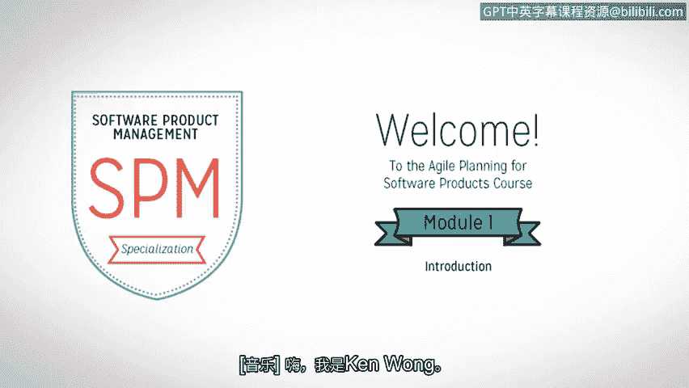

# 艾伯塔大学软件产品管理课程4：《面向软件产品的敏捷规划》：P2：1_敏捷软件产品计划简介 🎯

## 概述

在本节课中，我们将学习《面向软件产品的敏捷规划》课程的总体介绍。我们将了解本课程在专项课程体系中的位置、核心目标以及将要涵盖的关键规划类型。

我是 Ken Wang。

欢迎来到《面向软件产品的敏捷规划》课程。

这是软件产品管理专项课程的第四门课。

本课程建议您在完成《软件过程与敏捷实践》以及《客户需求与软件需求》两门课程后学习。

前两门课程如同橡树的两条腿，构成了专项课程的基础结构。

本课程则将作为橡树的躯干，放置于双腿之上，进一步完善整个知识体系。

在本部分，我将为您预览《面向软件产品的敏捷规划》课程。

我之前提到，打造更好的软件涉及三个目标：**正确的产品**、**正确地完成**以及**正确地管理**。

本课程专注于敏捷规划技术，以确保软件产品项目得到妥善管理。

其核心在于有效地组织工作，同时适应变化。

通过本课程分享的技术，我们可以确保软件过程和敏捷实践被正确执行，并最终实现正确的产品。

本课程汇集了前两门课程的许多基础知识。例如，您将识别出软件需求中的**用户故事**概念、Scrum方法论中的**冲刺**，以及过程管理中的**时间盒**。

本课程将在此基础上进行构建。

无论您是直接管理团队还是通过他人管理，您都会认识到软件项目涉及的三种关键规划类型：**发布规划**、**迭代规划**和**风险规划**。

我们将在本课程的第二、三、四模块中分别讲解这些内容。

## 课程模块预览

以下是本课程各模块的核心内容简介。

### 第一模块：工作分解与估算基础

在第一模块中，Morgan将阐述项目需要解决的各种不确定性。

她还将展示如何将工作分解为可管理的部分。

她也会解释**估算**、**目标**和**承诺**之间的区别。

### 第二模块：发布规划与故事点估算

在第二模块中，Bli Poette将解释如何使用**故事点**来估算需求的规模。

他还会解释估算如何与**速率**相关联，后者是衡量开发团队生产力的一种方式。

他将展示如何使用**时间盒**作为规划工作的基础，进而可以制作成**燃尽图**。

这最终导向构建一个**发布计划**，以规划在即将到来的冲刺中交付哪些用户故事。

### 第三模块：迭代规划与任务管理

在第三模块中，Morgan将回归，描述如何估算任务时间并确定任务依赖关系。

她将展示如何使用**关键路径法图**和**甘特图**在任务级别规划工作。

这导向构建一个**迭代计划**，以规划在下一个冲刺中需要完成的任务。

### 第四模块：风险识别与管理

在第四模块中，Brad将详细说明可能导致项目失败的问题或风险。

他将描述一系列**反模式**，即对项目及其人员产生负面后果的情况。

您将学习如何评估风险并确定需要采取何种级别的应对措施。

这导向构建一个**风险计划**，以规划在风险发生时应采取的行动。

## 总结

在本节课中，我们一起预览了《面向软件产品的敏捷规划》课程的全貌。通过本课程的学习，您将获得一套有效的技术，帮助您规划下一个项目并创造出优秀的软件产品——一个被**正确管理**的产品。