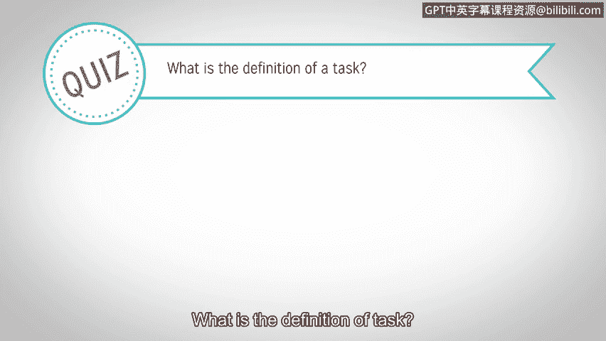
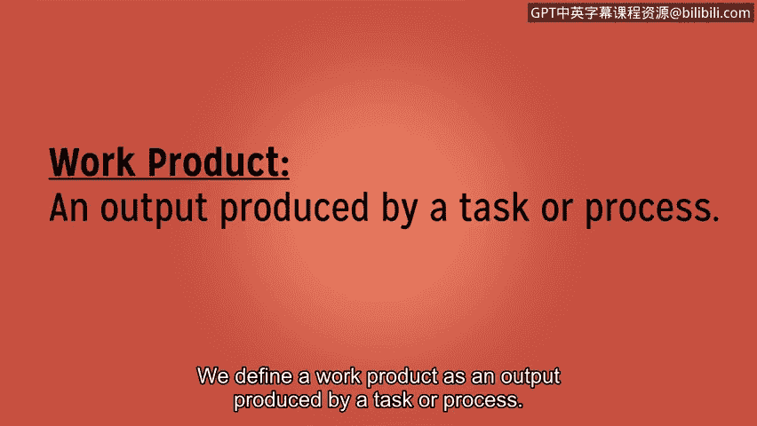
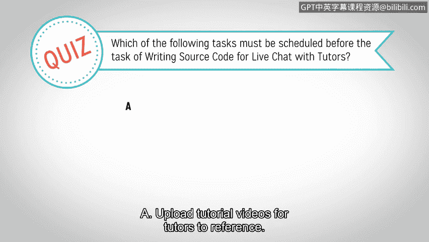

# 艾伯塔大学软件产品管理课程4：《面向软件产品的敏捷规划》：1：课程介绍

在本节课中，我们将要学习面向软件产品的敏捷规划策略与技术。这些技术遵循敏捷宣言的原则，将使您的软件项目更能适应变化。

软件项目规划的关键在于将工作量分解为更小、更易管理的任务。本课程将从理解如何描述和组织细粒度任务开始，接着会重点讲解如何分解大型活动。您还将学习如何创建时间和工作量估算，以便准确安排所需工作。

软件项目有多种排期方式。我们将涵盖如何在发布级别和迭代级别规划项目。发布是指将产品交付至可上市状态。一个发布通常由多个迭代组成。您使用发布计划来整体规划项目，包括决定每个迭代要完成哪些需求。您使用迭代计划来规划特定迭代中要完成的任务。

您将学习诸如甘特图和发布计划等发布规划技术，以及诸如PERT图、CPM图和迭代计划等迭代规划技术。我们将在课程中详细讲解所有这些技术。

您还将学习风险规划。正如在介绍性课程中提到的，风险规划是软件规划的重要组成部分。软件开发过程中可能出现许多风险，因此您需要为这些风险做好准备，以避免对产品创建和支持产生负面影响。

让我们回顾一下之前课程的内容。

在关于软件过程和敏捷实践的课程中，我们讨论了“任务”这个术语。任务的定义是什么？

A. 一个人承担或扮演的职责。
B. 项目中要完成的一个小的、可管理的步骤。
C. 软件过程产生的输出。
D. 衡量进度的内部检查点。

在关于软件过程和敏捷实践的课程中，我们将任务定义为项目中要完成的一个小的、可管理的步骤。因此，B是正确答案。答案A定义了角色，答案C定义了工作产品，答案D定义了里程碑。这些都是我们即将更详细讨论的术语。

我们将从检查上一个测验中看到的术语开始，并介绍本课程将使用的一些新术语。

让我们从“任务”这个术语开始。

**任务**被定义为项目中要完成的一个小的、可管理的步骤。任务是项目的核心。项目中发生的所有事情都可以分解为任务。我们将在本模块后面讨论如何将项目分解为任务。在规划中，您将频繁使用任务来为项目创建估算和进度表。

接下来，让我们看看“角色”这个术语。我们在关于软件过程和敏捷实践的课程中定义了“角色”。

**角色**是一个人承担或扮演的职责。角色的例子包括程序员、测试员、设计师、客户和产品经理。角色执行任务，例如，程序员可能承担为某个功能编写源代码的任务。

“工作产品”这个术语在关于软件过程和敏捷实践的课程中已经介绍过。

**工作产品**被定义为任务或过程产生的输出。

任务不仅产生工作产品作为输出，它们也使用工作产品。一个任务中产生的输出工作产品，可以作为后续任务的输入工作产品被使用。

让我们看一个例子。假设程序员角色承担了为特定功能编写测试的任务。该任务产生该功能的测试工作产品。这些测试是执行测试任务的输入工作产品，因为执行测试这个任务要求事先编写好测试。

正如我们在讨论工作产品时看到的，执行测试的任务依赖于编写测试的任务，因为一个任务的输出工作产品是另一个任务的输入工作产品。在规划时，您需要牢记这些依赖关系，以便以逻辑顺序安排任务。

您正在与一个开发团队合作，创建一个允许学生提问作业问题并从在线导师那里获得帮助的网站。学生也会被引导至教程和资源链接。您正在安排任务，遇到了“为与导师的在线聊天编写源代码”这个任务。

以下哪个任务必须安排在“为与导师的在线聊天编写源代码”这个任务之前？

A. 上传供导师参考的教程视频。
B. 对与导师的在线聊天进行验收测试。
C. 设计在线聊天工具。
D. 雇佣导师进行在线聊天工作。

上传视频是一个可以在开发后期才实施的任务。雇佣导师将取决于在线聊天功能是否正常工作，因此不会安排在此任务之前。所以，答案A和D不正确。

答案B很接近，但也不正确。进行验收测试依赖于源代码的编写。为此功能编写源代码的任务必须安排在验收测试任务之前。功能需要先设计好，程序员才能开始编程。因此，答案C正确。设计在线聊天的任务必须安排在为在线聊天编写源代码的任务之前。

本节课中，我们一起学习了敏捷规划的基本概念，包括任务、角色、工作产品和依赖关系的定义。理解这些基础术语是进行有效项目规划的第一步。在接下来的章节中，我们将深入探讨如何将这些概念应用于实际的发布和迭代规划中。