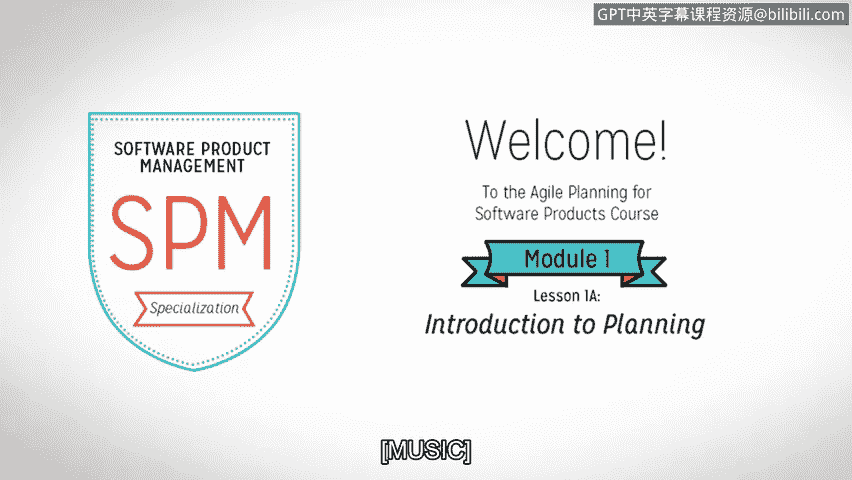
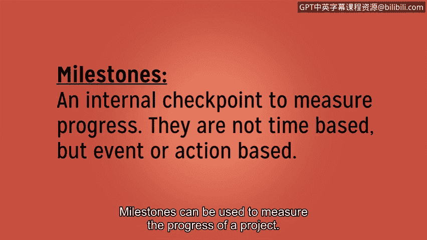
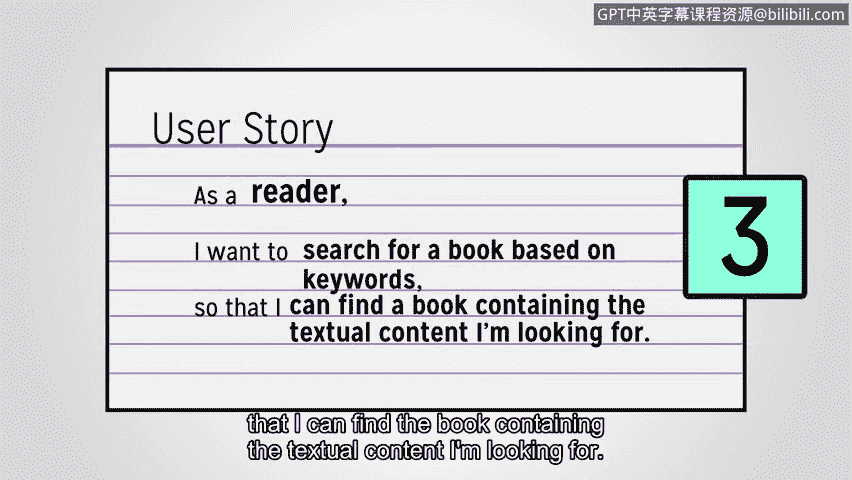
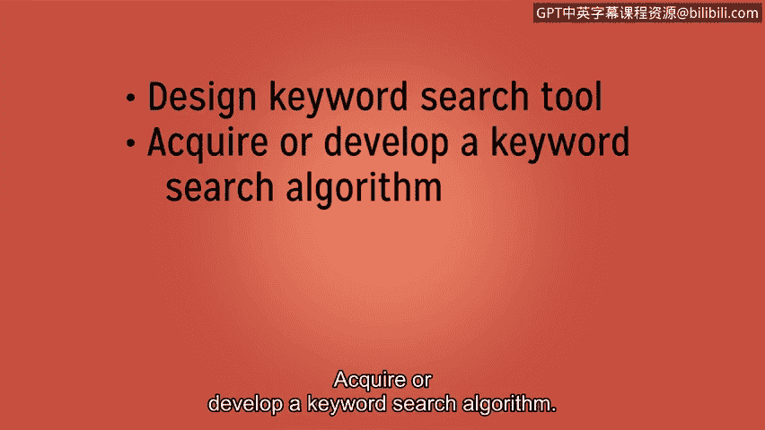

# 艾伯塔大学软件产品管理课程4：《面向软件产品的敏捷规划》：P31：3_02_4-1-1a-规划简介

在本节课中，我们将学习规划中的几个核心概念：**进度表**和**里程碑**。我们将了解它们的定义、区别以及在实际项目中的应用。

## 进度表与里程碑

上一节我们介绍了规划的基础。本节中，我们来看看规划的两个关键组成部分：进度表和里程碑。

**进度表**是将任务映射到时间线上的安排。任务是一个项目的基本要素。正如之前讨论过的，任务之间会基于其工作成果产生依赖关系。识别任务的依赖关系是创建进度表的重要步骤。

你需要以这样的方式将任务映射到时间线：作为输入所需的工作成果，必须在被需要之前创建完成。同时，你还需要确保高优先级的需求被优先完成。你需要规划每个迭代周期内要完成的内容。这听起来很复杂，但本课程将向你展示有效安排这些内容的技术。

接下来，我们谈谈**里程碑**。里程碑是衡量进展的内部检查点。它们不是基于时间的，而是基于事件或行动的。里程碑可用于衡量项目的进展。然而，它们在**线性流程**和**早期迭代流程**中更为常见。

你在《软件流程与敏捷实践》课程中学习过这些线性和早期迭代流程。在之前的课程中研究敏捷宣言时，我们了解到，在敏捷开发中，通常不设置里程碑。进展是通过可工作的软件来衡量的，而不是通过事件。所有的发布和迭代都是基于时间的，因此它们不符合里程碑的定义。

## 里程碑示例分析

为了加深理解，我们通过一个例子来分析什么是真正的里程碑。

Sierra正在开发一个允许用户监控和跟踪月度支出的项目。她和她的开发团队决定基于里程碑来衡量进展。

以下是几个选项，哪个是里程碑的示例？
A. 一个为期两周的冲刺结束。
B. 项目启动一周年纪念日。
C. 产品的截止日期。
D. 需求已编写并完成评审。

**里程碑不是基于时间的**。因此，一个为期两周的冲刺结束不是里程碑，因为它是用两周时间来衡量的。同样，一周年纪念日也是基于时间的。所以，答案A和B不正确。

截止日期可能被视为一个里程碑，但它仍然是基于时间的，因此答案C也不正确。如果Sierra想将其表述为里程碑，更好的措辞是“最终产品交付”。然而，最终产品交付的日期并不总是产品的截止日期。

答案D不是基于时间，而是基于行动的。当所有需求都已编写并完成评审时，你就知道这个里程碑已经达成。这可以是一个项目的主要里程碑，因此答案D是正确答案。

## 任务：从需求到实现

正如本节课前面所说，项目中发生的所有事情都可以分解为**任务**。它们是规划的一个重要方面，也是之前课程的重要组成部分。

在《客户需求与软件需求》课程中，你学习了如何创建需求。一旦你创建并确定了软件需求的优先级，就需要将它们分解为要完成的开发人员任务。让我们看一个例子。

假设我们正在创建一个允许用户浏览电子书（就像一个虚拟图书馆）的应用程序。我们的一个需求是：“作为一名读者，我希望能够基于关键词搜索书籍，以便找到包含我正在寻找的文本内容的书籍。”

我们有了一个需求，但你的开发团队如何将其转化为产品的一部分呢？以下是由此需求可能产生的一些开发人员任务示例：

以下是可能由此需求产生的开发人员任务示例：
*   设计关键词搜索工具。
*   获取或开发关键词搜索算法。
*   编写关键词搜索工具的源代码。
*   测试关键词搜索工具。

开发人员任务可以更具体地涉及技术，而需求则应独立于技术。通过开发人员任务，开发团队正在为问题提出解决方案。这些开发人员任务通常使用**迭代计划**来安排。你将在本课程后续部分学习如何做到这一点。

## 任务在流程与敏捷中的作用

在《软件流程与敏捷实践》课程中，我们讨论了任务如何构成活动，活动又如何构成阶段。每个阶段都有要完成的特定任务。因此，任务是创建流程的基础。任务在敏捷实践中也扮演着重要角色。

敏捷实践提供了组织任务并确保其有效完成的方法。使用迭代计划是Scrum方法论中常见的一种敏捷实践。如前所述，迭代计划是一种安排任务的技术。**看板**则是一种通过一系列步骤可视化跟踪任务进展的方式。

## 总结与预告

现在，你已经有了一个良好的基础，可以开始学习更多关于规划的知识。在本节课中，我们一起学习了：
*   **进度表**的定义：将任务映射到时间线的安排。
*   **里程碑**的定义：基于事件或行动的、用于衡量进展的内部检查点。
*   如何从**需求**分解出具体的**开发人员任务**。
*   任务在传统流程和敏捷实践中的核心作用。

在下一课中，你将学习**不确定性空间**以及如何在项目中导航。我们下节课见。😊