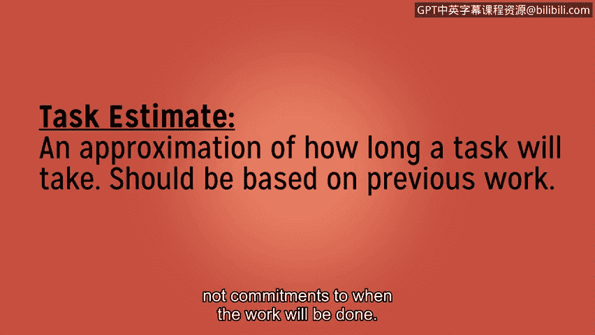
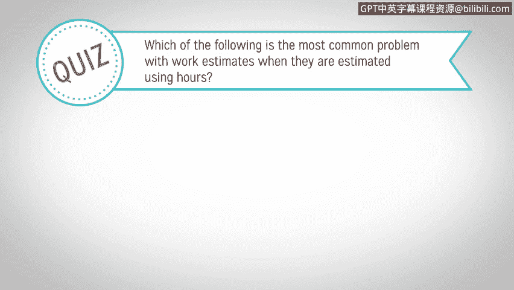

# 艾伯塔大学软件产品管理课程4：《面向软件产品的敏捷规划》｜agile-planning-for-software-products｜ - P35：7_01_4-2-1-story-points.en_subtitled - GPT中英字幕课程资源 - BV14w411a7jH

🎼。😊。

Welcome to the next module on Agile Plan for softwareft Product。In the last module。

 Morgan introduced some of the core concepts in planning， like uncertainty space。

 how to break down work， and the difference between estimates， targets， and commitments。

In this module， I'm going to talk about story points and velocity and then move into some techniques for turning these estimates into tangible plans。

In the last lesson， Morgan talked about estimates， targets and commitments。 Here's a refresher。

A task estimate is an approximation of how long a task will take。

These are made by the developers who expect to work on a task that is being estimated。

The estimates should be based on previous work。They're non negotiable since they're only figures of how long work will take。

 not commitments to when the work will be done。

A target is a deadline to be met。Targetets are usually set externally to the development team。

 They're also non negotiable， since other parties may depend on the dates。Finally。

 commitments are real enforced work to which the development team commits。

They outline exactly what work will be completed at what time。

They're based off target deadlines and realistic estimates。

Commitments are the schedules by which a project is determined。

 and they're negotiated between the client and the development team。

Project commitments are governed by targets and estimates。Targets are specific dates。

 and estimates give commitments some realistic grounding。

Without estimates on how much time work will take， commitments could be made that are not realistic。

By the target dates。I just reapppped what the difference is between an estimate， a target。

 and a commitment。Which of these terms describes a deadline set externally to the development team that must be met。

A estimate。B， target。Or C commitment。The correct answer is B target。

Targets are dates that are set externally to the development team and must be met。Commitments。

 on the other hand， are negotiable， where targets are not。How do we create good estimates？Well。

 Morgan mentioned in the previous lesson that a developer should base their estimates on the amount of time it has taken them to implement similar functionality in the past。

She talked about a few different scenarios in which software developers gave time estimates。

 usually paded a bit to give the developer some breathing room。But why is this？

What makes the software developer feel they have to pad their work estimates to begin with？Well。

 what often happens is that managers mistake developers estimates as commitments。

Developers know this。They also know that their estimates may be way off。

In order to protect themselves from committing to something they might not be able to uphold。

 the developer gives themselves a little bit of breathing room。 they pat out their estimate。

So a task that took four hours to complete in the past is now being estimated to be completed in 10 hours。

Of course， managers know this， too。They know when an estimate seems unreasonable。

It's no surprise then that managers end up negotiating these estimates with their developers。Now。

 a 10 hour estimate is whittled down to a six hour estimate。They're compromising on the estimates。

 which should be absolute。Organizationally， it doesn't make much sense。

Wouldn't it be better if you could just make an estimate without it sounding like a commitment？

One of the problems here is that time is often used as a unit of measurement for work estimates。

That's to say that each estimate is measured in hours， it takes five hours to do this。

 one hour to do that。Naturally， you might think that if a standard workday has eight hours。

 you can complete one， five hour task and about three， one hour tasks。

What ends up happening naturally is developers and product managers begin to associate time estimates with working hours。

This makes it really easy to mistake the estimate for commitment。So how do we fix this？Well。

 one method that's often used in the industry is the story point。

I just talked about some of the problems with estimating work on software projects。

Which of the following is the most common problem with work estimates when they are estimated using hours？

A estimates should be made using minutes， not hours。B。

 time based estimates can be misunderstood as commitments。C。

 software developers are bad at estimating time or D estimates should be made using days， not hours。

The correct answer is B time based estimates can be misunderstood as commitments。

Story pointss are what we aim to use instead of time units。Let's talk about storyPos some more。

