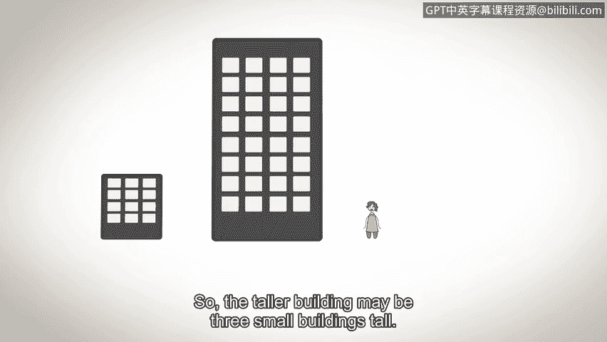
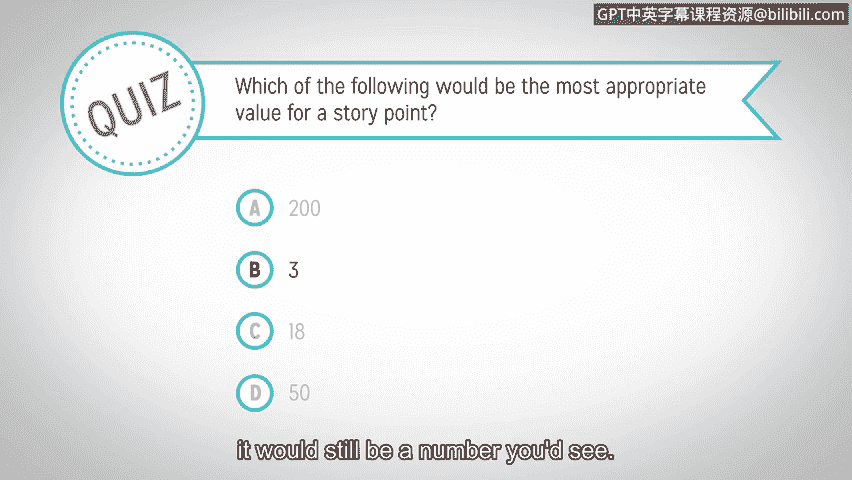

# 艾伯塔大学软件产品管理课程4：《面向软件产品的敏捷规划》｜agile-planning-for-software-products｜ - P36：8_02_4-2-1a-story-points.en_subtitled - GPT中英字幕课程资源 - BV14w411a7jH

🎼。😊。

Story points were created out of a need to save software developer sanity。

 as estimates are often taken to be commitments。This is a huge problem in managing software projects in general。

For this reason， developers cringe at the idea of giving a solid time estimate to complete a particular task。

A developer may be forced to give a manager an estimate for task completion time。

And that manager then ends up taking that estimate as a commitment。The manager。

 then it ends up taking this commitment to their managers。 and all of a sudden。

 the product's internal deadlines are being based on one software developer's R estimate。

What's worse is that if a software developer's work ends up taking more time than they had estimated。

 as it often does， that developer ends up feeling the heat。

It isn't that the developer is performing poorly。 They just didn't make an accurate estimate。

An inaccurate estimate doesn't necessarily reflect a lack of experience or competence on the developer's part either。

As you'll see in this lesson on estimating task time， it's hard to make reliably accurate estimates。

 especially when you make those estimates far into the future。

The way story pointss try to solve this problem is to eliminate time as the unit measurement for estimating work。

Instead， story pointss are used when estimating required work to be done。

Story pointss are unitless and relative。The point is that they allow your developers to move away from trying to estimate the exact amount of time some work will take and towards how long it will take in relation to other pieces of work。

Here's how it works。Your developers choose a product requirement， a user story。

 within their product backlog， which is relatively easy to estimate。

Then the developers assign that an arbitrary integer value， which we will call story pointss。

Once you have this value， you assign story points to the rest of your user stories based on it。

So if the next user story is about the same size。That will be assigned the same number of points。

If the one after that is about twice as large， then you assign it twice the number of points and so on。

What you end up with is a list of user stories whose work estimates are all based on each other instead of your developers inadvertently committing to a certain amount of time when they estimate how long each user story will take。

They're determining how large each user story is。And that's exactly what an estimate is supposed to be。

Remember， estimates aren't supposed to be commitments。

 and so taking the time aspect out of them helps prevent them from becoming commitments。

The reason this works is that humans are actually really bad at estimating things exactly。

We're much better at estimating things based on relative sizes。

Let's take a look at a real world example to demonstrate this concept。

Say you want to estimate the size of a building。😡，You try to estimate its size by a gut feeling and say that it's about 60 meters tall。

Another method would be to compare that size to another building。

Pick a smaller building near it and use that one for scale。

So that taller building may be three small buildings tall。

In software， this comes with the added benefit of keeping your developer sanity in check。

You don't have to be exact when estimating story pointss because it's all relative。

If a developer goes over their time estimate， even by a few minutes， it can be hard on them mentally。

They might be upset with themselves for not being on time to their estimate。With story pointss。

 it's not so easy to go over their estimate because the estimate is not linked to time。

You just learned a little bit about story pointss。They are a way for you to avoid accidentally making commitments when estimating using hours。

What about story pointss makes them well suited for estimation without becoming commitments？

You may choose more than one answer。A， story pointss are unitless。B。

 story point values may change from project to project。C， story pointss are harder to understand。D。

 story pointss do not map directly to one time value。And or E St pointss do not map time at all。

The answers are A， B， and D。Story pointss are unitless。

 and their value changes from project to project。Since they change from project to project。

 their time value can change from project to project。

 But that doesn't mean that story points don't map at time at all。

Story points can often be misunderstood because they're often assigned values that are treated like ours would be。

If you set your first user story as 100 story pointss， for example。

 then it will be easy for your developers to assign very precise numbers of points to other user stories based on that。

So you might see other user stories being assigned values of 42 points， for example。

If the whole point of using user stories is to be relative。

 it doesn't make much sense to use such precise numbers。

It's important to set the right value for your story pointss so that your points stay relative。

One way to help support this relativity is to use storypoint values which are fixed。

A good way to do this is to assign story points based on a Fibonacci sequence。

A Fibonacci sequence is a sequence of numbers， or any individual number is the sum of the two numbers which precedeed。

So a Fibonacci sequence could look like this。Wan。Wen。2。3。5ve。eight。13 and so on。

Fibbonacci numbers make it really simple to estimate using story pointss。

Instead of using whatever numbers you think would work。

 you restrict yourself to only using Fibonacci numbers for your estimates。

If your estimate falls between two estimates， you would round up to the nearest available number。

This keeps your estimates tidy， and because of uncertainty。

 avoids making large estimates unnecessarily precise。

So if your first task estimate is assigned a three and your next task seems to be about twice as large。

 you don't assign it a six because you were limited to the Fibonacci sequence。

 you would round your estimate up to an eight。It's in this way that you can keep your estimates in check and deal with uncertainty without making unintended commitments。

Which of the following would be the most appropriate value for a story point？A200。B，3。C，18 or D50。

The correct answer is B，3。Since three is nice and low。

 it's easy to estimate other values around it without getting into percentages of points。

Three is also a number in the most common Fibonacci sequence。

So if you were using storyPo estimates in a Fibonacci sequence， it would still be a number you'd see。

Story pointss are a great alternative to estimating work by the amount of hours it might take。

However， story pointss aren't a widely accepted practice in the industry。

 even among the strongest proponents of Agile software development and scrum。If StPos work so well。

 why would there be any controversy surrounding them at all？Story pointss can be tricky。

To begin with， it takes a very particular type of thinking to implement。

It can be a confusing requirement for developers to suddenly shift their thinking from time estimates to points。

What often ends up happening is that developers will translate a certain number of predicted hours to a certain number of story pointss。

Because that's what makes the most sense to them。However。

 that's completely contrary to what story pointss are all about。This is just a matter of education。

 you might think。It's true after some practice， developers do become better at using story pointss to estimate their work。

However， there are some inherent limits to estimation， which makes story pointss a touchy subject。

One of these limits is that the act of estimating itself is a risky endeavor。

You can never be 100% certain that any given estimate will be accurate。

 That's why they're called estimates。While estimates of relative size are much more accurate than exact number estimates。

 relative size estimates are still not perfect。A really good example of just how bad we are at this is the vertical horizontal perceptual illusion。

What essentially happens here is that when presented with a vertical line on top of a horizontal line of the same length。

 people tend to overestimate the length of the vertical line。So even if it's just a couple of lines。

 it's easy to see that we're not exactly perfect at estimating the size of something。

 even if you have a direct comparison against which to measure。

Another issue is that story pointss can get out of hand in large teams。They're meant to scale。

 but some developers might give themselves inflated story points for very small tasks in order to give the appearance of productivity。

This is fine if the estimate for a point is consistent throughout the entire project。

It's possible that a manager will ask a team to work extra hard in the middle of a project in order to increase productivity。

If at this point， developers inflate their numbers artificially by changing the reference for a story point。

 accurate estimation becomes more challenging。Basically。

 story pointss are susceptible to gaming or cheating the system。

 and this is a potential concern for managers。This isn't to say that story pointss are necessarily bad。

 but there are definitely risks to using them， and you should know about those risks and how to mitigate them if you intend to integrate them into your projects。

So what do you think？Should we use story pointss as an estimation tool？Should we estimate it all？

I've started a discussion forum for this lesson。To post your thoughts。

Please share your views with the rest of the class。That's the story point。

 it's a way to estimate your work based on relative concepts and avoid mistaking estimates for commitments。

In the next lesson， I'm going to introduce the concept of velocity。

 which is a way for you to measure team productivity over time。 See you soon。😊。

