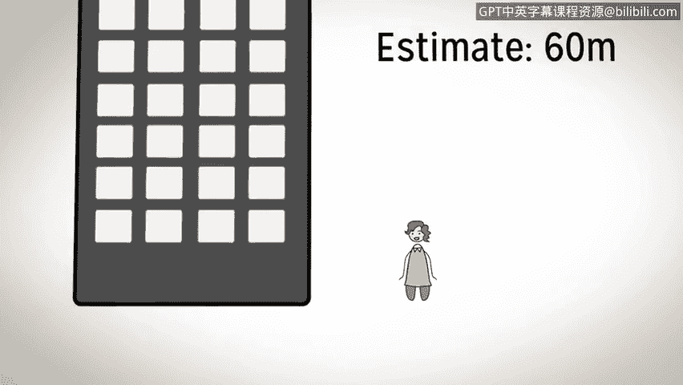
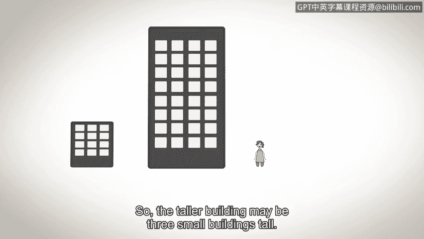
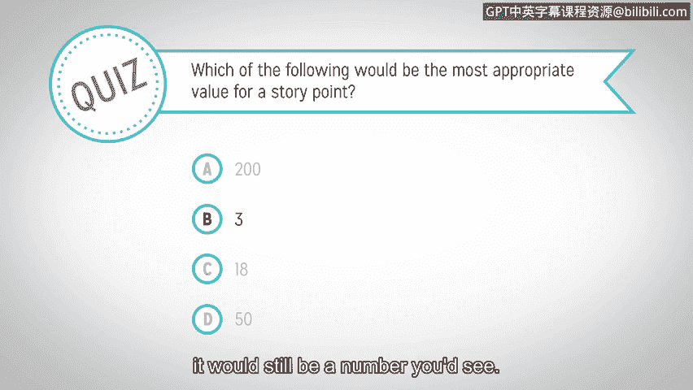

# 艾伯塔大学软件产品管理课程4：《面向软件产品的敏捷规划》：8_02_4-2-1a：故事点详解 🧩

## 概述
在本节课中，我们将要学习敏捷开发中的一个核心估算工具——故事点。我们将了解故事点是什么、它如何解决传统时间估算的问题、以及如何正确使用它来估算工作量，同时避免将估算误认为承诺。

---

## 故事点的起源与目的
故事点的诞生源于保护软件开发人员心智健康的需求，因为估算常常被当作承诺。这在软件项目管理中是一个普遍存在的巨大问题。

因此，开发人员对于为完成特定任务给出一个确切的时间估算感到畏惧。开发人员可能被迫向管理者提供任务完成时间的估算，而管理者最终会将这个估算当作承诺。管理者随后又会将这个“承诺”传达给他们的上级，突然间，产品的内部截止日期就建立在某一位开发人员的粗略估算之上。

更糟糕的是，如果开发人员的工作最终花费的时间超过了他们的估算（这种情况经常发生），该开发人员就会感受到压力。这并非开发人员表现不佳，只是他们没能做出准确的估算。不准确的估算也未必反映了开发人员缺乏经验或能力。

正如你将在本次关于任务时间估算的课程中看到的，做出可靠且准确的估算非常困难，尤其是当你对未来很远的事情进行估算时。

---

## 故事点如何解决问题
故事点试图解决这个问题的方式是，**消除将时间作为估算工作的度量单位**。取而代之的是，在估算需要完成的工作时使用故事点。

故事点是**无量纲**且**相对**的。关键在于，它们让你的开发人员不再试图估算某项工作将花费的确切时间，而是转向估算它相对于其他工作需要花费多长时间。

---

## 故事点的使用方法
以下是它的工作原理。你的开发团队从产品待办事项列表中选择一个相对容易估算的产品需求，即一个用户故事。

然后，开发人员为它分配一个任意的整数值，我们称之为故事点。一旦你有了这个基准值，你就可以基于它为其余的用户故事分配故事点。

因此，如果下一个用户故事规模大致相同，它将获得相同数量的点数。如果随后的一个故事大约是基准故事的两倍大，那么你就分配给它两倍的点数，依此类推。

最终你得到的是一个用户故事列表，其工作量估算全部基于彼此，而不是你的开发人员在估算每个用户故事需要多长时间时，无意中承诺了某个具体的时间量。他们是在确定每个用户故事的规模大小。而这正是估算应有的样子。

请记住，估算不应该是承诺，因此将时间因素从中剔除有助于防止它们变成承诺。

这种方法之所以有效，是因为人类实际上非常不擅长精确地估算事物。我们更擅长基于相对大小进行估算。

---

## 现实世界类比
让我们看一个现实世界的例子来演示这个概念。假设你想估算一栋建筑的高度。你试图凭直觉估算它的大小，并说它大约有60米高。

另一种方法是将其大小与另一栋建筑进行比较。

选择附近一栋较小的建筑，用它作为尺度。那么那栋较高的建筑可能相当于三栋小建筑的高度。

在软件领域，这种方法带来的额外好处是能保持开发人员的心智健康。估算故事点时你不必追求精确，因为一切都是相对的。如果开发人员超出了他们的时间估算，即使只是几分钟，也可能在心理上对他们造成负担。他们可能会因为未能按时完成估算而对自己感到沮丧。而使用故事点，则不容易“超出估算”，因为估算与时间无关。

---

## 知识检查
你刚刚学习了一些关于故事点的知识。它们是一种避免在使用小时数估算时意外做出承诺的方法。

故事点的哪些特性使其非常适合用于估算而不至于变成承诺？你可以选择多个答案。
A. 故事点是无量纲的。
B. 故事点的数值可能因项目而异。
C. 故事点更难理解。
D. 故事点不直接映射到一个时间值。
E. 故事点完全不映射时间。

**答案：A, B, D。**
故事点是无量纲的，并且它们的数值因项目而异。由于它们因项目而异，其对应的时间价值也可能变化，但这并不意味着故事点完全不映射时间。

---

## 使用斐波那契序列
故事点常常被误解，因为它们经常被赋予像小时数一样被对待的数值。例如，如果你将第一个用户故事设为100个故事点，那么你的开发人员就很容易基于此为其他用户故事分配非常精确的点数。因此，你可能会看到其他用户故事被分配了诸如42点这样的值。

如果使用用户故事的整个要点在于相对性，那么使用如此精确的数字就没有太大意义。为你的故事点设置合适的基准值非常重要，这样才能保持点数的相对性。

帮助支持这种相对性的一种方法是使用固定的故事点数值。一个好的做法是基于**斐波那契序列**来分配故事点。

斐波那契序列是一个数字序列，其中**任何单个数字都是前两个数字之和**。

所以一个斐波那契序列可能看起来像这样：
`1, 2, 3, 5, 8, 13, ...`

斐波那契数使得使用故事点进行估算变得非常简单。你不是使用任何你认为可行的数字，而是限制自己只使用斐波那契数进行估算。如果你的估算落在两个可用数字之间，你会向上取整到最接近的可用数字。这使你的估算保持整洁，并且由于存在不确定性，避免了不必要地使大估算过于精确。

因此，如果你的第一个任务估算被分配为3点，而你的下一个任务看起来大约是它的两倍大，你不会分配给它6点，因为你受限于斐波那契序列，你会将估算向上取整到8点。通过这种方式，你可以控制你的估算，并在处理不确定性的同时避免做出无意的承诺。

---

## 另一个知识检查
以下哪个值最适合作为故事点？
A. 200
B. 3
C. 18
D. 50

**正确答案是 B, 3。**
因为3这个数值既小又好，很容易围绕它估算其他值，而不会陷入点数的百分比计算。3也是最常见的斐波那契序列中的一个数字。因此，如果你在斐波那契序列中使用故事点估算，它仍然是一个你会看到的数字。

---

## 故事点的争议与局限
上一节我们介绍了故事点的理想使用方法，本节中我们来看看它在实践中面临的挑战。故事点是估算工作量的一个很好的替代方案，可以避免使用可能花费的小时数。然而，故事点并不是业界广泛接受的实践，即使在敏捷软件开发和Scrum最坚定的支持者中也是如此。如果故事点效果这么好，为什么还会存在争议呢？

故事点可能很棘手。首先，实施它需要一种非常特殊的思维方式。对于开发人员来说，突然将思维从时间估算转向点数估算可能是一个令人困惑的要求。最终经常发生的情况是，开发人员会将预测的若干小时数转换为特定数量的故事点，因为这对他们来说最有意义。然而，这完全违背了故事点的初衷。

你可能会认为，这只是一个教育问题。确实，经过一些练习后，开发人员在使用故事点估算工作时确实会变得更好。然而，估算本身存在一些固有的限制，这使得故事点成为一个敏感话题。

其中一个限制是，估算行为本身就是一项有风险的工作。你永远无法100%确定任何给定的估算都是准确的。这就是为什么它们被称为“估算”。虽然相对大小的估算比精确的数字估算要准确得多，但相对大小估算仍然不完美。一个很好的例子是垂直-水平感知错觉，它展示了我们在这方面有多不擅长。

这里本质上发生的是，当一条垂直线段放在一条等长的水平线段上方时，人们往往会高估垂直线段的长度。所以，即使只是几条线段，也很容易看出我们并不擅长估算某物的大小，即使你有直接的比较对象。

另一个问题是，故事点在大型团队中可能会失控。它们本意是可扩展的，但一些开发人员可能会为非常小的任务给自己分配过高的故事点，以制造高生产力的假象。如果整个项目中每个点的估算是一致的，这倒没问题。但有可能管理者会要求团队在项目中期加倍努力以提高生产力。如果在此时，开发人员通过改变故事点的基准来人为地夸大他们的数字，准确的估算就变得更具挑战性。

基本上，故事点容易受到“玩弄系统”或作弊的影响，这对管理者来说是一个潜在的担忧。这并不是说故事点一定不好，但使用它们确实存在风险，如果你打算将它们整合到你的项目中，你应该了解这些风险以及如何减轻它们。

---

## 总结
本节课中我们一起学习了故事点。它是一种基于相对概念来估算工作量的方法，旨在避免将估算误认为承诺。我们探讨了其原理、使用方法（特别是结合斐波那契序列）、优势以及在实际应用中需要注意的争议和局限。

在下一节课中，我将介绍“速率”的概念，这是一种衡量团队随时间推移的生产力的方法。我们很快再见。😊