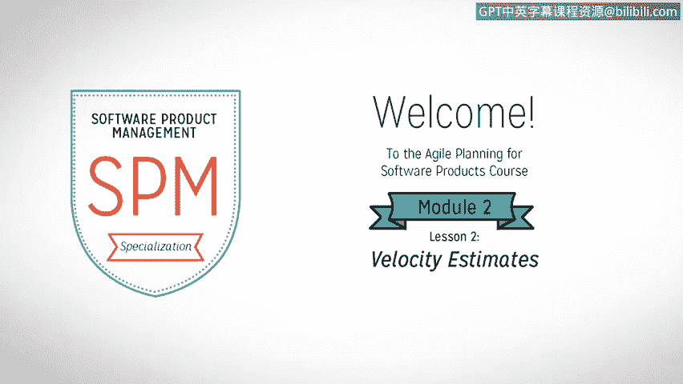
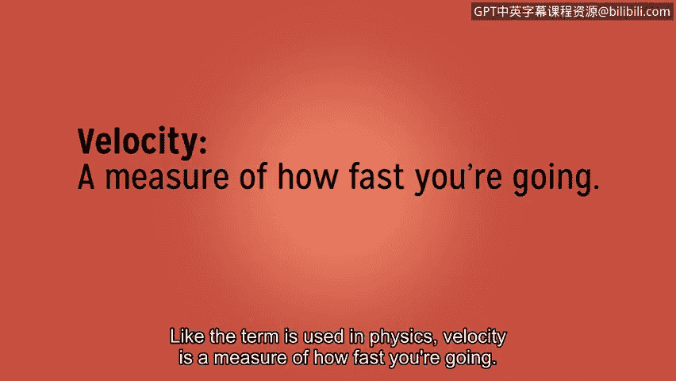
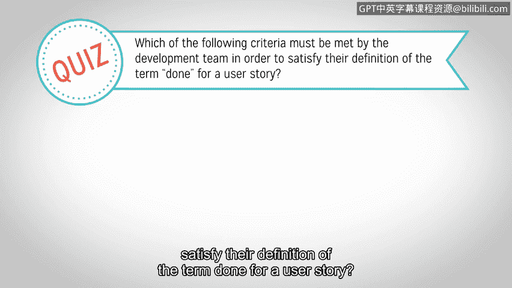

# 艾伯塔大学软件产品管理课程4：《面向软件产品的敏捷规划》：P37：9_01_4-2-2-速度估算

## 概述

在本节课中，我们将要学习敏捷开发中的一个核心概念：**速度**。我们将了解速度的定义、如何计算它，以及如何利用它来估算团队未来的工作量。

## 什么是速度？

上一节我们介绍了故事点以及如何使用它们来估算用户故事的规模。故事点是对完成一个用户故事所需工作量的相对估算。

本节中，我们来看看**速度**，以及它与项目和估算的关系。

那么，什么是速度？就像物理学中的术语一样，速度是衡量你前进快慢的指标。

在物理学中，平均速度是通过测量**一定时间内移动的距离**来计算的。例如，如果你在公路旅行，你可以通过计算过去一小时行驶的公里数或英里数来计算你的速度。

对于软件项目，情况非常相似。唯一的区别在于，我们测量的不是移动的距离，而是**完成的工作量**，时间单位则是你的冲刺周期长度。例如，一个软件项目的速度可以表示为“每个冲刺完成15个故事点”。顺便提一下，冲刺和迭代是同一个概念，它们都是将工作按小块进行时间盒定的方式。我们将在下一课讨论时间盒定。

## 如何衡量工作量？

你可以用不同的单位来衡量生产力。就像公路旅行中，你可以选择使用英里或公里作为单位，它们都能给出速度，只是解释结果的方式会有所不同。

在软件项目中，衡量生产力的单位可以是**完成的用户故事数量**，也可以是**完成的故事点数量**。两者都衡量了项目中完成的工作量，但解释方式不同。混合使用用户故事和故事点可能会像混合使用公里和英里一样令人困惑。

尽管在本课程中你会看到同时使用用户故事和故事点来计算速度，但本节我将主要使用**故事点**作为生产力衡量单位。因为用户故事的规模可能差异很大，使用故事点总数比简单地计算用户故事数量更能代表完成的工作量。

使用用户故事来估算，类似于计算你的公路旅行穿过了多少个城镇。在你的计划路线上城镇数量是有限的，但说你已经穿过了9个城镇中的3个，并不能为你提供关于何时到达下一个城镇或目的地的可靠信息。

## 计算速度

现在你知道了速度是什么，让我们来计算它。如前所述，速度是**在一段时间内完成的工作量**。

在敏捷社区中，通常使用团队在一个冲刺周期内完成的、标记为“已完成”的用户故事所对应的故事点总数来衡量团队速度。

以下是计算速度的步骤：
1.  确定一个冲刺周期（例如，两周）。
2.  记录在该冲刺周期内所有被标记为“已完成”的用户故事。
3.  将这些“已完成”用户故事的故事点相加。
4.  总和即为该冲刺的**速度**。

**公式**：`速度 = 一个冲刺周期内所有“已完成”用户故事的故事点总和`

## “已完成”的定义

什么叫做一个用户故事被标记为“已完成”？一种可能的理解是，该用户故事的功能代码已经编写完成。然而，按照这个定义，你可能会在所需功能完成后就认为用户故事完成了。这在很多情况下可能没问题，但你如何测试它是否真的完成了呢？

要认为一个用户故事“已完成”，至少在Scrum框架中，该用户故事的测试必须通过。这意味着产品必须通过单元测试和验收测试，你和产品负责人才能认为该用户故事完成。

因此，这意味着你不能将一个用户故事的故事点计入你的速度，除非该故事的所有测试都已通过。在实际工作中，你会听到“完成，完成”的说法，这与Scrum中认为用户故事“已完成”是同一个意思：所有功能必须构建完成，所有测试必须通过，并且必须有相应的文档。

## 速度的作用

你为什么要计算速度？速度帮助你对你团队在整个项目中可以完成的工作量做出有意义的估算。这被称为**速度驱动开发**。

在速度驱动开发中，每个冲刺的计划都是基于先前冲刺中完成的工作量或达到的速度。这里的前提是，开发团队要知道在任何一个给定的冲刺中可以完成多少工作，唯一的方法就是看他们过去完成了多少。如果你不清楚过去完成类似工作花了多少精力，就很难估算新工作可能需要多少精力。

因此，使用团队速度进行规划，需要其过去的速度具有一定的稳定性。你需要知道团队完成工作的历史记录是稳定的。这可能需要在项目开始后经过几个冲刺才能实现。如果没有对团队生产力的可靠估算，你就无法可靠地用它来估算未来的工作。

## 使用速度进行估算

假设你的团队速度是恒定且稳定的。你如何使用它来估算未来的工作？这实际上是关于使用你过去的实际速度来估算未来的速度。你根据之前每个冲刺完成的工作量来预测下一个冲刺可以完成多少工作。

你通常会处于以下两种情况之一：
1.  你刚刚开始项目，没有任何速度数据可以作为估算依据。
2.  你正处于项目中期，至少有一些过去的数据。

在项目开始时，很难估算你的速度，因为你没有可以作为估算依据的先前工作。因此，你可以预期在任何给定项目开始时的速度估算是不准确的。从客观的角度来看，你只是不知道你的生产力能达到什么水平。

当你在项目中期时，你将拥有更多数据可供使用。然而，值得注意的是，大多数项目开始时速度并不稳定。团队需要一点时间来找到节奏。所以在初期，你可能仍然需要处理一定程度的不准确性。不过，随着时间的推移，情况会趋于平稳，你应该能够获得更好的估算。

## 关于速度的讨论

现在我们已经讨论了速度以及如何将其用作估算工具，让我们开始一点讨论。关于速度估算是否准确甚至是否有用，存在一些争议。我鼓励你在讨论区分享你对这个话题的看法，我会在那里提供一些讨论起点。

## 总结

本节课中，我们一起学习了**速度**的概念。速度是跟踪团队生产力并估算未来可完成工作量的手段。理论上，它非常强大；在实践中，它也有一些潜在的缺点。尽管如此，了解如何计算团队速度仍然很有用，因为了解团队的大致生产力仍然具有价值。

下一节课，我将讨论**时间盒定**。