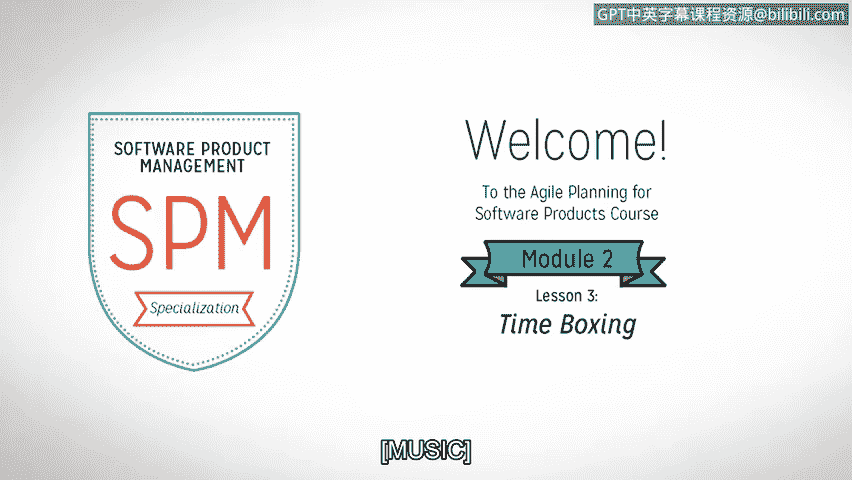
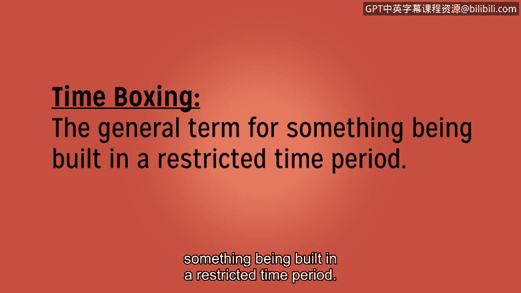
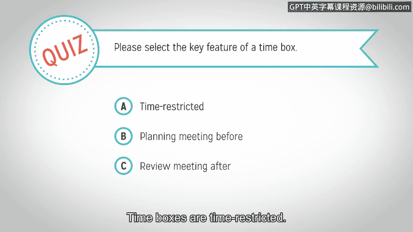

# 艾伯塔大学软件产品管理课程4：《面向软件产品的敏捷规划》｜agile-planning-for-software-products｜ - P38：10_01_4-2-3-time-boxing.en_subtitled - GPT中英字幕课程资源 - BV14w411a7jH

In the last lesson， I talked about velocity and how you can use it to estimate the amount of work that can be done in your projects。

I discussed how you use the story pointss you've completed in your project with a certain period of time you've been working to inform your future work estimates。

But there was a critical step taken， Why is the period of time fixed to be a sprint？In this lesson。

 I'm going to pull together a lot of points from past courses and lessons to help answer that question。

The general answer is time boxing。Time boxing is a way for software teams to compartmentalize the work which they have planned for themselves and leave room for reflection on their progress。

This is a popular modern method for organizing work and the underlying idea behind how Scrum works。

You'll recall that we introduce Scrum in the softwareft processessses and Agile Practices course。

To help you plan what work is to be done in your project。

 we talked about using story pointss as your metric for estimating how much effort each requirement will take。

Let's start with a little bit of a recap on what story pointss are。😡。

StoryPos are relative units for estimating the work required on any given user story。

They're not measured in time units to avoid having the estimates sound like commitments。

You can track how much work your team can do in a sprint to determine your team's velocity。

I talked about that in the last lesson。You might be wondering。

 how do you make sure that you're developing with discipline？Time boxing。

Time boxing is the general term for something being built in a restricted time period you could timebox anything from a four week scrum sprint to a half hour planning meeting。

The broad category under which scrum sprints fall is called。A time lock。B， plan。C。

 workbox or D time box。The correct answer is D time box。

Scrrum sprints are considered time boxed because they are restricted to a relatively short period of development time and a relatively small amount of work。

To create a time box， you simply need to set a period of time in your project during which work will get done。

Set a limit to how much work will get done in the amount of time and plan that work at the beginning。

In Scrum， sprint lengths are anywhere from two to four weeks in length。

 with planning and review periods before and after。

It's one thing to develop a product on your own and track your progress。

 then estimate your project's completion date based on your velocity。

It's another thing entirely to plan your work in order to make sure that you stay on track。

This is because if left without development goals or milestones。

 most people tend to develop slower than if they had regularly planned their work。Why， well。

 think about it。 If you give yourself a task to do with no solid deadline to complete that task。

 then it's easy to get distracted and do unnecessary work。Because time is seemingly flexible。

 the scope tends to expand， which is a risk。If， however。

 you plan your work in sufficiently small doses of time。

 it's easy to see what your next target is and what needs to get done by that time。When you time box。

 you place a certain amount of work into specifically planned fixed length segments or boxes of time。

You take a subset of the work which needs to be completed by the end of the project and divide it into manageable chunks to be put into the boxes。

In Scrum， each time box or sprint also involves reviewing the work that your team completed at the end of each period。

All of this together allows you to see regular sustained pace for your project。However。

 there's a bit of an art to planning your work。You can put all the required work that you want into a time box。

 but does that mean everything will get done at the end of the time box？Not likely。

That's why using your team's velocity is so helpful。

 you can use their history of productivity to inform how much work can be realistically completed in a time period。

😊，What's great about time boxing is that aside from organizing your work in a rational。

 sustainable way， you can now learn from your work at regular intervals。

Many methods allow you to plan in time to review。You can take this review time to look back over your progress。

 Then you can use the insights gained to inform your plan for the next time box。

This isn't critical for the principle of time boxing on its own。

 but it's a valuable extension on the principle。Time boxes give you the opportunity to see how your work will be divided throughout your project。

Even if you don't know what exactly will get done at what time？

Having a general idea is still useful information to have。

You don't have to wait until the very end of your project in order to have a releasable product。

It can be released in stages。 In fact， at the end of each time box。

 you should have working software that can potentially be released as a product。

This keeps your developer' morale up and makes sure that if resources run out。

 you still have a tangible product at the end of your project。

Please select the key feature of a time box。A。Time restricted。B。Planning meeting before。Or C。

 review Me after。The correct answer is a， time boxes are time restricted。

Time boxed work can have planning and review meetings before and after。

 but that doesn't make it critical to the concept itself。

 so time boxing is just a way to break your work schedule into manageable chunks。

It's easy to implement and significantly increases your project's chances of success。

In the next lesson， I'm going to talk about a popular way to visualize your project plan， Gt charts。

Let's get to it。